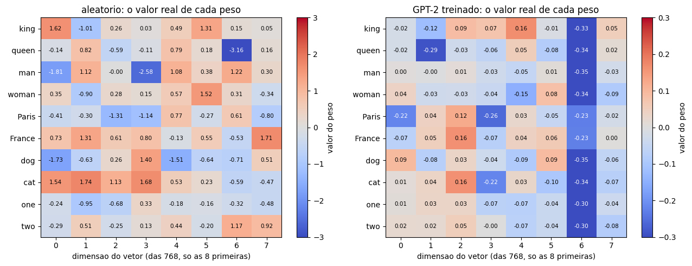
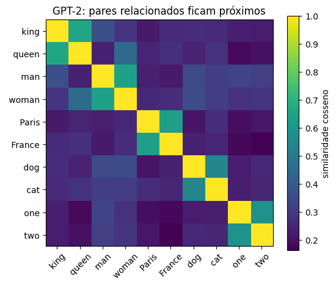
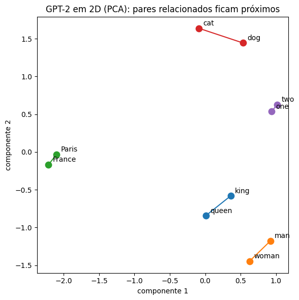
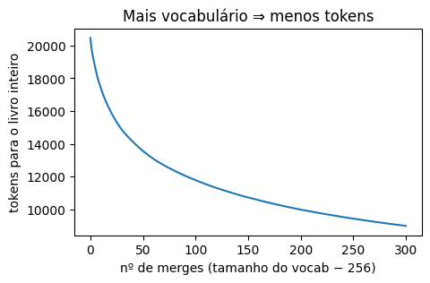

# 01 · Tokenization and embeddings — *Elmo*

**Construct produced here:** `tokenizer` + `dataloader` + embeddings (token + position) → input to notebook 02.

> 📓 Page generated from the notebook [`01_tokenizacao.ipynb`](https://github.com/victorflll/LLMs-from-scratch/blob/main/30-09/01_tokenizacao.ipynb) (*LLMs-from-scratch* repository, `30-09` folder), with the outputs of its last run. To run it, see the [class setup](setup.md).

```python
import re                                # regex: used to split the text into "words" (word level)
from collections import Counter          # counts the most frequent byte pairs in the from-scratch BPE

import matplotlib.pyplot as plt          # plots: token curve, heatmaps, similarity
import tiktoken                          # real tokenizers: gpt2, cl100k_base (GPT-4), o200k_base (GPT-4o)
import torch                             # tensors and embeddings (nn.Embedding)

from aula import the_verdict, load_gpt2                      # the_verdict: reads the training short story; load_gpt2: downloads/loads the official GPT-2 weights
from llms_from_scratch.ch02 import create_dataloader_v1       # dataloader from chapter 2 of the book (sliding input/target window)

torch.manual_seed(123)                   # fixes the seed: the random embeddings created later always come out the same
texto = the_verdict()                    # loads the short story "The Verdict" (training text used in the book), ~20k characters
frase = "Hello, class! Tokenização do GPT-2 é unbelievably interessante."  # test sentence: mixes English/Portuguese, accents, a number and a long word
print(len(texto), "caracteres no livro de treino (the-verdict)")  # checks the corpus size
```

```text
20479 caracteres no livro de treino (the-verdict)
```

## 1. Three ways to split text
Let's build **character**-level and **word**-level tokenizers from *the-verdict* and compare them with GPT-2's **BPE**.

```python
# Character level: vocabulary = every character that appeared in the text
vocab_char = sorted(set(texto))                                  # set of distinct characters in the story, sorted = our "vocabulary"
fora_char = [c for c in frase if c not in vocab_char]             # characters of the sentence that don't exist in this vocabulary
print("vocab caractere:", len(vocab_char), "| tokens da frase:", len(frase), "| desconhecidos:", fora_char)  # at this level, 1 character = 1 token

# Word level (same as the SimpleTokenizer from ch. 2)
def palavras(t):
    # splits on punctuation (, . : ; ? _ ! " ( ) '), on "--" and on whitespace; discards empty/blank pieces
    return [p for p in re.split(r'([,.:;?_!"()\']|--|\s)', t) if p.strip()]

vocab_pal = set(palavras(texto))          # distinct words in the story = word vocabulary
tokens_pal = palavras(frase)              # the test sentence split into words/punctuation
print("vocab palavra:", len(vocab_pal), "| tokens da frase:", len(tokens_pal),
      "| desconhecidos:", [p for p in tokens_pal if p not in vocab_pal])  # words in the sentence the vocabulary has never seen

# GPT-2 BPE: never has an unknown token, splits into pieces (subwords / bytes)
bpe = tiktoken.get_encoding("gpt2")       # loads the real GPT-2 tokenizer (tiktoken)
ids = bpe.encode(frase)                   # sentence -> list of integer IDs
print("vocab BPE:", bpe.n_vocab, "| tokens da frase:", len(ids))  # fixed vocabulary size (50,257) and number of tokens produced
print([bpe.decode([i]) for i in ids])     # decodes each ID individually to see the piece of text it represents
```

```text
vocab caractere: 62 | tokens da frase: 63 | desconhecidos: ['ç', 'ã', '2', 'é']
vocab palavra: 1130 | tokens da frase: 11 | desconhecidos: ['Hello', 'class', 'Tokenização', 'GPT-2', 'é', 'unbelievably', 'interessante']
vocab BPE: 50257 | tokens da frase: 20
['Hello', ',', ' class', '!', ' Token', 'iza', 'ç', 'ão', ' do', ' G', 'PT', '-', '2', ' é', ' unbelievably', ' int', 'e', 'ress', 'ante', '.']
```

**Reading:** character → tiny vocabulary but long sequences (and the context fills up quickly).
Word → short sequences, but any new word becomes `<|unk|>`.
BPE → middle ground: fixed vocabulary (~50k) and **zero** unknowns, because in the worst case it falls back to bytes.

### What about newer tokenizers? (GPT-4 = `cl100k_base`, GPT-4o = `o200k_base`)

```python
frases = {
    "inglês": "The quick brown fox jumps over the lazy dog.",
    "português": "A rápida raposa marrom pula sobre o cachorro preguiçoso.",
    "código": "def soma(a, b):\n    return a + b",
}  # 3 test texts: English, Portuguese and Python code
for nome in ["gpt2", "cl100k_base", "o200k_base"]:   # real tokenizers: GPT-2, GPT-4/3.5, GPT-4o
    enc = tiktoken.get_encoding(nome)                # loads the current tokenizer
    contagem = {k: len(enc.encode(v)) for k, v in frases.items()}  # number of tokens produced for each sentence
    print(f"{nome:12s} vocab={enc.n_vocab:>7,}  tokens={contagem}")  # total vocabulary vs tokens used per sentence
```

```text
gpt2         vocab= 50,257  tokens={'inglês': 10, 'português': 23, 'código': 16}
cl100k_base  vocab=100,277  tokens={'inglês': 10, 'português': 18, 'código': 11}
o200k_base   vocab=200,019  tokens={'inglês': 10, 'português': 15, 'código': 11}
```

Larger vocabulary ⇒ fewer tokens per sentence (especially outside English) ⇒ more text fits in the context,
**but** the embedding layer and the output layer get bigger (`vocab × emb_dim` parameters each).

## 2. From text to (input, target) pairs
GPT learns to predict **the next token**: the target is the input shifted by 1 position.

```python
loader = create_dataloader_v1(texto, batch_size=2, max_length=4, stride=4, shuffle=False)  # 4-token windows, no overlap (stride=max_length), no shuffling
x, y = next(iter(loader))                            # takes only the first batch: x = input, y = target (the same window, shifted 1 position)
print("entrada:\n", x, "\nalvo:\n", y)
for a, b in zip(x[0], y[0]):                         # walks side by side through the 4 tokens of the 1st row of x and y
    print(f"{bpe.decode([a.item()])!r:>12} → {bpe.decode([b.item()])!r}")  # shows the "input → target" pair decoded back into text
```

```text
entrada:
 tensor([[  40,  367, 2885, 1464],
        [1807, 3619,  402,  271]]) 
alvo:
 tensor([[  367,  2885,  1464,  1807],
        [ 3619,   402,   271, 10899]])
         'I' → ' H'
        ' H' → 'AD'
        'AD' → ' always'
   ' always' → ' thought'
```

```python
#stride: 1 = overlapping windows (more samples, more repetition); = max_length = no overlap
for stride in [1, 2, 4]:                             # tests 3 step values for the sliding window
    print(f"stride={stride}: {len(create_dataloader_v1(texto, batch_size=1, max_length=4, stride=stride).dataset):>5} amostras")  # number of windows (samples) produced for each stride
```

```text
stride=1:  5141 amostras
stride=2:  2571 amostras
stride=4:  1286 amostras
```

## 3. Embeddings: each id becomes a trainable vector
`tok_emb` is just a `vocab_size × emb_dim` table; we add a **position** embedding (`pos_emb`).

```python
emb_dim, contexto = 768, 4                            # 768 = size of each token's vector (GPT-2 small); 4 = number of positions (= dataloader max_length)
tok_emb = torch.nn.Embedding(bpe.n_vocab, emb_dim)    # TOKEN embedding table: 50,257 rows x 768 columns, random and trainable weights
pos_emb = torch.nn.Embedding(contexto, emb_dim)       # POSITION embedding table: 4 rows x 768 columns
entrada = tok_emb(x) + pos_emb(torch.arange(contexto))  # adds "which token it is" + "which position it is in" (broadcast: the 4 positions are added to both batch examples)
print("ids:", tuple(x.shape), "→ embeddings:", tuple(entrada.shape))  # (2,4) IDs become (2,4,768) vectors
print("primeiras 8 dimensões do vetor do 1º token da entrada:", [round(v, 3) for v in entrada[0, 0, :8].tolist()])
```

```text
ids: (2, 4) → embeddings: (2, 4, 768)
primeiras 8 dimensões do vetor do 1º token da entrada: [1.345, -1.174, -0.406, 0.669, -1.135, 0.6, -0.126, 0.662]
```

```python
# What if we change emb_dim? The table grows linearly (and the whole model ~quadratically, see notebook 07)
for d in [4, 64, 768, 1024, 1600, 12288]:             # embedding sizes: from toy (4) to GPT-3 (12288)
    p = bpe.n_vocab * d                               # number of parameters in the tok_emb table (rows x columns = vocab_size x emb_dim)
    print(f"emb_dim={d:>6}: {p:>13,} parâmetros só no tok_emb  ≈ {p * 4 / 1e6:8.1f} MB em float32")  # each float32 parameter takes 4 bytes
```

```text
emb_dim=     4:       201,028 parâmetros só no tok_emb  ≈      0.8 MB em float32
emb_dim=    64:     3,216,448 parâmetros só no tok_emb  ≈     12.9 MB em float32
emb_dim=   768:    38,597,376 parâmetros só no tok_emb  ≈    154.4 MB em float32
emb_dim=  1024:    51,463,168 parâmetros só no tok_emb  ≈    205.9 MB em float32
emb_dim=  1600:    80,411,200 parâmetros só no tok_emb  ≈    321.6 MB em float32
emb_dim= 12288:   617,558,016 parâmetros só no tok_emb  ≈   2470.2 MB em float32
```

Larger dimension = more "space" to encode meaning, but more memory and more data to train.
768 is GPT-2 small, 1600 is XL, 12288 is GPT-3.

## 4. Visualizing the weights inside the vectors
**Random** embedding vs GPT-2's **trained** embedding (downloads the official weights once, ~500 MB).

```python
gpt2, _ = load_gpt2("124M")                           # downloads (1st time, ~500 MB) and loads the official GPT-2 small weights; "_" discards the config, not used here
palavras_viz = [" king", " queen", " man", " woman", " Paris", " France", " dog", " cat", " one", " two"]  # 10 words in related pairs 
ids_viz = [bpe.encode(p)[0] for p in palavras_viz]    # ID of each word (all become a single token in GPT-2's BPE); [0] takes that token
print("gpt2 carregado |", len(palavras_viz), "palavras escolhidas:", [p.strip() for p in palavras_viz])
```

```text
gpt2 carregado | 10 palavras escolhidas: ['king', 'queen', 'man', 'woman', 'Paris', 'France', 'dog', 'cat', 'one', 'two']
```

```python
# I compare the REAL weights (not just the color): 8 dimensions, value written in each cell, on both sides: random and trained.
n_dims_mostrar = 8                                     # only the first 8 dimensions (out of 768), so the numbers fit on screen
pesos_aleatorio = tok_emb.weight[ids_viz, :n_dims_mostrar].detach()   # (10 words, 8 dimensions) from the RANDOM table (STEP 8)
pesos_treinado = gpt2.tok_emb.weight[ids_viz, :n_dims_mostrar].detach()  # (10 words, 8 dimensions) from the ALREADY TRAINED table

fig, axs = plt.subplots(1, 2, figsize=(13, 5))
for ax, nome, pesos, vlim in zip(axs, ["aleatorio", "GPT-2 treinado"], [pesos_aleatorio, pesos_treinado], [3, 0.3]):
    im = ax.imshow(pesos, aspect="auto", cmap="coolwarm", vmin=-vlim, vmax=vlim)  # each side with its own color scale
    ax.set_xticks(range(n_dims_mostrar))
    ax.set_xlabel("dimensao do vetor (das 768, so as 8 primeiras)")
    ax.set_yticks(range(len(palavras_viz)))
    ax.set_yticklabels(palavras_viz)
    ax.set_title(f"{nome}: o valor real de cada peso")
    for i in range(len(palavras_viz)):                 # writes each weight's number inside its own cell
        for j in range(n_dims_mostrar):
            valor = pesos[i, j].item()
            cor_texto = "white" if abs(valor) > 0.6 * vlim else "black"  # white text on dark background, black on light background
            ax.text(j, i, f"{valor:.2f}", ha="center", va="center", fontsize=7.5, color=cor_texto)
    fig.colorbar(im, ax=ax, label="valor do peso")
plt.tight_layout()
plt.show()

# And in plain text: the whole vector (first 8 dimensions) of "king", on both sides, number by number
print("valores reais de \'king\' (8 primeiras das 768 dimensoes):")
print("  aleatorio:", [round(v, 3) for v in pesos_aleatorio[0].tolist()])
print("  treinado :", [round(v, 3) for v in pesos_treinado[0].tolist()])
```



```text
valores reais de 'king' (8 primeiras das 768 dimensoes):
  aleatorio: [1.618, -1.008, 0.261, 0.025, 0.493, 1.308, 0.154, 0.048]
  treinado : [-0.019, -0.117, 0.089, 0.073, 0.165, -0.011, -0.327, 0.051]
```

```python
# No single dimension "means" anything on its own — meaning shows up in the geometry: similar vectors = similar words
E = gpt2.tok_emb.weight[ids_viz].detach()             # full vectors (768 dimensions) of the 10 words, already trained by OpenAI
sim = torch.nn.functional.cosine_similarity(E[:, None], E[None, :], dim=-1)  # all-vs-all cosine similarity (broadcast -> 10x10 matrix)
plt.figure(figsize=(6, 5))
plt.imshow(sim, cmap="viridis")
plt.xticks(range(len(palavras_viz)), palavras_viz, rotation=45)
plt.yticks(range(len(palavras_viz)), palavras_viz)
plt.colorbar(label="similaridade cosseno")
plt.title("GPT-2: pares relacionados ficam próximos")
plt.show()
```



```python

# 1) In text: which word is most similar to each one (excluding itself)?
sim_sem_diagonal = sim.clone()
sim_sem_diagonal.fill_diagonal_(-1)          # removes the diagonal (word with itself) from the contest
mais_parecida = sim_sem_diagonal.argmax(dim=1)  # index of the most similar word for each row
print("palavra mais parecida com cada uma (fora ela mesma):")
for i, palavra in enumerate(palavras_viz):
    j = mais_parecida[i].item()
    print(f"  {palavra.strip():8s} -> {palavras_viz[j].strip():8s}  (similaridade {sim[i, j]:.2f})")

pares_idx = [(0, 1), (2, 3), (4, 5), (6, 7), (8, 9)]                 # indices of the 5 related pairs in palavras_viz
sim_pares = torch.stack([sim[i, j] for i, j in pares_idx]).mean()    # mean similarity within the pairs only
mask = torch.ones_like(sim, dtype=torch.bool)
mask.fill_diagonal_(False)                                            # removes each word compared with itself
for i, j in pares_idx:
    mask[i, j] = mask[j, i] = False                                   # also removes the pairs themselves from the "unrelated" set
sim_resto = sim[mask].mean()                                          # mean similarity between UNRELATED words
print(f"\nsimilaridade media nos pares relacionados:       {sim_pares:.2f}")
print(f"similaridade media entre palavras NAO relacionadas: {sim_resto:.2f}")

# 2) As an image: projects the 768-dimensional vectors onto a 2D plane (PCA) and connects each pair with a line
torch.manual_seed(123)
E_centrado = E - E.mean(dim=0, keepdim=True)          # PCA requires centered vectors (zero mean)
_, _, V = torch.pca_lowrank(E_centrado, q=2)           # finds the 2 directions that best explain the variation of the vectors
E_2d = E_centrado @ V[:, :2]                            # projects each 768-dimensional vector onto these 2 directions

pares = [(0, 1, "king-queen"), (2, 3, "man-woman"), (4, 5, "Paris-France"), (6, 7, "dog-cat"), (8, 9, "one-two")]
cores = plt.cm.tab10.colors
plt.figure(figsize=(6, 6))
for cor, (i, j, nome) in zip(cores, pares):
    plt.plot(E_2d[[i, j], 0], E_2d[[i, j], 1], "-", color=cor, linewidth=1.5, zorder=1)  # connects the two points of the pair
    plt.scatter(E_2d[[i, j], 0], E_2d[[i, j], 1], color=cor, s=80, zorder=2)              # marks the points
for i, palavra in enumerate(palavras_viz):
    plt.annotate(palavra.strip(), (E_2d[i, 0].item(), E_2d[i, 1].item()), textcoords="offset points", xytext=(6, 4))
plt.title("GPT-2 em 2D (PCA): pares relacionados ficam próximos")
plt.xlabel("componente 1")
plt.ylabel("componente 2")
plt.tight_layout()
plt.show()
```

```text
palavra mais parecida com cada uma (fora ela mesma):
  king     -> queen     (similaridade 0.66)
  queen    -> king      (similaridade 0.66)
  man      -> woman     (similaridade 0.64)
  woman    -> man       (similaridade 0.64)
  Paris    -> France    (similaridade 0.63)
  France   -> Paris     (similaridade 0.63)
  dog      -> cat       (similaridade 0.55)
  cat      -> dog       (similaridade 0.55)
  one      -> two       (similaridade 0.59)
  two      -> one       (similaridade 0.59)

similaridade media nos pares relacionados:       0.62
similaridade media entre palavras NAO relacionadas: 0.26
```



### ✅ Construct
`bpe` (tokenizer) → `create_dataloader_v1` (input/target pairs) → `tok_emb + pos_emb` (tensor `batch × tokens × emb_dim`).
In notebook **02** these vectors go into attention.

## Extra· Building my own vocabulary: BPE from scratch in ~20 lines
 "What if I want to build my own tokenizer?".
It starts with the 256 bytes and, at each step, merges the **most frequent adjacent pair** into a new token.

```python
def treinar_bpe(texto, n_merges):
    ids = list(texto.encode("utf-8"))               # text -> bytes (0-255); BPE's starting point
    vocab = {i: bytes([i]) for i in range(256)}      # initial vocabulary: the 256 possible bytes (that's why there's never an unknown)
    merges, tamanhos = {}, [len(ids)]                # merges: learned rules; tamanhos: number of tokens in the text after each merge
    for novo in range(256, 256 + n_merges):          # creates n_merges new tokens, with IDs 256, 257, 258...
        par = Counter(zip(ids, ids[1:])).most_common(1)[0][0]  # counts all adjacent pairs and takes the most frequent one
        merges[par] = novo                            # records the rule: this pair of IDs becomes the "novo" token
        vocab[novo] = vocab[par[0]] + vocab[par[1]]    # the new token is the concatenation of the bytes of the two merged tokens
        saida, i = [], 0
        while i < len(ids):                            # walks the sequence applying the learned merge
            if i + 1 < len(ids) and (ids[i], ids[i + 1]) == par:
                saida.append(novo)                      # found the pair: replaces both with the new token
                i += 2                                   # skips the two tokens that were just merged
            else:
                saida.append(ids[i])                     # not the pair: keeps the token as is
                i += 1
        ids = saida                                       # shorter sequence after the merge
        tamanhos.append(len(ids))                          # stores the new size (used in the next cell's plot)
    return merges, vocab, tamanhos


def codificar(texto, merges):
    ids = list(texto.encode("utf-8"))                # same starting point: raw bytes of the new text
    for par, novo in merges.items():                  # applies the merges in the order they were learned
        saida, i = [], 0
        while i < len(ids):
            if i + 1 < len(ids) and (ids[i], ids[i + 1]) == par:
                saida.append(novo)
                i += 2
            else:
                saida.append(ids[i])
                i += 1
        ids = saida
    return ids


merges, meu_vocab, tamanhos = treinar_bpe(texto, n_merges=300)   # trains our BPE with 300 merges (final vocabulary = 256 + 300 = 556)
print("primeiros tokens aprendidos:", [meu_vocab[i].decode("utf-8", "replace") for i in range(256, 276)])  # earliest merges = most common English pieces
print("últimos tokens aprendidos:  ", [meu_vocab[i].decode("utf-8", "replace") for i in range(536, 556)])  # latest merges = pieces specific to the story
```

```text
primeiros tokens aprendidos: ['e ', ' t', 'd ', 't ', 'in', 's ', 'he ', 'ha', ', ', 'ou', 'er', 'an', 'on', 'en', ' the ', 'y ', '. ', 'o ', 'ing', 'hi']
últimos tokens aprendidos:   ['room', 'when ', 'Stroud ', 'ough', 'Th', 'ed it', 'las', 'picture ', 'is ', 's, ', 'And ', 'say', 'ear', 'I f', 'al ', 'ous', 'fa', 'pre', 'il', 'lif']
```

```python
meus_ids = codificar(frase, merges)               # tokenizes the same test sentence with the vocabulary we just trained
print(len(meus_ids), "tokens:", [meu_vocab[i].decode("utf-8", "replace") for i in meus_ids])  # shows each decoded token (loose bytes become "�")
assert b"".join(meu_vocab[i] for i in meus_ids).decode("utf-8") == frase  # joins the bytes of all tokens back: checks that nothing was lost

plt.figure(figsize=(5, 3))
plt.plot(tamanhos)                                  # number of tokens for the whole book after each merge (starts at ~20,500, drops with diminishing returns)
plt.xlabel("nº de merges (tamanho do vocab − 256)")
plt.ylabel("tokens para o livro inteiro")
plt.title("Mais vocabulário ⇒ menos tokens")
plt.show()
```

```text
45 tokens: ['H', 'ell', 'o', ', ', 'c', 'las', 's', '! ', 'T', 'o', 'k', 'en', 'i', 'z', 'a', '�', '�', '�', '�', 'o ', 'd', 'o ', 'G', 'P', 'T', '-', '2', ' ', '�', '�', ' ', 'un', 'b', 'el', 'i', 'ev', 'ab', 'ly ', 'in', 'ter', 'es', 's', 'ant', 'e', '.']
```



The `�` are loose bytes from `ç`, `ã`, `é`: the story has no accents, so our BPE never learned to join them.
Our BPE was trained only on an English short story, so it works poorly on Portuguese — exactly what happens
with `gpt2` compared to `o200k_base`. **The vocabulary reflects the training corpus.**
Full version (with pre-tokenization regex like GPT-2): `ch02/05_bpe-from-scratch/`.
