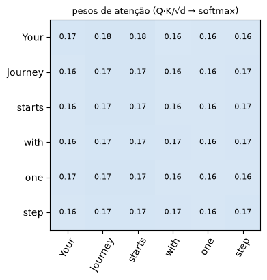
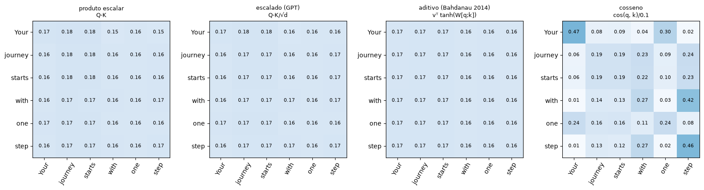
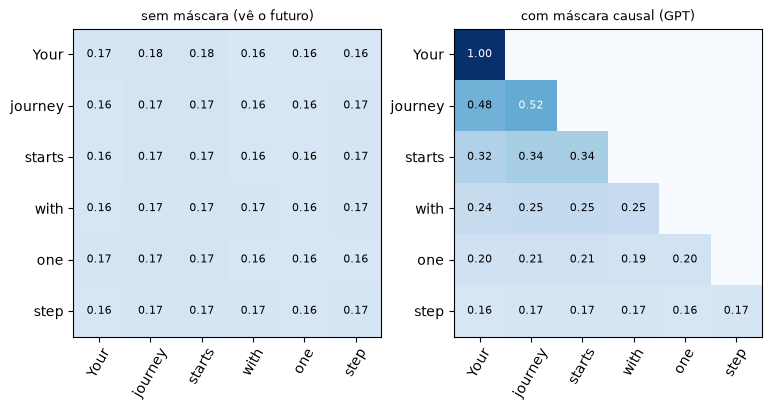
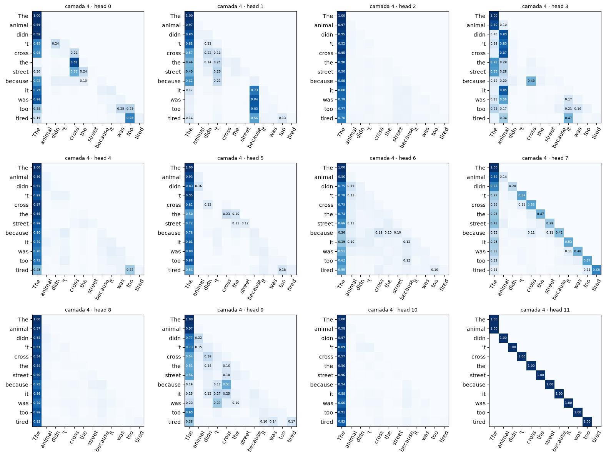
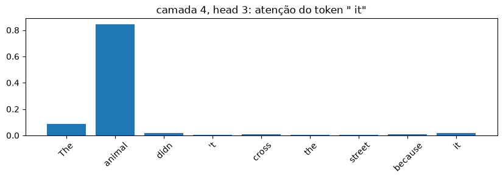

# 02 · Attention and multiple heads — *Rafael*

**In:** embeddings from notebook 01. **Out:** `MultiHeadAttention` → used inside each GPT block (notebook 03).

**Questions:**
1. Are there other ways to compute the attention score?
2. Can we visualize the scores, at least for 1 head?
3. What happens if I change the number of heads?
4. What if the dimension is not divisible by the number of heads?

**Goal:** prepare the attention input: 6 tokens, each represented by a vector.

> 📓 Page generated from the notebook [`02_atencao.ipynb`](https://github.com/victorflll/LLMs-from-scratch/blob/main/30-09/02_atencao.ipynb) (*LLMs-from-scratch* repository, `30-09` folder), with the outputs of its last run. To run it, see the [class setup](setup.md).

```python
import matplotlib.pyplot as plt  # plots (the attention maps)
import tiktoken  # GPT-2 tokenizer: text → numbers (used in section 6)
import torch  # PyTorch: tensors (tables of numbers) and neural network layers

from aula import load_gpt2  # loads GPT-2 124M with the weights trained by OpenAI
from llms_from_scratch.ch03 import MultiHeadAttention  # the book's multi-head attention (pkg/llms_from_scratch/ch03.py)

torch.manual_seed(123)  # fixes the random draw: the random weights of W_q, W_k, W_v come out the same on every run
tokens = ["Your", "journey", "starts", "with", "one", "step"]  # the example sentence, already split into 6 tokens
# the book's example embedding: 3 numbers per token (real GPT-2 would use 768) → 6 × 3 table
x = torch.tensor([[0.43, 0.15, 0.89], [0.55, 0.87, 0.66], [0.57, 0.85, 0.64],
                  [0.22, 0.58, 0.33], [0.77, 0.25, 0.10], [0.05, 0.80, 0.55]])
for t, v in zip(tokens, x):  # shows each token next to its 3-number vector
    print(f"{t:>8} → {[round(n, 2) for n in v.tolist()]}")
print("x:", tuple(x.shape), "= 6 tokens × 3 números")  # table shape: (tokens, dimensions)


# only DEFINES the plotting function (shows nothing here); it is used in sections 1, 2, 3 and 6
# draws an attention matrix: row = token that looks, column = token looked at, value written in each square
def mapa(ax, pesos, titulo, rotulos=tokens):
    ax.imshow(pesos.detach(), cmap="Blues", vmin=0, vmax=1)  # fixed scale: 0 = white, 1 = dark blue (makes plots comparable)
    ax.set_xticks(range(len(rotulos)), rotulos, rotation=60)  # x axis: token being looked at
    ax.set_yticks(range(len(rotulos)), rotulos)  # y axis: token that is looking
    ax.set_title(titulo, fontsize=9)  # title
    p, n = pesos.detach(), len(rotulos)  # values (no gradient) and number of tokens
    limite = 0 if n <= 6 else 0.1  # on the large map (GPT-2), only writes values from 0.10 upward
    for i in range(n):  # loops over the rows...
        for j in range(n):  # ...and the columns
            if p[i, j] > limite:  # skips the mask's zeros (and, on the large map, the small values)
                ax.text(j, i, f"{p[i, j]:.2f}", ha="center", va="center", fontsize=8 if n <= 6 else 6,
                        color="white" if p[i, j] > 0.5 else "black")  # writes the value; white on dark blue
```

```text
    Your → [0.43, 0.15, 0.89]
 journey → [0.55, 0.87, 0.66]
  starts → [0.57, 0.85, 0.64]
    with → [0.22, 0.58, 0.33]
     one → [0.77, 0.25, 0.1]
    step → [0.05, 0.8, 0.55]
x: (6, 3) = 6 tokens × 3 números
```

## 1. Q, K, V and the score

**Goal:** compute, for each token, how much attention it should pay to each of the others, and produce a
new vector that mixes the information of the sentence.

Each token becomes a **query** (what I look for), a **key** (what I offer) and a **value** (what I deliver).
score = how well one token's query "matches" another token's key.

```python
d_k = 2  # size of the query/key/value vectors (small so it fits on screen)
W_q, W_k, W_v = (torch.nn.Linear(3, d_k, bias=False) for _ in range(3))  # 3 weight matrices (3 → 2), start out random
# creates a linear layer: a 2 × 3 weight matrix that turns a 3-number vector into a 2-number one, adjusted during training
Q, K, V = W_q(x), W_k(x), W_v(x)  # each one: (6, 2)
# dot product of every query with every key; K.T transposes K (6×2 → 2×6) so the @ fits
scores = Q @ K.T  # score of each pair of tokens: (6, 2) @ (2, 6) = (6, 6)
pesos = torch.softmax(scores / d_k**0.5, dim=-1)  # ÷√d_k avoids oversized scores; row-wise softmax → percentages that sum to 1
contexto = pesos @ V  # average of the values weighted by the weights: new vector for each token, (6, 6) @ (6, 2) = (6, 2)
print("scores", tuple(scores.shape), "| pesos (linha soma):", pesos.sum(-1)[:2].detach(), "| contexto", tuple(contexto.shape))  # checks shapes and that rows sum to 1

fig, ax = plt.subplots(figsize=(4, 4))  # figure with 1 plot
mapa(ax, pesos, "pesos de atenção (Q·K/√d → softmax)")  # nearly uniform (~0.17): random weights, no training
plt.show()  # display
```

```text
scores (6, 6) | pesos (linha soma): tensor([1.0000, 1.0000]) | contexto (6, 2)
```



## 2. Other ways to compute the score

**Goal:** show that scaled dot product (the one GPT uses) is a choice, not the only way to measure
how well two tokens match.

```python
torch.manual_seed(0)  # fixes the random draw of the additive attention weights
W_a = torch.nn.Linear(2 * d_k, 4)  # additive attention (Bahdanau, 2014): linear layer that takes query and key concatenated
v_a = torch.nn.Linear(4, 1, bias=False)  # reduces to 1 number: the pair's score
# builds all (query i, key j) pairs, concatenates, passes them through the mini network → score (6, 6)
aditivo = v_a(torch.tanh(W_a(torch.cat(torch.broadcast_tensors(Q[:, None], K[None, :]), dim=-1)))).squeeze(-1)

variantes = {  # 4 ways to compute the score (each is a 6 × 6 table)
    "produto escalar\nQ·K": scores,  # multiply and sum (from section 1), no scaling
    "escalado (GPT)\nQ·K/√d": scores / d_k**0.5,  # the same ÷ √d: this is what GPT uses
    "aditivo (Bahdanau 2014)\nvᵀ tanh(W[q;k])": aditivo,  # mini neural network (predates the Transformer)
    "cosseno\ncos(q, k)/0.1": torch.nn.functional.cosine_similarity(Q[:, None], K[None, :], dim=-1) / 0.1,  # only the vectors' direction; ÷0.1 amplifies the differences
}
fig, axs = plt.subplots(1, 4, figsize=(16, 4))  # 4 plots side by side
for ax, (nome, s) in zip(axs, variantes.items()):  # for each way of scoring...
    mapa(ax, torch.softmax(s, dim=-1), nome)  # ...applies softmax and draws
plt.tight_layout()  # adjusts spacing (names don't spill into the neighboring plot)
plt.show()  # display
```



The plot doesn't say which one is better, because nothing has been trained.

## 3. Causal mask: GPT cannot look at the future

**Goal:** prevent a token from looking at the tokens that come after it, because GPT generates text from left to
right. If it could see them during training, it would copy the answer instead of learning to predict.

```python
n = len(tokens)  # 6 tokens
mascara = torch.triu(torch.ones(n, n), diagonal=1).bool()  # builds a 6 × 6 table that marks everything above the diagonal with  True .
s_mascarado = (scores / d_k**0.5).masked_fill(mascara, -torch.inf)  # replaces the score at those positions with minus infinity. Softmax turns −∞ into exactly 0%

fig, axs = plt.subplots(1, 2, figsize=(9, 4))  # 2 plots side by side
mapa(axs[0], torch.softmax(scores / d_k**0.5, -1), "sem máscara (vê o futuro)")  # each token looks at all of them
mapa(axs[1], torch.softmax(s_mascarado, -1), "com máscara causal (GPT)")  # each token only looks at itself and the previous ones
plt.show()  # display
```



## 4. Multi-head: several attentions in parallel

From here on we use GPT-2's real size: each token is represented by 768 numbers.

The book's `MultiHeadAttention` **slices** `d_out` into `num_heads` pieces of `head_dim = d_out / num_heads`.
It doesn't return the weights, so we reproduce its steps up to the softmax in order to plot them:

```python
# the book's MultiHeadAttention only returns the final result; this function redoes the computation and stops at the weights (to plot them)
def pesos_atencao(mha, x):
    """Same computation as MultiHeadAttention.forward, stopping at the weights: (batch, heads, tokens, tokens)."""
    b, t, _ = x.shape  # b = number of sentences, t = number of tokens; .shape gives the size of each tensor dimension
    # projects, cuts the vector into num_heads pieces of head_dim
    # rearranges the numbers without changing any: each token's 768 numbers are viewed as 12 pieces of 64 → (1, 6, 12, 64). Numbers 0–63 go to head 0, 64–127 to head 1, and so on.
    # transpose = swaps the dimensions
    q = mha.W_query(x).view(b, t, mha.num_heads, mha.head_dim).transpose(1, 2)  # (b, heads, t, head_dim)
    k = mha.W_key(x).view(b, t, mha.num_heads, mha.head_dim).transpose(1, 2)  # keys, same shape
    s = (q @ k.transpose(2, 3)).masked_fill(mha.mask.bool()[:t, :t], -torch.inf)  # scores of each head (b, heads, t, t) + causal mask
    return torch.softmax(s / mha.head_dim**0.5, dim=-1)  # ÷√head_dim and softmax: attention weights of each head
```

```python
# Changing the number of heads: parameters and output shape do NOT change, only how d_out is sliced
X = torch.randn(1, 6, 768)  # random input in GPT-2 shape: (1 sentence, 6 tokens, 768 numbers)
for h in [1, 2, 4, 12, 24]:  # numbers of heads to test
    mha = MultiHeadAttention(d_in=768, d_out=768, context_length=1024, dropout=0.0, num_heads=h)  # attention with h heads
    print(f"heads={h:>2}  head_dim={mha.head_dim:>3}  params={sum(p.numel() for p in mha.parameters()):,}"
          f"  saída={tuple(mha(X).shape)}  pesos={tuple(pesos_atencao(mha, X).shape)}")  # size per head, parameters, shape of the output and of the weights
```

```text
heads= 1  head_dim=768  params=2,360,064  saída=(1, 6, 768)  pesos=(1, 1, 6, 6)
heads= 2  head_dim=384  params=2,360,064  saída=(1, 6, 768)  pesos=(1, 2, 6, 6)
heads= 4  head_dim=192  params=2,360,064  saída=(1, 6, 768)  pesos=(1, 4, 6, 6)
heads=12  head_dim= 64  params=2,360,064  saída=(1, 6, 768)  pesos=(1, 12, 6, 6)
heads=24  head_dim= 32  params=2,360,064  saída=(1, 6, 768)  pesos=(1, 24, 6, 6)
```

More heads = more independent "points of view", each with fewer dimensions.
Few heads → each one is rich but there are fewer patterns; many → each head_dim becomes too small.
GPT-2 keeps **head_dim = 64** across all sizes (768/12, 1024/16, 1280/20, 1600/25).

## 5. What if it isn't divisible?

```python
try:  # tries to create the attention...
    MultiHeadAttention(d_in=768, d_out=768, context_length=1024, dropout=0.0, num_heads=5)  # ...with 5 heads for 768 numbers
except AssertionError as e:  # the class checks whether 768 is divisible by the number of heads
    print("AssertionError:", e)  # shows the error without crashing the notebook
print("768 / 5 =", 768 / 5, "→ não dá para fazer .view(b, t, 5, 153.6)")  # each head would get 153.6 numbers: impossible
```

```text
AssertionError: d_out must be divisible by n_heads
768 / 5 = 153.6 → não dá para fazer .view(b, t, 5, 153.6)
```

`.view` needs to split the vector into equal, whole-number parts. Workarounds used in practice:
choose `head_dim` explicitly and set `d_out = num_heads × head_dim` (Llama/Gemma/Qwen define `head_dim` in the config)
and project back to `emb_dim` in `out_proj`.

```python
# 5 heads of 64 → d_out=320. Here out_proj is 320→320; in real models it goes back to emb_dim
# (e.g. Qwen3 in the repo: 16 heads × 128 = 2048 → out_proj 2048→1024, see pkg/llms_from_scratch/qwen3.py)
mha5 = MultiHeadAttention(d_in=768, d_out=5 * 64, context_length=1024, dropout=0.0, num_heads=5)  # fixes 64 per head: d_out = 5 × 64 = 320
print(tuple(mha5(X).shape))  # works: output (1, 6, 320)
```

```text
(1, 6, 320)
```

## 6. Real scores: the 12 heads of one layer of the trained GPT-2

```python
gpt2, _ = load_gpt2("124M")  # trained GPT-2 124M (the config is not used here)
bpe = tiktoken.get_encoding("gpt2")  # GPT-2 tokenizer
frase = "The animal didn't cross the street because it was too tired"  # test: what does " it" refer to?
ids = torch.tensor([bpe.encode(frase)])  # sentence → token IDs, shape (1, 12)
rotulos = [bpe.decode([i]) for i in ids[0]]  # each token as text, for the axes

CAMADA = 4  # change the layer (0–11) and watch the patterns change
with torch.no_grad():  # inference only: no gradient computation
    h = gpt2.tok_emb(ids) + gpt2.pos_emb(torch.arange(ids.shape[1]))  # token + position embedding (as in notebook 01): (1, 12, 768)
    for bloco in gpt2.trf_blocks[:CAMADA]:  # passes the sentence through the layers before the chosen one
        h = bloco(h)
    bloco = gpt2.trf_blocks[CAMADA]  # the layer we are going to inspect
    P = pesos_atencao(bloco.att, bloco.norm1(h))[0]  # attention receives the normalized input (norm1); P = (12 heads, 12, 12)

fig, axs = plt.subplots(3, 4, figsize=(16, 12))  # 3 × 4 grid = 12 plots
for head, ax in enumerate(axs.flat):  # one plot per head
    mapa(ax, P[head], f"camada {CAMADA} · head {head}", rotulos)
plt.tight_layout()  # adjusts spacing
plt.show()  # display
```



```python
# A single head, and where " it" looks
HEAD = 3  # in layer 4, head 3 links " it" to " animal"
i_it = rotulos.index(" it")  # position of the " it" token in the sentence (8)
fig, ax = plt.subplots(figsize=(10, 2.5))  # figure for the bar chart
ax.bar(rotulos[: i_it + 1], P[HEAD, i_it, : i_it + 1])  # the " it" row: weight for each token up to it (sums to 1)
ax.set_title(f'camada {CAMADA}, head {HEAD}: atenção do token " it"')  # title
plt.xticks(rotation=45)  # tilts the token names
plt.show()  # display
```



### ✅ Construct
`MultiHeadAttention(d_in, d_out, context_length, dropout, num_heads)` — in notebook **03** it becomes a piece of the `TransformerBlock`.
