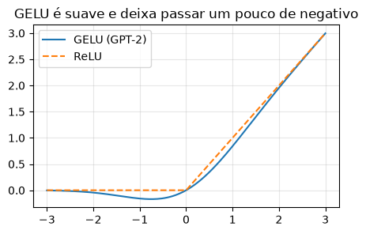

# 03 · Building the GPT and generating text — *Victor*

**In:** tokenizer + embeddings (01) and `MultiHeadAttention` (02). **Out:** `GPTModel` + `generate` → trained in notebook 04.

Questions:
1. Can I generate meaningful text **without** pretraining?
2. What happens if I remove a step from the Transformer (normalization, FFN)?
3. Can I use ReLU in the FFN?
4. What is the difference between 12 and 24 layers?

> 📓 Page generated from the notebook [`03_gpt_e_geracao.ipynb`](https://github.com/victorflll/LLMs-from-scratch/blob/main/30-09/03_gpt_e_geracao.ipynb) (*LLMs-from-scratch* repository, `30-09` folder), with the outputs of its last run. To run it, see the [class setup](setup.md).

```python
import time

import matplotlib.pyplot as plt
import tiktoken
import torch

from aula import GPT_CONFIG_124M, variante, n_params
from llms_from_scratch.ch04 import GPTModel, TransformerBlock, GELU, generate_text_simple

torch.manual_seed(123)
cfg = GPT_CONFIG_124M
bpe = tiktoken.get_encoding("gpt2")
batch = torch.tensor([bpe.encode("Every effort moves you"), bpe.encode("Every day holds a")])
print(batch)
```

```text
tensor([[6109, 3626, 6100,  345],
        [6109, 1110, 6622,  257]])
```

## 1. A Transformer block, step by step
`LayerNorm → attention → + shortcut → LayerNorm → FFN → + shortcut`. Let's call each piece by hand and look at the tensor.

```python
tok_emb = torch.nn.Embedding(cfg["vocab_size"], cfg["emb_dim"])
pos_emb = torch.nn.Embedding(cfg["context_length"], cfg["emb_dim"])
bloco = TransformerBlock(cfg).eval()

def info(nome, t):
    print(f"{nome:28s} shape={tuple(t.shape)}  média={t.mean():+.3f}  desvio={t.std():.3f}")

with torch.no_grad():
    x = tok_emb(batch) + pos_emb(torch.arange(batch.shape[1]))
    info("embeddings", x)
    h = bloco.norm1(x);             info("1. LayerNorm", h)
    h = bloco.att(h);               info("2. multi-head attention", h)
    x = x + h;                      info("3. + atalho (residual)", x)
    h = bloco.norm2(x);             info("4. LayerNorm", h)
    h = bloco.ff.layers[0](h);      info("5. FFN: expande 768→3072", h)
    h = bloco.ff.layers[1](h);      info("6. GELU", h)
    h = bloco.ff.layers[2](h);      info("7. FFN: volta 3072→768", h)
    x = x + h;                      info("8. + atalho (residual)", x)
    assert torch.allclose(x, bloco(tok_emb(batch) + pos_emb(torch.arange(batch.shape[1]))), atol=1e-5)
```

```text
embeddings                   shape=(2, 4, 768)  média=+0.009  desvio=1.420
1. LayerNorm                 shape=(2, 4, 768)  média=+0.000  desvio=1.000
2. multi-head attention      shape=(2, 4, 768)  média=-0.002  desvio=0.238
3. + atalho (residual)       shape=(2, 4, 768)  média=+0.007  desvio=1.442
4. LayerNorm                 shape=(2, 4, 768)  média=+0.000  desvio=1.000
5. FFN: expande 768→3072     shape=(2, 4, 3072)  média=-0.002  desvio=0.580
6. GELU                      shape=(2, 4, 3072)  média=+0.115  desvio=0.326
7. FFN: volta 3072→768       shape=(2, 4, 768)  média=+0.002  desvio=0.199
8. + atalho (residual)       shape=(2, 4, 768)  média=+0.009  desvio=1.456
```

`batch × tokens × 768` goes in, **the same shape** comes out → we can stack as many blocks as we want.

### GELU vs ReLU

```python
z = torch.linspace(-3, 3, 200)
plt.figure(figsize=(5, 3))
plt.plot(z, GELU()(z), label="GELU (GPT-2)")
plt.plot(z, torch.relu(z), "--", label="ReLU")
plt.legend(); plt.grid(alpha=.3); plt.title("GELU é suave e deixa passar um pouco de negativo")
plt.show()
```



## 2. The whole GPT: embeddings + 12 blocks + final LayerNorm + output head

```python
torch.manual_seed(123)
model = GPTModel(cfg).eval()
print(model.trf_blocks[0])
total = n_params(model)
print(f"\nparâmetros: {total:,}")
print(f"sem contar out_head (weight tying do GPT-2 original): {total - model.out_head.weight.numel():,}")
print(f"memória em float32: {total * 4 / 1e6:.0f} MB")
```

```text
TransformerBlock(
  (att): MultiHeadAttention(
    (W_query): Linear(in_features=768, out_features=768, bias=False)
    (W_key): Linear(in_features=768, out_features=768, bias=False)
    (W_value): Linear(in_features=768, out_features=768, bias=False)
    (out_proj): Linear(in_features=768, out_features=768, bias=True)
    (dropout): Dropout(p=0.1, inplace=False)
  )
  (ff): FeedForward(
    (layers): Sequential(
      (0): Linear(in_features=768, out_features=3072, bias=True)
      (1): GELU()
      (2): Linear(in_features=3072, out_features=768, bias=True)
    )
  )
  (norm1): LayerNorm()
  (norm2): LayerNorm()
  (drop_resid): Dropout(p=0.1, inplace=False)
)

parâmetros: 163,009,536
sem contar out_head (weight tying do GPT-2 original): 124,412,160
memória em float32: 652 MB
```

```python
with torch.no_grad():
    logits = model(batch)
print("logits:", tuple(logits.shape), "→ para cada posição, uma nota para cada um dos 50.257 tokens")
```

```text
logits: (2, 4, 50257) → para cada posição, uma nota para cada um dos 50.257 tokens
```

## 3. Generating text = predicting the next token in a loop

```python
def proximo_token(model, ids, k=5):
    with torch.no_grad():
        probs = torch.softmax(model(ids)[0, -1], dim=-1)
    top = torch.topk(probs, k)
    for p, i in zip(top.values, top.indices):
        print(f"  {bpe.decode([i.item()])!r:>15}  {p:.5f}")

ids = torch.tensor([bpe.encode("Hello, I am")])
print("top-5 para o próximo token (modelo aleatório):")
proximo_token(model, ids)

saida = generate_text_simple(model, ids, max_new_tokens=15, context_size=cfg["context_length"])
print("\ntexto gerado:", bpe.decode(saida[0].tolist()))
```

```text
top-5 para o próximo token (modelo aleatório):
       ' Feature'  0.00021
            '677'  0.00015
          'TRUMP'  0.00014
  ' participated'  0.00014
          'retch'  0.00014

texto gerado: Hello, I am Featureiman Byeswickattribute argue logger Normandy Compton analogous bore ITVEGIN ministriesysics
```

**Answer to question 1:** no. With random weights all probabilities stay ≈ 1/50257 ≈ 0.00002 and the text is garbage.
The architecture is just the "plumbing"; the knowledge comes from **pretraining** (notebook 04).

## 4. 🔧 Removing and swapping pieces
`variante()` (in `aula.py`) takes the book's `GPTModel` and replaces LayerNorm with identity, the FFN with zero, or GELU with ReLU.
Still untrained: we look at the parameters and at what happens to the values after 12 blocks.

```python
def forward_stats(m):
    m.eval()
    with torch.no_grad():
        h = m.tok_emb(batch) + m.pos_emb(torch.arange(batch.shape[1]))
        h = m.trf_blocks(h)
    return h.std().item()

variantes = {
    "original": {},
    "sem LayerNorm": {"sem_norm": True},
    "sem FFN": {"sem_ffn": True},
    "FFN com ReLU": {"relu": True},
}
for nome, kw in variantes.items():
    torch.manual_seed(123)
    m = variante(cfg, **kw)
    print(f"{nome:15s} params={n_params(m):>12,}  desvio do sinal após 12 blocos={forward_stats(m):7.2f}")
```

```text
original        params= 163,009,536  desvio do sinal após 12 blocos=   1.81
sem LayerNorm   params= 162,971,136  desvio do sinal após 12 blocos=   3.23
sem FFN         params= 106,340,352  desvio do sinal após 12 blocos=   1.68
FFN com ReLU    params= 163,009,536  desvio do sinal após 12 blocos=   1.88
```

- **Without FFN:** loses ~⅔ of the blocks' parameters — the FFN is where most of the model's "memory" lives.
- **Without LayerNorm:** the signal grows block after block (the shortcuts keep adding up); during training this destabilizes the gradients.
- **ReLU:** same parameters, only the non-linearity changes.

We measure the effect **on learning** by training these variants in notebook 04.

## 5. 🔧 12 vs 24 layers

```python
for n_camadas in [6, 12, 24, 48]:
    torch.manual_seed(123)
    m = GPTModel({**cfg, "n_layers": n_camadas}).eval()
    ids = torch.randint(0, cfg["vocab_size"], (1, 256))
    with torch.no_grad():
        t0 = time.perf_counter(); m(ids); dt = time.perf_counter() - t0
    print(f"{n_camadas:>2} camadas: {n_params(m) / 1e6:6.1f}M params | forward de 256 tokens: {dt * 1000:6.0f} ms")
```

```text
 6 camadas:  120.5M params | forward de 256 tokens:     64 ms
12 camadas:  163.0M params | forward de 256 tokens:    105 ms
24 camadas:  248.0M params | forward de 256 tokens:    213 ms
48 camadas:  418.1M params | forward de 256 tokens:    630 ms
```

Each block costs ~7M parameters (12·d²). Doubling the layers ≈ doubles the blocks' cost and memory;
more depth = more "reasoning" steps over the representation, **if** there is data to train on.
(GPT-2 medium has 24 layers, but it also increases `emb_dim` to 1024 — see notebook 07.)

### ✅ Construct
`GPTModel(cfg)` + `generate_text_simple` → in notebook **04** we will train this model.
