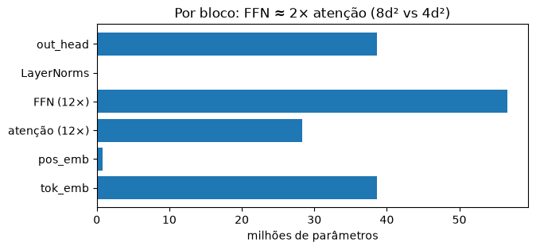
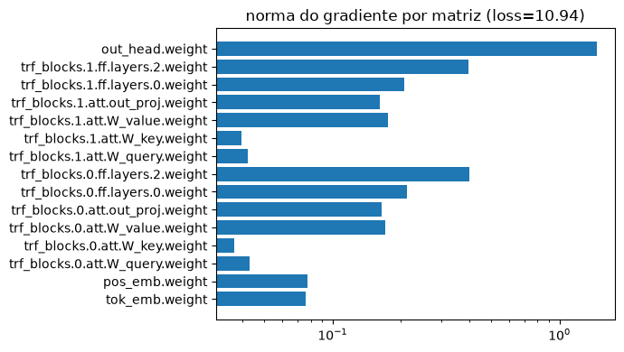

# 07 · Parameters, scale and other families — *Cristiane*

Questions:
1. Why does GPT-2 have these values? Where did they come from?
2. What are the differences between small, medium, large and XL?
3. What if I scale everything by 3? What if I want to reach GPT-3?
4. What is the model's **bias**, and where does it come in? And the **gradient**?
5. Llama, Claude, GPT-4/5… do they use the same foundation?

The large models are created on the `meta` device: shape only, no memory allocated — so we can "instantiate" even GPT-3.

> 📓 Page generated from the notebook [`07_parametros.ipynb`](https://github.com/victorflll/LLMs-from-scratch/blob/main/30-09/07_parametros.ipynb) (*LLMs-from-scratch* repository, `30-09` folder), with the outputs of its last run. To run it, see the [class setup](setup.md).

```python
import matplotlib.pyplot as plt
import pandas as pd
import tiktoken
import torch

from aula import GPT_CONFIG_124M, GPT2_SIZES, device, load_gpt2, n_params
from llms_from_scratch.ch04 import GPTModel

bpe = tiktoken.get_encoding("gpt2")
COMPARAR_355M = False  # 🔧 True downloads GPT-2 medium (~1.4 GB) to compare generated text


def contar(cfg):
    with torch.device("meta"):
        m = GPTModel(cfg)
    total = n_params(m)
    return {
        "params (M)": total / 1e6,
        "sem out_head (M)": (total - m.out_head.weight.numel()) / 1e6,  # original GPT-2 shares weights with tok_emb
        "embeddings (M)": (m.tok_emb.weight.numel() + m.pos_emb.weight.numel()) / 1e6,
        "blocos (M)": sum(p.numel() for p in m.trf_blocks.parameters()) / 1e6,
        "float32 (GB)": total * 4 / 1e9,
        "treino Adam ≈ (GB)": total * 16 / 1e9,  # weights + gradients + 2 Adam states, no activations
    }
```

## 1. The four versions of GPT-2

```python
linhas = []
for nome, tam in GPT2_SIZES.items():
    cfg = {**GPT_CONFIG_124M, **tam}
    linhas.append({"modelo": f"GPT-2 {nome}", **tam, "head_dim": tam["emb_dim"] // tam["n_heads"], **contar(cfg)})
tabela = pd.DataFrame(linhas).set_index("modelo")
tabela.round(1)
```

```text
             emb_dim  n_layers  n_heads  head_dim  params (M)  \
modelo                                                          
GPT-2 124M       768        12       12        64       163.0   
GPT-2 355M      1024        24       16        64       406.2   
GPT-2 774M      1280        36       20        64       838.2   
GPT-2 1558M     1600        48       25        64      1637.8   

             sem out_head (M)  embeddings (M)  blocos (M)  float32 (GB)  \
modelo                                                                    
GPT-2 124M              124.4            39.4        85.0           0.7   
GPT-2 355M              354.7            52.5       302.2           1.6   
GPT-2 774M              773.9            65.6       708.2           3.4   
GPT-2 1558M            1557.4            82.0      1475.3           6.6   

             treino Adam ≈ (GB)  
modelo                           
GPT-2 124M                  2.6  
GPT-2 355M                  6.5  
GPT-2 774M                 13.4  
GPT-2 1558M                26.2
```

- The name (124M, 355M…) counts the parameters **with** weight tying (`sem out_head`, i.e. without out_head).
- **head_dim is always 64**: OpenAI grew width and depth together while keeping each head the same size.
- The embeddings' share drops from ~30% (small) to ~5% (XL): in large models almost everything is in the blocks.

## 2. Where do these numbers come from?
| value | origin |
|---|---|
| `vocab_size = 50257` | 256 bytes + 50,000 BPE merges + `<|endoftext|>` |
| `context_length = 1024` | double GPT-1's (512); attention is O(n²) in memory, it was what fit on 2019 GPUs |
| `emb_dim = 768`, 12 layers, 12 heads | inherited from GPT-1 / BERT-base (which in turn came from the "base" Transformer 512 → 768) |
| FFN = 4 × `emb_dim` | ratio from the original Transformer (512 → 2048) |
| larger sizes | chosen to test *scaling*: ~3× parameters at each step, head_dim fixed at 64 |

They are not "magic" values: they are empirical choices constrained by GPUs. The *scaling laws* (Kaplan 2020, Chinchilla 2022)
later showed how to split the budget between size and data (Chinchilla: ~20 training tokens per parameter).

### Where does each parameter come from? (GPT-2 small)

```python
with torch.device("meta"):
    m = GPTModel({**GPT_CONFIG_124M, "qkv_bias": True})
partes = {
    "tok_emb": m.tok_emb.weight.numel(),
    "pos_emb": m.pos_emb.weight.numel(),
    "atenção (12×)": sum(p.numel() for b in m.trf_blocks for p in b.att.parameters()),
    "FFN (12×)": sum(p.numel() for b in m.trf_blocks for p in b.ff.parameters()),
    "LayerNorms": sum(p.numel() for b in m.trf_blocks for n in (b.norm1, b.norm2) for p in n.parameters())
                  + sum(p.numel() for p in m.final_norm.parameters()),
    "out_head": m.out_head.weight.numel(),
}
plt.figure(figsize=(7, 3))
plt.barh(list(partes), [v / 1e6 for v in partes.values()])
plt.xlabel("milhões de parâmetros"); plt.title("Por bloco: FFN ≈ 2× atenção (8d² vs 4d²)")
plt.show()
```



## 3. 🔧 Scaling by 3

```python
FATOR = 3  # 🔧
base = GPT_CONFIG_124M
escalas = {
    "GPT-2 small": base,
    f"emb_dim × {FATOR}": {**base, "emb_dim": base["emb_dim"] * FATOR, "n_heads": base["n_heads"] * FATOR},
    f"n_layers × {FATOR}": {**base, "n_layers": base["n_layers"] * FATOR},
    f"tudo × {FATOR}": {**base, "emb_dim": base["emb_dim"] * FATOR, "n_heads": base["n_heads"] * FATOR,
                         "n_layers": base["n_layers"] * FATOR},
    "GPT-3 175B": {**base, "emb_dim": 12288, "n_heads": 96, "n_layers": 96, "context_length": 2048},
}
pd.DataFrame({k: contar(v) for k, v in escalas.items()}).T.round(1)
```

```text
              params (M)  sem out_head (M)  embeddings (M)  blocos (M)  \
GPT-2 small        163.0             124.4            39.4        85.0   
emb_dim × 3        998.6             882.8           118.2       764.7   
n_layers × 3       333.1             294.5            39.4       255.1   
tudo × 3          2528.0            2412.2           118.2      2294.1   
GPT-3 175B      175218.3          174600.7           642.7    173958.0   

              float32 (GB)  treino Adam ≈ (GB)  
GPT-2 small            0.7                 2.6  
emb_dim × 3            4.0                16.0  
n_layers × 3           1.3                 5.3  
tudo × 3              10.1                40.4  
GPT-3 175B           700.9              2803.5
```

- **Width × 3 → blocks × 9** (the weights are d×d matrices: quadratic cost in `emb_dim`).
- **Depth × 3 → blocks × 3** (linear in `n_layers`).
- **GPT-3** is *the same code* with other numbers (+ alternating sparse attention, which we omit): 175 billion parameters,
  ~700 GB in float32 alone and ~2.8 TB to train with Adam. Scaling the code is trivial; scaling data, GPUs and engineering is not.

## 4. Bias and gradient
### 4a. The bias *term*: the `+ b` in `y = Wx + b`

```python
torch.manual_seed(123)
pequeno = GPTModel({**GPT_CONFIG_124M, "emb_dim": 64, "n_heads": 4, "n_layers": 2, "context_length": 32, "qkv_bias": True})
vieses = [(n, p.numel()) for n, p in pequeno.named_parameters() if n.endswith("bias") or n.endswith("shift")]
for n, k in vieses[:10]:
    print(f"{n:40s} {k}")
print(f"\n{len(vieses)} vetores de viés | GPT-2 usa qkv_bias=True; Llama e a maioria dos modelos novos removem quase todos")
```

```text
trf_blocks.0.att.W_query.bias            64
trf_blocks.0.att.W_key.bias              64
trf_blocks.0.att.W_value.bias            64
trf_blocks.0.att.out_proj.bias           64
trf_blocks.0.ff.layers.0.bias            256
trf_blocks.0.ff.layers.2.bias            64
trf_blocks.0.norm1.shift                 64
trf_blocks.0.norm2.shift                 64
trf_blocks.1.att.W_query.bias            64
trf_blocks.1.att.W_key.bias              64

17 vetores de viés | GPT-2 usa qkv_bias=True; Llama e a maioria dos modelos novos removem quase todos
```

### 4b. The gradient: how much each weight should change to reduce the loss
It shows up in `loss.backward()` — it is what the optimizer uses in `optimizer.step()`.

```python
x = torch.randint(0, 50257, (2, 16))
loss = torch.nn.functional.cross_entropy(pequeno(x[:, :-1]).flatten(0, 1), x[:, 1:].flatten())
print("antes do backward:", pequeno.trf_blocks[0].att.W_query.weight.grad)
loss.backward()
normas = {n: p.grad.norm().item() for n, p in pequeno.named_parameters() if p.grad is not None and p.dim() == 2}
plt.figure(figsize=(7, 4))
plt.barh(list(normas), list(normas.values()))
plt.xscale("log"); plt.title(f"norma do gradiente por matriz (loss={loss.item():.2f})")
plt.tight_layout(); plt.show()
```

```text
antes do backward: None
```



### 4c. The *other* bias: what the model learned from the data
Pretraining absorbs patterns (and prejudices) from internet text. Look at the real GPT-2:

```python
gpt2, cfg = load_gpt2("124M")
gpt2.to(device)
he, she = bpe.encode(" he")[0], bpe.encode(" she")[0]
for profissao in ["nurse", "engineer", "teacher", "CEO", "secretary", "doctor"]:
    ids = torch.tensor([bpe.encode(f"The {profissao} said that")], device=device)
    with torch.no_grad():
        p = torch.softmax(gpt2(ids)[0, -1], -1)
    print(f"{profissao:10s} P(he)={p[he]:.3f}  P(she)={p[she]:.3f}")
```

```text
nurse      P(he)=0.029  P(she)=0.149
engineer   P(he)=0.069  P(she)=0.008
teacher    P(he)=0.098  P(she)=0.122
CEO        P(he)=0.092  P(she)=0.009
secretary  P(he)=0.061  P(she)=0.033
doctor     P(he)=0.127  P(she)=0.060
```

This bias enters **through the pretraining data**, and is mitigated (not eliminated) during fine-tuning / alignment.

## 5. 🔧 small vs medium generating text

```python
from llms_from_scratch.ch05 import generate, text_to_token_ids, token_ids_to_text

prompt = "The most important idea in machine learning is"
tamanhos = ["124M", "355M"] if COMPARAR_355M else ["124M"]
for tam in tamanhos:
    m, c = load_gpt2(tam)
    m.to(device)
    torch.manual_seed(123)
    out = generate(m, text_to_token_ids(prompt, bpe).to(device), 40, c["context_length"], temperature=0.8, top_k=40)
    print(f"[{tam}] {token_ids_to_text(out, bpe)}\n")
```

```text
[124M] The most important idea in machine learning is that your results can be represented by a series of discrete mathematical equations. In this way, the more you know, the easier it is to predict a given problem as it is likely to develop in the
```

## 6. Do other families use the same foundation?
Yes — practically every current LLM is a **decoder-only Transformer** like ours, with some parts swapped:

| | GPT-2 (2019) | GPT-3 (2020) | Llama 2/3 | Qwen3 / Gemma 3 |
|---|---|---|---|---|
| normalization | LayerNorm (pre-norm) | LayerNorm | **RMSNorm** | RMSNorm (+ QK-norm) |
| position | learned embedding | learned | **RoPE** | RoPE |
| FFN | GELU | GELU | **SwiGLU** | SwiGLU / GeGLU |
| attention | multi-head | + alternating sparse | **GQA** | GQA (+ sliding window in Gemma) |
| bias | yes | yes | **no** | no |
| context | 1024 | 2048 | 4k → 128k | 32k → 128k+ |

The repository converts **this very code** into Llama step by step: `ch05/07_gpt_to_llama/`
(and Qwen3, Gemma 3, OLMo 3 in `ch05/11_qwen3`, `12_gemma3`, `13_olmo3`).

**GPT-4, GPT-5 and Anthropic's models (Claude):** architecture, parameter count and data are **not disclosed**.
What is public: they are decoder Transformers, multimodal, with long context and trained with RLHF/alignment.
Figures like "GPT-4 = 1.8T with MoE" circulate, but they are **rumors without official confirmation** — don't use them as fact.
To see the same recipe at scale with open weights: Llama 3, Qwen3, DeepSeek-V3 (MoE, 671B total / 37B active).
