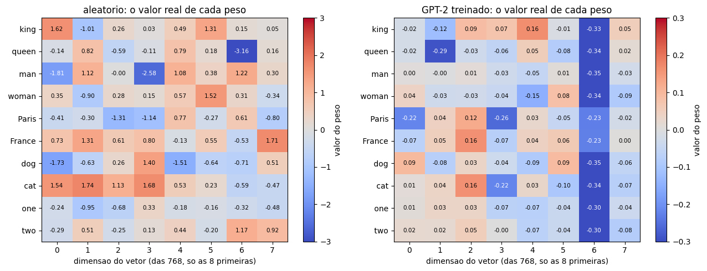
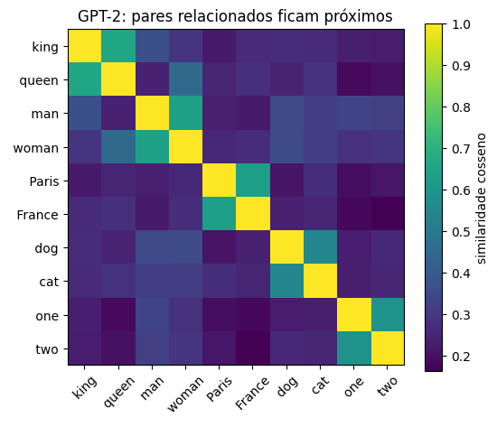
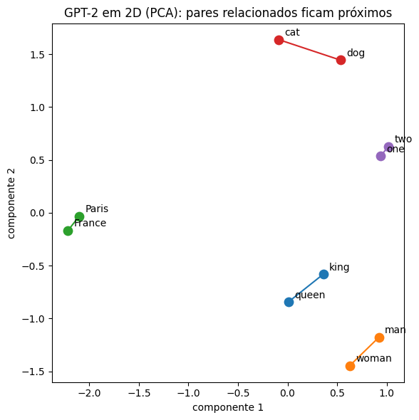
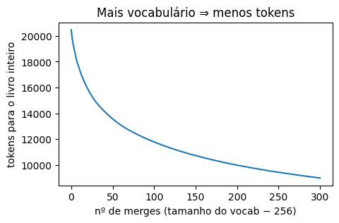

# 01 · Tokenização e embeddings — *Elmo*

**Construto que sai daqui:** `tokenizer` + `dataloader` + embeddings (token + posição) → entrada do notebook 02.

> 📓 Página gerada a partir do notebook [`01_tokenizacao.ipynb`](https://github.com/victorflll/LLMs-from-scratch/blob/main/30-09/01_tokenizacao.ipynb) (repositório *LLMs-from-scratch*, pasta `30-09`), com as saídas da última execução. Para rodar, veja o [setup da aula](setup.md).

```python
import re                                # regex: usada para separar o texto em "palavras" (nível palavra)
from collections import Counter          # conta pares de bytes mais frequentes no  BPE do zero

import matplotlib.pyplot as plt          # gráficos: curva de tokens, heatmaps, similaridade
import tiktoken                          # tokenizadores reais: gpt2, cl100k_base (GPT-4), o200k_base (GPT-4o)
import torch                             # tensores e embeddings (nn.Embedding)

from aula import the_verdict, load_gpt2                      # the_verdict: lê o conto de treino; load_gpt2: baixa/carrega os pesos oficiais do GPT-2
from llms_from_scratch.ch02 import create_dataloader_v1       # dataloader do capítulo 2 do livro (janela deslizante entrada/alvo)

torch.manual_seed(123)                   # fixa a semente: os embeddings aleatórios criados mais à frente saem sempre iguais
texto = the_verdict()                    # carrega o conto "The Verdict" (texto de treino usado no livro), ~20 mil caracteres
frase = "Hello, class! Tokenização do GPT-2 é unbelievably interessante."  # frase de teste: mistura inglês/português, acento, número e palavra longa
print(len(texto), "caracteres no livro de treino (the-verdict)")  # confere o tamanho do corpus
```

```text
20479 caracteres no livro de treino (the-verdict)
```

## 1. Três jeitos de quebrar texto
Vamos montar tokenizadores de **caractere** e de **palavra** a partir do *the-verdict* e comparar com o **BPE** do GPT-2.

```python
# Nível caractere: vocabulário = todo caractere que apareceu no texto
vocab_char = sorted(set(texto))                                  # conjunto de caracteres distintos do conto, ordenado = nosso "vocabulário"
fora_char = [c for c in frase if c not in vocab_char]             # caracteres da frase que não existem nesse vocabulário
print("vocab caractere:", len(vocab_char), "| tokens da frase:", len(frase), "| desconhecidos:", fora_char)  # nesse nível, 1 caractere = 1 token

# Nível palavra (igual ao SimpleTokenizer do cap. 2)
def palavras(t):
    # separa por pontuação (, . : ; ? _ ! " ( ) '), por "--" e por espaço; descarta pedaços vazios/em branco
    return [p for p in re.split(r'([,.:;?_!"()\']|--|\s)', t) if p.strip()]

vocab_pal = set(palavras(texto))          # palavras distintas do conto = vocabulário de palavras
tokens_pal = palavras(frase)              # a frase de teste quebrada em palavras/pontuação
print("vocab palavra:", len(vocab_pal), "| tokens da frase:", len(tokens_pal),
      "| desconhecidos:", [p for p in tokens_pal if p not in vocab_pal])  # palavras da frase que o vocabulário nunca viu

# BPE do GPT-2: nunca tem token desconhecido, quebra em pedaços (subpalavras / bytes)
bpe = tiktoken.get_encoding("gpt2")       # carrega o tokenizador real do GPT-2 (tiktoken)
ids = bpe.encode(frase)                   # frase -> lista de IDs inteiros
print("vocab BPE:", bpe.n_vocab, "| tokens da frase:", len(ids))  # tamanho do vocabulário fixo (50.257) e nº de tokens gerados
print([bpe.decode([i]) for i in ids])     # decodifica cada ID individualmente para ver o pedaço de texto que ele representa
```

```text
vocab caractere: 62 | tokens da frase: 63 | desconhecidos: ['ç', 'ã', '2', 'é']
vocab palavra: 1130 | tokens da frase: 11 | desconhecidos: ['Hello', 'class', 'Tokenização', 'GPT-2', 'é', 'unbelievably', 'interessante']
vocab BPE: 50257 | tokens da frase: 20
['Hello', ',', ' class', '!', ' Token', 'iza', 'ç', 'ão', ' do', ' G', 'PT', '-', '2', ' é', ' unbelievably', ' int', 'e', 'ress', 'ante', '.']
```

**Leitura:** caractere → vocabulário minúsculo mas sequências longas (e o contexto enche rápido).
Palavra → sequências curtas, mas qualquer palavra nova vira `<|unk|>`.
BPE → meio-termo: vocabulário fixo (~50k) e **zero** desconhecidos, porque no pior caso cai para bytes.

### E tokenizadores mais novos? (GPT-4 = `cl100k_base`, GPT-4o = `o200k_base`)

```python
frases = {
    "inglês": "The quick brown fox jumps over the lazy dog.",
    "português": "A rápida raposa marrom pula sobre o cachorro preguiçoso.",
    "código": "def soma(a, b):\n    return a + b",
}  # 3 textos de teste: inglês, português e código Python
for nome in ["gpt2", "cl100k_base", "o200k_base"]:   # tokenizadores reais: GPT-2, GPT-4/3.5, GPT-4o
    enc = tiktoken.get_encoding(nome)                # carrega o tokenizador da vez
    contagem = {k: len(enc.encode(v)) for k, v in frases.items()}  # nº de tokens gerados para cada frase
    print(f"{nome:12s} vocab={enc.n_vocab:>7,}  tokens={contagem}")  # vocabulário total x tokens usados por frase
```

```text
gpt2         vocab= 50,257  tokens={'inglês': 10, 'português': 23, 'código': 16}
cl100k_base  vocab=100,277  tokens={'inglês': 10, 'português': 18, 'código': 11}
o200k_base   vocab=200,019  tokens={'inglês': 10, 'português': 15, 'código': 11}
```

Vocabulário maior ⇒ menos tokens por frase (principalmente fora do inglês) ⇒ mais texto cabe no contexto,
**mas** a camada de embedding e a camada de saída ficam maiores (`vocab × emb_dim` parâmetros cada).

## 2. Do texto para pares (entrada, alvo)
O GPT aprende a prever **o próximo token**: o alvo é a entrada deslocada 1 posição.

```python
loader = create_dataloader_v1(texto, batch_size=2, max_length=4, stride=4, shuffle=False)  # janelas de 4 tokens, sem sobreposição (stride=max_length), sem embaralhar
x, y = next(iter(loader))                            # pega só o primeiro lote: x = entrada, y = alvo (a mesma janela, deslocada 1 posição)
print("entrada:\n", x, "\nalvo:\n", y)
for a, b in zip(x[0], y[0]):                         # percorre lado a lado os 4 tokens da 1ª linha de x e de y
    print(f"{bpe.decode([a.item()])!r:>12} → {bpe.decode([b.item()])!r}")  # mostra o par "entrada → alvo" já decodificado de volta para texto
```

```text
entrada:
 tensor([[  40,  367, 2885, 1464],
        [1807, 3619,  402,  271]]) 
alvo:
 tensor([[  367,  2885,  1464,  1807],
        [ 3619,   402,   271, 10899]])
         'I' → ' H'
        ' H' → 'AD'
        'AD' → ' always'
   ' always' → ' thought'
```

```python
#stride: 1 = janelas sobrepostas (mais amostras, mais repetição); = max_length = sem sobreposição
for stride in [1, 2, 4]:                             # testa 3 valores de passo da janela deslizante
    print(f"stride={stride}: {len(create_dataloader_v1(texto, batch_size=1, max_length=4, stride=stride).dataset):>5} amostras")  # nº de janelas (amostras) geradas para cada stride
```

```text
stride=1:  5141 amostras
stride=2:  2571 amostras
stride=4:  1286 amostras
```

## 3. Embeddings: cada id vira um vetor treinável
`tok_emb` é só uma tabela `vocab_size × emb_dim`; somamos um embedding de **posição** (`pos_emb`).

```python
emb_dim, contexto = 768, 4                            # 768 = tamanho do vetor de cada token (GPT-2 small); 4 = nº de posições (= max_length do dataloader)
tok_emb = torch.nn.Embedding(bpe.n_vocab, emb_dim)    # tabela de embeddings de TOKEN: 50.257 linhas x 768 colunas, pesos aleatórios e treináveis
pos_emb = torch.nn.Embedding(contexto, emb_dim)       # tabela de embeddings de POSIÇÃO: 4 linhas x 768 colunas
entrada = tok_emb(x) + pos_emb(torch.arange(contexto))  # soma "qual é o token" + "em que posição está" (broadcast: as 4 posições somam nos 2 exemplos do lote)
print("ids:", tuple(x.shape), "→ embeddings:", tuple(entrada.shape))  # (2,4) IDs viram (2,4,768) vetores
print("primeiras 8 dimensões do vetor do 1º token da entrada:", [round(v, 3) for v in entrada[0, 0, :8].tolist()])
```

```text
ids: (2, 4) → embeddings: (2, 4, 768)
primeiras 8 dimensões do vetor do 1º token da entrada: [1.345, -1.174, -0.406, 0.669, -1.135, 0.6, -0.126, 0.662]
```

```python
# E se mudarmos emb_dim? A tabela cresce linearmente (e o modelo inteiro ~quadraticamente, ver notebook 07)
for d in [4, 64, 768, 1024, 1600, 12288]:             # tamanhos de embedding: do brinquedo (4) ao GPT-3 (12288)
    p = bpe.n_vocab * d                               # nº de parâmetros da tabela tok_emb (linhas x colunas = vocab_size x emb_dim)
    print(f"emb_dim={d:>6}: {p:>13,} parâmetros só no tok_emb  ≈ {p * 4 / 1e6:8.1f} MB em float32")  # cada parâmetro em float32 ocupa 4 bytes
```

```text
emb_dim=     4:       201,028 parâmetros só no tok_emb  ≈      0.8 MB em float32
emb_dim=    64:     3,216,448 parâmetros só no tok_emb  ≈     12.9 MB em float32
emb_dim=   768:    38,597,376 parâmetros só no tok_emb  ≈    154.4 MB em float32
emb_dim=  1024:    51,463,168 parâmetros só no tok_emb  ≈    205.9 MB em float32
emb_dim=  1600:    80,411,200 parâmetros só no tok_emb  ≈    321.6 MB em float32
emb_dim= 12288:   617,558,016 parâmetros só no tok_emb  ≈   2470.2 MB em float32
```

Dimensão maior = mais "espaço" para codificar significado, mas mais memória e mais dados para treinar.
768 é o GPT-2 small, 1600 o XL, 12288 o GPT-3.

## 4. Visualizando os pesos dentro dos vetores
Embedding **aleatório** vs embedding **treinado** do GPT-2 (baixa os pesos oficiais uma vez, ~500 MB).

```python
gpt2, _ = load_gpt2("124M")                           # baixa (1a vez, ~500 MB) e carrega os pesos oficiais do GPT-2 small; "_" descarta a config, nao usada aqui
palavras_viz = [" king", " queen", " man", " woman", " Paris", " France", " dog", " cat", " one", " two"]  # 10 palavras em pares relacionados 
ids_viz = [bpe.encode(p)[0] for p in palavras_viz]    # ID de cada palavra (todas viram 1 unico token no BPE do GPT-2); [0] pega esse token
print("gpt2 carregado |", len(palavras_viz), "palavras escolhidas:", [p.strip() for p in palavras_viz])
```

```text
gpt2 carregado | 10 palavras escolhidas: ['king', 'queen', 'man', 'woman', 'Paris', 'France', 'dog', 'cat', 'one', 'two']
```

```python
# Comparo os pesos REAIS (nao so a cor): 8 dimensoes, valor escrito em cada celula, dos dois lados: aleatorio e treinado.
n_dims_mostrar = 8                                     # so as 8 primeiras dimensoes (das 768), para os numeros caberem na tela
pesos_aleatorio = tok_emb.weight[ids_viz, :n_dims_mostrar].detach()   # (10 palavras, 8 dimensoes) da tabela ALEATORIA (ETAPA 8)
pesos_treinado = gpt2.tok_emb.weight[ids_viz, :n_dims_mostrar].detach()  # (10 palavras, 8 dimensoes) da tabela JA TREINADA

fig, axs = plt.subplots(1, 2, figsize=(13, 5))
for ax, nome, pesos, vlim in zip(axs, ["aleatorio", "GPT-2 treinado"], [pesos_aleatorio, pesos_treinado], [3, 0.3]):
    im = ax.imshow(pesos, aspect="auto", cmap="coolwarm", vmin=-vlim, vmax=vlim)  # cada lado com sua propria escala de cor
    ax.set_xticks(range(n_dims_mostrar))
    ax.set_xlabel("dimensao do vetor (das 768, so as 8 primeiras)")
    ax.set_yticks(range(len(palavras_viz)))
    ax.set_yticklabels(palavras_viz)
    ax.set_title(f"{nome}: o valor real de cada peso")
    for i in range(len(palavras_viz)):                 # escreve o numero de cada peso dentro da propria celula
        for j in range(n_dims_mostrar):
            valor = pesos[i, j].item()
            cor_texto = "white" if abs(valor) > 0.6 * vlim else "black"  # texto branco no fundo escuro, preto no fundo claro
            ax.text(j, i, f"{valor:.2f}", ha="center", va="center", fontsize=7.5, color=cor_texto)
    fig.colorbar(im, ax=ax, label="valor do peso")
plt.tight_layout()
plt.show()

# E em texto puro: o vetor inteiro (8 primeiras dimensoes) de "king", nos dois lados, numero a numero
print("valores reais de \'king\' (8 primeiras das 768 dimensoes):")
print("  aleatorio:", [round(v, 3) for v in pesos_aleatorio[0].tolist()])
print("  treinado :", [round(v, 3) for v in pesos_treinado[0].tolist()])
```



```text
valores reais de 'king' (8 primeiras das 768 dimensoes):
  aleatorio: [1.618, -1.008, 0.261, 0.025, 0.493, 1.308, 0.154, 0.048]
  treinado : [-0.019, -0.117, 0.089, 0.073, 0.165, -0.011, -0.327, 0.051]
```

```python
# Cada dimensão isolada não "significa" nada — o significado aparece na geometria: vetores parecidos = palavras parecidas
E = gpt2.tok_emb.weight[ids_viz].detach()             # vetores completos (768 dimensões) das 10 palavras, já treinados pela OpenAI
sim = torch.nn.functional.cosine_similarity(E[:, None], E[None, :], dim=-1)  # similaridade cosseno de todos contra todos (broadcast -> matriz 10x10)
plt.figure(figsize=(6, 5))
plt.imshow(sim, cmap="viridis")
plt.xticks(range(len(palavras_viz)), palavras_viz, rotation=45)
plt.yticks(range(len(palavras_viz)), palavras_viz)
plt.colorbar(label="similaridade cosseno")
plt.title("GPT-2: pares relacionados ficam próximos")
plt.show()
```



```python

# 1) Em texto: qual e a palavra mais parecida com cada uma (fora ela mesma)?
sim_sem_diagonal = sim.clone()
sim_sem_diagonal.fill_diagonal_(-1)          # tira a diagonal (palavra com ela mesma) da disputa
mais_parecida = sim_sem_diagonal.argmax(dim=1)  # indice da palavra mais parecida com cada linha
print("palavra mais parecida com cada uma (fora ela mesma):")
for i, palavra in enumerate(palavras_viz):
    j = mais_parecida[i].item()
    print(f"  {palavra.strip():8s} -> {palavras_viz[j].strip():8s}  (similaridade {sim[i, j]:.2f})")

pares_idx = [(0, 1), (2, 3), (4, 5), (6, 7), (8, 9)]                 # indices dos 5 pares relacionados em palavras_viz
sim_pares = torch.stack([sim[i, j] for i, j in pares_idx]).mean()    # similaridade media so dentro dos pares
mask = torch.ones_like(sim, dtype=torch.bool)
mask.fill_diagonal_(False)                                            # tira cada palavra comparada com ela mesma
for i, j in pares_idx:
    mask[i, j] = mask[j, i] = False                                   # tira tambem os proprios pares da "nao relacionadas"
sim_resto = sim[mask].mean()                                          # similaridade media entre palavras SEM relacao
print(f"\nsimilaridade media nos pares relacionados:       {sim_pares:.2f}")
print(f"similaridade media entre palavras NAO relacionadas: {sim_resto:.2f}")

# 2) Em imagem: projeta os vetores de 768 dimensoes num plano 2D (PCA) e liga cada par com uma linha
torch.manual_seed(123)
E_centrado = E - E.mean(dim=0, keepdim=True)          # PCA exige vetores centralizados (media zero)
_, _, V = torch.pca_lowrank(E_centrado, q=2)           # acha as 2 direcoes que mais explicam a variacao dos vetores
E_2d = E_centrado @ V[:, :2]                            # projeta cada vetor de 768 dimensoes nessas 2 direcoes

pares = [(0, 1, "king-queen"), (2, 3, "man-woman"), (4, 5, "Paris-France"), (6, 7, "dog-cat"), (8, 9, "one-two")]
cores = plt.cm.tab10.colors
plt.figure(figsize=(6, 6))
for cor, (i, j, nome) in zip(cores, pares):
    plt.plot(E_2d[[i, j], 0], E_2d[[i, j], 1], "-", color=cor, linewidth=1.5, zorder=1)  # liga os dois pontos do par
    plt.scatter(E_2d[[i, j], 0], E_2d[[i, j], 1], color=cor, s=80, zorder=2)              # marca os pontos
for i, palavra in enumerate(palavras_viz):
    plt.annotate(palavra.strip(), (E_2d[i, 0].item(), E_2d[i, 1].item()), textcoords="offset points", xytext=(6, 4))
plt.title("GPT-2 em 2D (PCA): pares relacionados ficam próximos")
plt.xlabel("componente 1")
plt.ylabel("componente 2")
plt.tight_layout()
plt.show()
```

```text
palavra mais parecida com cada uma (fora ela mesma):
  king     -> queen     (similaridade 0.66)
  queen    -> king      (similaridade 0.66)
  man      -> woman     (similaridade 0.64)
  woman    -> man       (similaridade 0.64)
  Paris    -> France    (similaridade 0.63)
  France   -> Paris     (similaridade 0.63)
  dog      -> cat       (similaridade 0.55)
  cat      -> dog       (similaridade 0.55)
  one      -> two       (similaridade 0.59)
  two      -> one       (similaridade 0.59)

similaridade media nos pares relacionados:       0.62
similaridade media entre palavras NAO relacionadas: 0.26
```



### ✅ Construto
`bpe` (tokenizer) → `create_dataloader_v1` (pares entrada/alvo) → `tok_emb + pos_emb` (tensor `batch × tokens × emb_dim`).
No notebook **02** esses vetores entram na atenção.

## Extra· Construindo o meu vocabulário: BPE do zero em ~20 linhas
 "Se eu quiser montar meu próprio tokenizador?".
Começa com os 256 bytes e, a cada passo, funde o **par vizinho mais frequente** em um token novo.

```python
def treinar_bpe(texto, n_merges):
    ids = list(texto.encode("utf-8"))               # texto -> bytes (0-255); ponto de partida do BPE
    vocab = {i: bytes([i]) for i in range(256)}      # vocabulário inicial: os 256 bytes possíveis (por isso nunca há desconhecido)
    merges, tamanhos = {}, [len(ids)]                # merges: regras aprendidas; tamanhos: nº de tokens do texto após cada merge
    for novo in range(256, 256 + n_merges):          # cria n_merges tokens novos, com IDs 256, 257, 258...
        par = Counter(zip(ids, ids[1:])).most_common(1)[0][0]  # conta todos os pares de vizinhos e pega o mais frequente
        merges[par] = novo                            # registra a regra: esse par de IDs vira o token "novo"
        vocab[novo] = vocab[par[0]] + vocab[par[1]]    # o token novo é a concatenação dos bytes dos dois tokens fundidos
        saida, i = [], 0
        while i < len(ids):                            # percorre a sequência aplicando a fusão aprendida
            if i + 1 < len(ids) and (ids[i], ids[i + 1]) == par:
                saida.append(novo)                      # encontrou o par: substitui os dois pelo token novo
                i += 2                                   # pula os dois tokens que acabaram de ser fundidos
            else:
                saida.append(ids[i])                     # não é o par: mantém o token como está
                i += 1
        ids = saida                                       # sequência mais curta após a fusão
        tamanhos.append(len(ids))                          # guarda o novo tamanho (usado no gráfico da próxima célula)
    return merges, vocab, tamanhos


def codificar(texto, merges):
    ids = list(texto.encode("utf-8"))                # mesmo ponto de partida: bytes crus do texto novo
    for par, novo in merges.items():                  # aplica os merges na ordem em que foram aprendidos
        saida, i = [], 0
        while i < len(ids):
            if i + 1 < len(ids) and (ids[i], ids[i + 1]) == par:
                saida.append(novo)
                i += 2
            else:
                saida.append(ids[i])
                i += 1
        ids = saida
    return ids


merges, meu_vocab, tamanhos = treinar_bpe(texto, n_merges=300)   # treina nosso BPE com 300 fusões (vocabulário final = 256 + 300 = 556)
print("primeiros tokens aprendidos:", [meu_vocab[i].decode("utf-8", "replace") for i in range(256, 276)])  # fusões mais cedo = pedaços mais comuns do inglês
print("últimos tokens aprendidos:  ", [meu_vocab[i].decode("utf-8", "replace") for i in range(536, 556)])  # fusões mais tardias = pedaços específicos do conto
```

```text
primeiros tokens aprendidos: ['e ', ' t', 'd ', 't ', 'in', 's ', 'he ', 'ha', ', ', 'ou', 'er', 'an', 'on', 'en', ' the ', 'y ', '. ', 'o ', 'ing', 'hi']
últimos tokens aprendidos:   ['room', 'when ', 'Stroud ', 'ough', 'Th', 'ed it', 'las', 'picture ', 'is ', 's, ', 'And ', 'say', 'ear', 'I f', 'al ', 'ous', 'fa', 'pre', 'il', 'lif']
```

```python
meus_ids = codificar(frase, merges)               # tokeniza a mesma frase de teste com o vocabulário que acabamos de treinar
print(len(meus_ids), "tokens:", [meu_vocab[i].decode("utf-8", "replace") for i in meus_ids])  # mostra cada token decodificado (bytes soltos viram "�")
assert b"".join(meu_vocab[i] for i in meus_ids).decode("utf-8") == frase  # junta os bytes de todos os tokens de volta: confere que nada se perdeu

plt.figure(figsize=(5, 3))
plt.plot(tamanhos)                                  # nº de tokens do livro inteiro após cada merge (começa em ~20.500, cai com retorno decrescente)
plt.xlabel("nº de merges (tamanho do vocab − 256)")
plt.ylabel("tokens para o livro inteiro")
plt.title("Mais vocabulário ⇒ menos tokens")
plt.show()
```

```text
45 tokens: ['H', 'ell', 'o', ', ', 'c', 'las', 's', '! ', 'T', 'o', 'k', 'en', 'i', 'z', 'a', '�', '�', '�', '�', 'o ', 'd', 'o ', 'G', 'P', 'T', '-', '2', ' ', '�', '�', ' ', 'un', 'b', 'el', 'i', 'ev', 'ab', 'ly ', 'in', 'ter', 'es', 's', 'ant', 'e', '.']
```



Os `�` são bytes soltos de `ç`, `ã`, `é`: o conto não tem acentos, então nosso BPE nunca aprendeu a juntá-los.
Nosso BPE foi treinado só com um conto em inglês, então funciona mal em português — exatamente o que acontece
com o `gpt2` comparado ao `o200k_base`. **O vocabulário reflete o corpus de treino.**
Versão completa (com regex de pré-tokenização como o GPT-2): `ch02/05_bpe-from-scratch/`.
