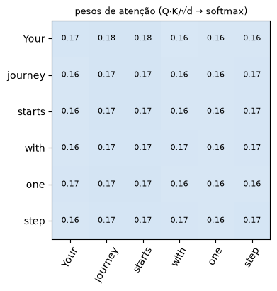
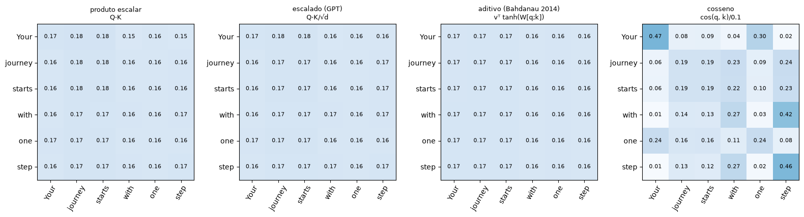
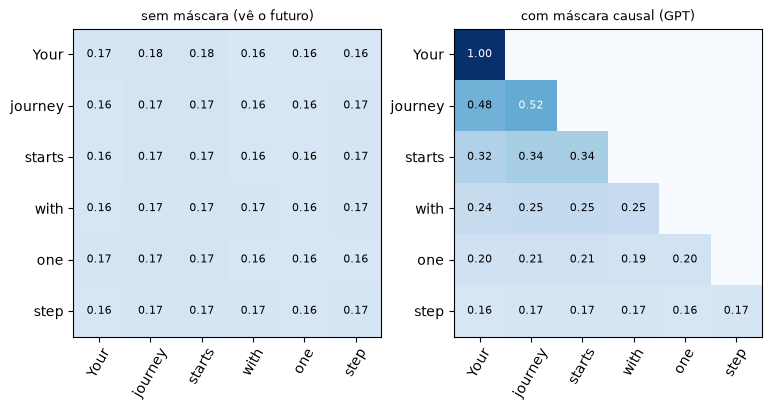
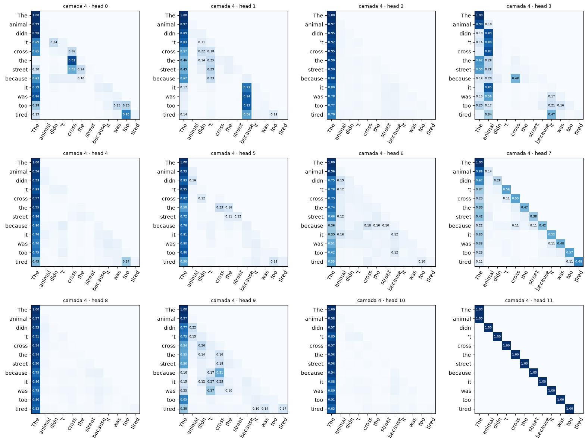
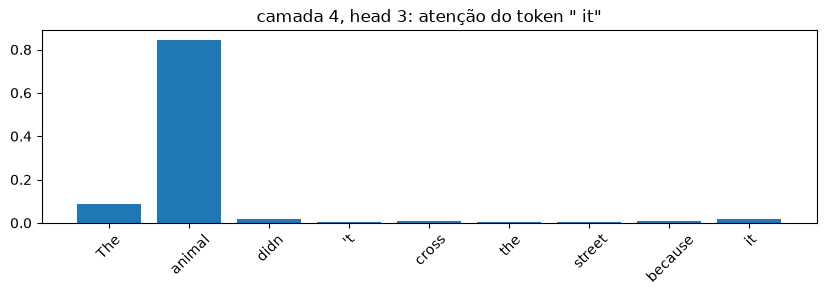

# 02 · Atenção e múltiplas cabeças — *Rafael*

**Entra:** embeddings do notebook 01. **Sai:** `MultiHeadAttention` → usada dentro de cada bloco do GPT (notebook 03).

**Perguntas:**
1. Existem outras formas de gerar o score de atenção?
2. Conseguimos visualizar os scores, ao menos de 1 head?
3. O que acontece se eu mudar a quantidade de heads?
4. E se a dimensão não for divisível pelo número de heads?

**Objetivo:** preparar a entrada da atenção: 6 tokens, cada um representado por um vetor.

> 📓 Página gerada a partir do notebook [`02_atencao.ipynb`](https://github.com/victorflll/LLMs-from-scratch/blob/main/30-09/02_atencao.ipynb) (repositório *LLMs-from-scratch*, pasta `30-09`), com as saídas da última execução. Para rodar, veja o [setup da aula](setup.md).

```python
import matplotlib.pyplot as plt  # gráficos (os mapas de atenção)
import tiktoken  # tokenizador do GPT-2: texto → números (usado na seção 6)
import torch  # PyTorch: tensores (tabelas de números) e camadas de rede neural

from aula import load_gpt2  # carrega o GPT-2 124M com os pesos treinados pela OpenAI
from llms_from_scratch.ch03 import MultiHeadAttention  # atenção multi-head do livro (pkg/llms_from_scratch/ch03.py)

torch.manual_seed(123)  # fixa o sorteio: os pesos aleatórios de W_q, W_k, W_v saem iguais em toda execução
tokens = ["Your", "journey", "starts", "with", "one", "step"]  # a frase de exemplo, já dividida em 6 tokens
# embedding de exemplo do livro: 3 números por token (no GPT-2 real seriam 768) → tabela 6 × 3
x = torch.tensor([[0.43, 0.15, 0.89], [0.55, 0.87, 0.66], [0.57, 0.85, 0.64],
                  [0.22, 0.58, 0.33], [0.77, 0.25, 0.10], [0.05, 0.80, 0.55]])
for t, v in zip(tokens, x):  # mostra cada token ao lado do seu vetor de 3 números
    print(f"{t:>8} → {[round(n, 2) for n in v.tolist()]}")
print("x:", tuple(x.shape), "= 6 tokens × 3 números")  # formato da tabela: (tokens, dimensões)


# só DEFINE a função de desenho (não mostra nada aqui); ela é usada nas seções 1, 2, 3 e 6
# desenha uma matriz de atenção: linha = token que olha, coluna = token olhado, valor escrito em cada quadrado
def mapa(ax, pesos, titulo, rotulos=tokens):
    ax.imshow(pesos.detach(), cmap="Blues", vmin=0, vmax=1)  # escala fixa: 0 = branco, 1 = azul-escuro (compara gráficos entre si)
    ax.set_xticks(range(len(rotulos)), rotulos, rotation=60)  # eixo x: token que está sendo olhado
    ax.set_yticks(range(len(rotulos)), rotulos)  # eixo y: token que está olhando
    ax.set_title(titulo, fontsize=9)  # título
    p, n = pesos.detach(), len(rotulos)  # valores (sem gradiente) e nº de tokens
    limite = 0 if n <= 6 else 0.1  # no mapa grande (GPT-2), só escreve os valores a partir de 0,10
    for i in range(n):  # percorre as linhas...
        for j in range(n):  # ...e as colunas
            if p[i, j] > limite:  # pula os zeros da máscara (e, no mapa grande, os valores pequenos)
                ax.text(j, i, f"{p[i, j]:.2f}", ha="center", va="center", fontsize=8 if n <= 6 else 6,
                        color="white" if p[i, j] > 0.5 else "black")  # escreve o valor; branco sobre azul-escuro
```

```text
    Your → [0.43, 0.15, 0.89]
 journey → [0.55, 0.87, 0.66]
  starts → [0.57, 0.85, 0.64]
    with → [0.22, 0.58, 0.33]
     one → [0.77, 0.25, 0.1]
    step → [0.05, 0.8, 0.55]
x: (6, 3) = 6 tokens × 3 números
```

## 1. Q, K, V e o score

**Objetivo:** calcular, para cada token, quanto ele deve prestar atenção em cada um dos outros e produzir um
novo vetor que mistura a informação da frase.

Cada token vira uma **query** (o que procuro), uma **key** (o que ofereço) e um **value** (o que entrego).
score = quão bem a query de um token "casa" com a key de outro.

```python
d_k = 2  # tamanho dos vetores de query/key/value (pequeno para caber na tela)
W_q, W_k, W_v = (torch.nn.Linear(3, d_k, bias=False) for _ in range(3))  # 3 matrizes de pesos (3 → 2), começam aleatórias
# cria uma camada linear: uma matriz de pesos 2 × 3 que transforma um vetor de 3 números em um de 2 , ajustada no treino
Q, K, V = W_q(x), W_k(x), W_v(x)  # cada um: (6, 2)
# produto escalar de cada query com cada key; K.T transpõe K (6×2 → 2×6) para o @ encaixar
scores = Q @ K.T  # score de cada par de tokens: (6, 2) @ (2, 6) = (6, 6)
pesos = torch.softmax(scores / d_k**0.5, dim=-1)  # ÷√d_k evita scores exagerados; softmax por linha → porcentagens que somam 1
contexto = pesos @ V  # média dos values ponderada pelos pesos: novo vetor de cada token, (6, 6) @ (6, 2) = (6, 2)
print("scores", tuple(scores.shape), "| pesos (linha soma):", pesos.sum(-1)[:2].detach(), "| contexto", tuple(contexto.shape))  # confere formatos e que as linhas somam 1

fig, ax = plt.subplots(figsize=(4, 4))  # figura com 1 gráfico
mapa(ax, pesos, "pesos de atenção (Q·K/√d → softmax)")  # quase uniforme (~0,17): pesos aleatórios, sem treino
plt.show()  # exibe
```

```text
scores (6, 6) | pesos (linha soma): tensor([1.0000, 1.0000]) | contexto (6, 2)
```



## 2. Outras formas de calcular o score

**Objetivo:** mostrar que o produto escalar escalado (o do GPT) é uma escolha, não a única forma de medir o
quanto dois tokens combinam.

```python
torch.manual_seed(0)  # fixa o sorteio dos pesos da atenção aditiva
W_a = torch.nn.Linear(2 * d_k, 4)  # atenção aditiva (Bahdanau, 2014): camada linear que recebe query e key concatenadas
v_a = torch.nn.Linear(4, 1, bias=False)  # reduz para 1 número: o score do par
# monta todos os pares (query i, key j), concatena, passa pela mini rede → score (6, 6)
aditivo = v_a(torch.tanh(W_a(torch.cat(torch.broadcast_tensors(Q[:, None], K[None, :]), dim=-1)))).squeeze(-1)

variantes = {  # 4 formas de calcular o score (cada uma é uma tabela 6 × 6)
    "produto escalar\nQ·K": scores,  # multiplica e soma (da seção 1), sem escala
    "escalado (GPT)\nQ·K/√d": scores / d_k**0.5,  # o mesmo ÷ √d: é o que o GPT usa
    "aditivo (Bahdanau 2014)\nvᵀ tanh(W[q;k])": aditivo,  # mini rede neural (anterior ao Transformer)
    "cosseno\ncos(q, k)/0.1": torch.nn.functional.cosine_similarity(Q[:, None], K[None, :], dim=-1) / 0.1,  # só a direção dos vetores; ÷0,1 amplia as diferenças
}
fig, axs = plt.subplots(1, 4, figsize=(16, 4))  # 4 gráficos lado a lado
for ax, (nome, s) in zip(axs, variantes.items()):  # para cada forma de score...
    mapa(ax, torch.softmax(s, dim=-1), nome)  # ...aplica o softmax e desenha
plt.tight_layout()  # ajusta os espaços (nomes não invadem o gráfico vizinho)
plt.show()  # exibe
```



O gráfico não diz qual é melhor, porque nada foi treinado.

## 3. Máscara causal: o GPT não pode olhar o futuro

**Objetivo:** impedir que um token olhe para os tokens seguintes, porque o GPT gera texto da esquerda para a
direita. Se no treino ele pudesse vê-las, ele copiaria a resposta em vez de aprender a prever.

```python
n = len(tokens)  # 6 tokens
mascara = torch.triu(torch.ones(n, n), diagonal=1).bool()  # monta uma tabela 6 × 6 que marca com  True  tudo o que está acima da diagonal.
s_mascarado = (scores / d_k**0.5).masked_fill(mascara, -torch.inf)  # troca o score dessas posições por menos infinito. O softmax transforma −∞ em exatamente 0%

fig, axs = plt.subplots(1, 2, figsize=(9, 4))  # 2 gráficos lado a lado
mapa(axs[0], torch.softmax(scores / d_k**0.5, -1), "sem máscara (vê o futuro)")  # cada token olha para todos
mapa(axs[1], torch.softmax(s_mascarado, -1), "com máscara causal (GPT)")  # cada token só olha para si e os anteriores
plt.show()  # exibe
```



## 4. Multi-head: várias atenções em paralelo

A partir daqui utilizaremos o tamanho real do GPT-2: cada token é representado por 768 números.

A `MultiHeadAttention` do livro **fatia** `d_out` em `num_heads` pedaços de `head_dim = d_out / num_heads`.
Ela não devolve os pesos, então reproduzimos seus passos até o softmax para poder desenhá-los:

```python
# a MultiHeadAttention do livro só devolve o resultado final; esta função refaz a conta e para nos pesos (para desenhar)
def pesos_atencao(mha, x):
    """Mesmo cálculo de MultiHeadAttention.forward, parando nos pesos: (batch, heads, tokens, tokens)."""
    b, t, _ = x.shape  # b = nº de frases, t = nº de tokens, o .shape  diz o tamanho de cada dimensão do tensor
    # projeta, corta o vetor em num_heads pedaços de head_dim
    # reorganiza os números sem mudar nenhum: os 768 números de cada token são vistos como 12 pedaços de 64 → (1, 6, 12, 64). Os números 0–63 vão para a head 0, os 64–127 para a head 1, e assim por diante.
    # transpose = troca de lugar as dimensões 
    q = mha.W_query(x).view(b, t, mha.num_heads, mha.head_dim).transpose(1, 2)  # (b, heads, t, head_dim)
    k = mha.W_key(x).view(b, t, mha.num_heads, mha.head_dim).transpose(1, 2)  # keys, mesmo formato
    s = (q @ k.transpose(2, 3)).masked_fill(mha.mask.bool()[:t, :t], -torch.inf)  # scores de cada head (b, heads, t, t) + máscara causal
    return torch.softmax(s / mha.head_dim**0.5, dim=-1)  # ÷√head_dim e softmax: pesos de atenção de cada head
```

```python
# Mudando o número de heads: parâmetros e formato de saída NÃO mudam, só como d_out é fatiado
X = torch.randn(1, 6, 768)  # entrada aleatória no formato do GPT-2: (1 frase, 6 tokens, 768 números)
for h in [1, 2, 4, 12, 24]:  # números de heads a testar
    mha = MultiHeadAttention(d_in=768, d_out=768, context_length=1024, dropout=0.0, num_heads=h)  # atenção com h heads
    print(f"heads={h:>2}  head_dim={mha.head_dim:>3}  params={sum(p.numel() for p in mha.parameters()):,}"
          f"  saída={tuple(mha(X).shape)}  pesos={tuple(pesos_atencao(mha, X).shape)}")  # tamanho por head, parâmetros, formato da saída e dos pesos
```

```text
heads= 1  head_dim=768  params=2,360,064  saída=(1, 6, 768)  pesos=(1, 1, 6, 6)
heads= 2  head_dim=384  params=2,360,064  saída=(1, 6, 768)  pesos=(1, 2, 6, 6)
heads= 4  head_dim=192  params=2,360,064  saída=(1, 6, 768)  pesos=(1, 4, 6, 6)
heads=12  head_dim= 64  params=2,360,064  saída=(1, 6, 768)  pesos=(1, 12, 6, 6)
heads=24  head_dim= 32  params=2,360,064  saída=(1, 6, 768)  pesos=(1, 24, 6, 6)
```

Mais heads = mais "pontos de vista" independentes, cada um com menos dimensões.
Poucas heads → cada uma é rica mas há menos padrões; muitas → cada head_dim fica pequena demais.
GPT-2 mantém **head_dim = 64** em todos os tamanhos (768/12, 1024/16, 1280/20, 1600/25).

## 5. E se não for divisível?

```python
try:  # tenta criar a atenção...
    MultiHeadAttention(d_in=768, d_out=768, context_length=1024, dropout=0.0, num_heads=5)  # ...com 5 heads para 768 números
except AssertionError as e:  # a classe verifica se 768 é divisível pelo nº de heads
    print("AssertionError:", e)  # mostra o erro sem travar o notebook
print("768 / 5 =", 768 / 5, "→ não dá para fazer .view(b, t, 5, 153.6)")  # cada head teria 153,6 números: impossível
```

```text
AssertionError: d_out must be divisible by n_heads
768 / 5 = 153.6 → não dá para fazer .view(b, t, 5, 153.6)
```

O `.view` precisa dividir o vetor em partes inteiras e iguais. Saídas usadas na prática:
escolher `head_dim` explicitamente e fazer `d_out = num_heads × head_dim` (Llama/Gemma/Qwen definem `head_dim` no config)
e projetar de volta para `emb_dim` na `out_proj`.

```python
# 5 heads de 64 → d_out=320. Aqui a out_proj é 320→320; em modelos reais ela volta para emb_dim
# (ex.: Qwen3 no repo: 16 heads × 128 = 2048 → out_proj 2048→1024, ver pkg/llms_from_scratch/qwen3.py)
mha5 = MultiHeadAttention(d_in=768, d_out=5 * 64, context_length=1024, dropout=0.0, num_heads=5)  # fixa 64 por head: d_out = 5 × 64 = 320
print(tuple(mha5(X).shape))  # funciona: saída (1, 6, 320)
```

```text
(1, 6, 320)
```

## 6. Scores de verdade: as 12 heads de uma camada do GPT-2 treinado

```python
gpt2, _ = load_gpt2("124M")  # GPT-2 124M treinado (a config não é usada aqui)
bpe = tiktoken.get_encoding("gpt2")  # tokenizador do GPT-2
frase = "The animal didn't cross the street because it was too tired"  # teste: a quem o " it" se refere?
ids = torch.tensor([bpe.encode(frase)])  # frase → IDs dos tokens, formato (1, 12)
rotulos = [bpe.decode([i]) for i in ids[0]]  # cada token como texto, para os eixos

CAMADA = 4  # troque a camada (0–11) e veja os padrões mudarem
with torch.no_grad():  # só inferência: sem calcular gradientes
    h = gpt2.tok_emb(ids) + gpt2.pos_emb(torch.arange(ids.shape[1]))  # embedding de token + posição (como no notebook 01): (1, 12, 768)
    for bloco in gpt2.trf_blocks[:CAMADA]:  # passa a frase pelas camadas anteriores à escolhida
        h = bloco(h)
    bloco = gpt2.trf_blocks[CAMADA]  # a camada que vamos inspecionar
    P = pesos_atencao(bloco.att, bloco.norm1(h))[0]  # a atenção recebe a entrada normalizada (norm1); P = (12 heads, 12, 12)

fig, axs = plt.subplots(3, 4, figsize=(16, 12))  # grade 3 × 4 = 12 gráficos
for head, ax in enumerate(axs.flat):  # um gráfico por head
    mapa(ax, P[head], f"camada {CAMADA} · head {head}", rotulos)
plt.tight_layout()  # ajusta os espaços
plt.show()  # exibe
```



```python
# Uma head só, e para onde " it" olha
HEAD = 3  # na camada 4, a head 3 liga " it" a " animal"
i_it = rotulos.index(" it")  # posição do token " it" na frase (8)
fig, ax = plt.subplots(figsize=(10, 2.5))  # figura para o gráfico de barras
ax.bar(rotulos[: i_it + 1], P[HEAD, i_it, : i_it + 1])  # linha do " it": peso para cada token até ele (soma 1)
ax.set_title(f'camada {CAMADA}, head {HEAD}: atenção do token " it"')  # título
plt.xticks(rotation=45)  # inclina os nomes dos tokens
plt.show()  # exibe
```



### ✅ Construto
`MultiHeadAttention(d_in, d_out, context_length, dropout, num_heads)` — no notebook **03** ela vira uma peça do `TransformerBlock`.
