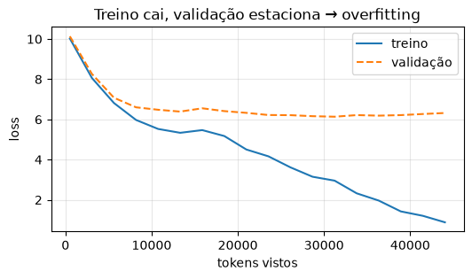
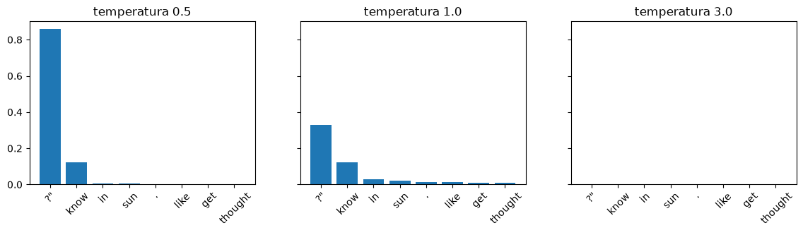
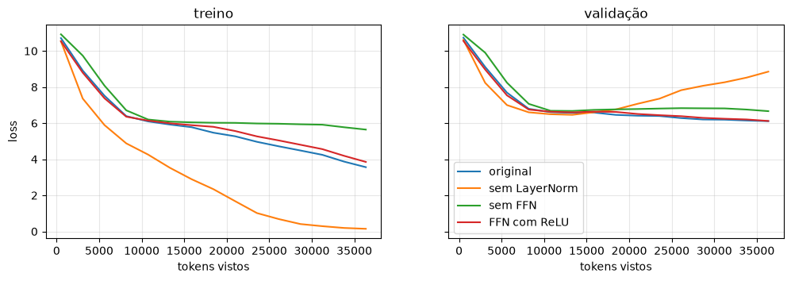

# 04 · Pré-treino — *Lilian*

**Entra:** `GPTModel` (03) + dataloader (01). **Sai:** um modelo que aprendeu algo + os **pesos oficiais do GPT-2** → base dos notebooks 05 e 06.

Perguntas:
1. Como o modelo aprende? O que é a loss?
2. Removendo LayerNorm / FFN ou usando ReLU — o que muda **no treino**?
3. Temperatura e top-k: por que o texto muda?
4. Dá para pré-treinar um GPT-2 de verdade aqui? (spoiler: não — carregamos os pesos da OpenAI)

> 📓 Página gerada a partir do notebook [`04_pre_treino.ipynb`](https://github.com/victorflll/LLMs-from-scratch/blob/main/30-09/04_pre_treino.ipynb) (repositório *LLMs-from-scratch*, pasta `30-09`), com as saídas da última execução. Para rodar, veja o [setup da aula](setup.md).

```python
import contextlib
import io
import time

import matplotlib.pyplot as plt
import tiktoken
import torch

from aula import GPT_CONFIG_124M, device, the_verdict, load_gpt2, variante
from llms_from_scratch.ch02 import create_dataloader_v1
from llms_from_scratch.ch04 import GPTModel
from llms_from_scratch.ch05 import (train_model_simple, calc_loss_loader, generate,
                                    text_to_token_ids, token_ids_to_text)

print("device:", device)
bpe = tiktoken.get_encoding("gpt2")
```

```text
device: mps
```

## 1. A loss: quão surpreso o modelo fica com o token certo
`cross_entropy` = −log(probabilidade dada ao token correto). Modelo aleatório ≈ −log(1/50257) ≈ 10,8.

```python
cfg = {**GPT_CONFIG_124M, "context_length": 256}  # contexto menor = treino mais rápido
texto = the_verdict()
corte = int(0.9 * len(texto))
train_loader = create_dataloader_v1(texto[:corte], batch_size=2, max_length=256, stride=256, shuffle=True, drop_last=True)
val_loader = create_dataloader_v1(texto[corte:], batch_size=2, max_length=256, stride=256, shuffle=False, drop_last=False)
print(len(train_loader), "batches de treino |", len(val_loader), "de validação")

torch.manual_seed(123)
model = GPTModel(cfg).to(device)
with torch.no_grad():
    print(f"loss inicial: {calc_loss_loader(train_loader, model, device):.2f}  (esperado ≈ {torch.log(torch.tensor(50257.)):.2f})")
```

```text
9 batches de treino | 1 de validação
loss inicial: 10.99  (esperado ≈ 10.82)
```

## 2. Treinando (≈1–2 min)
Loop do livro: `forward → loss → backward (gradientes) → optimizer.step (atualiza pesos)`.

```python
torch.manual_seed(123)
optimizer = torch.optim.AdamW(model.parameters(), lr=4e-4, weight_decay=0.1)
N_EPOCAS = 10
t0 = time.time()
train_losses, val_losses, tokens_vistos = train_model_simple(
    model, train_loader, val_loader, optimizer, device,
    num_epochs=N_EPOCAS, eval_freq=5, eval_iter=5,
    start_context="Every effort moves you", tokenizer=bpe,
)
print(f"\n{(time.time() - t0) / 60:.1f} min")
```

```text
Ep 1 (Step 000000): Train loss 10.024, Val loss 10.134
Ep 1 (Step 000005): Train loss 8.060, Val loss 8.262
Every effort moves you, the,,,,,,,,,, the,,,,,,,,,,,,,,,, the,, the,,,, the,,,,,,,,,,,,
Ep 2 (Step 000010): Train loss 6.815, Val loss 7.078
Ep 2 (Step 000015): Train loss 5.973, Val loss 6.602
Every effort moves you, the,,,,, the,,,, the,,, the,,,,, the,,,,,, the,, the,,,, the,,, the,, the,,,,,
Ep 3 (Step 000020): Train loss 5.526, Val loss 6.480
Ep 3 (Step 000025): Train loss 5.334, Val loss 6.389
Every effort moves you, and I had been a, and I had to a a, and I had to me, and I had to                          
Ep 4 (Step 000030): Train loss 5.469, Val loss 6.553
Ep 4 (Step 000035): Train loss 5.173, Val loss 6.413
Every effort moves you, and, and, and, and, and, and a, and, and, and, and, and, and, and, and, and, and, and, and, and, and, and, and, and, and,
Ep 5 (Step 000040): Train loss 4.503, Val loss 6.326
Every effort moves you, and, and I had been.                                          
Ep 6 (Step 000045): Train loss 4.164, Val loss 6.219
Ep 6 (Step 000050): Train loss 3.614, Val loss 6.212
Every effort moves you know he was his pictures--I had been--and a good his painting.                                  
Ep 7 (Step 000055): Train loss 3.148, Val loss 6.161
Ep 7 (Step 000060): Train loss 2.954, Val loss 6.135
Every effort moves you know he was not that he was dead? to the fact by his painting.                                  
Ep 8 (Step 000065): Train loss 2.324, Val loss 6.214
Ep 8 (Step 000070): Train loss 1.963, Val loss 6.188
Every effort moves you know he was one of the picture--I--I turned to me.                                   
Ep 9 (Step 000075): Train loss 1.424, Val loss 6.214
Ep 9 (Step 000080): Train loss 1.205, Val loss 6.269
Every effort moves you know," was one of the picture. The mere outline of the frame called up all Gisburn's past!                           
Ep 10 (Step 000085): Train loss 0.881, Val loss 6.320
Every effort moves you?"  "Yes--quite insensible to the irony. She wanted him back to my work, and went on groping and Mrs. Gisburn's open countenance. "It's his ridiculous modesty, and were amusing himself by holding

0.9 min
```

```python
plt.figure(figsize=(6, 3))
plt.plot(tokens_vistos, train_losses, label="treino")
plt.plot(tokens_vistos, val_losses, "--", label="validação")
plt.xlabel("tokens vistos"); plt.ylabel("loss"); plt.legend(); plt.grid(alpha=.3)
plt.title("Treino cai, validação estaciona → overfitting")
plt.show()
```



O conto tem ~5 mil tokens; o GPT-2 viu ~10 **bilhões** (WebText, 40 GB). Por isso o nosso modelo decora o texto
(loss de treino → 0) mas não generaliza (validação para de cair).

## 3. Temperatura e top-k

```python
model.eval()
ids = text_to_token_ids("Every effort moves you", bpe).to(device)
with torch.no_grad():
    logits = model(ids)[0, -1].cpu()
top = torch.topk(logits, 8)
rotulos = [bpe.decode([i]) for i in top.indices]

fig, axs = plt.subplots(1, 3, figsize=(14, 3), sharey=True)
for ax, T in zip(axs, [0.5, 1.0, 3.0]):
    ax.bar(rotulos, torch.softmax(logits / T, -1)[top.indices])
    ax.set_title(f"temperatura {T}"); ax.tick_params(axis="x", rotation=45)
plt.show()
```



```python
torch.manual_seed(123)
for T, k in [(0.0, None), (1.0, 25), (1.5, 25), (5.0, None)]:
    out = generate(model, ids, max_new_tokens=20, context_size=cfg["context_length"], temperature=T, top_k=k)
    print(f"T={T} top_k={k}: {token_ids_to_text(out, bpe)!r}")
```

```text
T=0.0 top_k=None: 'Every effort moves you?"\n\n"Yes--quite insensible to the irony. She wanted him back to my work'
T=1.0 top_k=25: 'Every effort moves you like to work down in the Mrs. Gisburn--as such--had not it was no'
T=1.5 top_k=25: 'Every effort moves you like the easWell--ed his by a year!"\nI didn\'t let it back to G'
T=5.0 top_k=None: 'Every effort moves you Tr a)[ Mix Tiffany crit PeshFootnotelicense Lodge virtuallyMoscowKick Naked Memory ellTurkish Phant unwuations'
```

Temperatura < 1 concentra (repetitivo), > 1 espalha (criativo → aleatório). Top-k corta a cauda de tokens absurdos.

## 4. 🔧 Ablações **com treino**: sem LayerNorm, sem FFN, ReLU
Modelo menor (256 dims, 4 camadas) para caber em ~1 min; mesmo seed e mesmos dados para todos.

```python
mini = {**cfg, "emb_dim": 256, "n_layers": 4, "n_heads": 4, "context_length": 128}
tl = create_dataloader_v1(texto[:corte], batch_size=4, max_length=128, stride=128, shuffle=True)
vl = create_dataloader_v1(texto[corte:], batch_size=4, max_length=128, stride=128, shuffle=False, drop_last=False)

curvas = {}
for nome, kw in {"original": {}, "sem LayerNorm": {"sem_norm": True}, "sem FFN": {"sem_ffn": True},
                 "FFN com ReLU": {"relu": True}}.items():
    torch.manual_seed(123)
    m = variante(mini, **kw).to(device)
    opt = torch.optim.AdamW(m.parameters(), lr=1e-3, weight_decay=0.1)
    with contextlib.redirect_stdout(io.StringIO()):  # silencia os prints do loop do livro
        tr, va, tok = train_model_simple(m, tl, vl, opt, device, num_epochs=8, eval_freq=5, eval_iter=5,
                                         start_context="Every", tokenizer=bpe)
    curvas[nome] = (tok, tr, va)
    print(f"{nome:14s} loss final treino={tr[-1]:.2f}  validação={va[-1]:.2f}")

fig, axs = plt.subplots(1, 2, figsize=(12, 3.5), sharey=True)
for nome, (tok, tr, va) in curvas.items():
    axs[0].plot(tok, tr, label=nome); axs[1].plot(tok, va, label=nome)
axs[0].set_title("treino"); axs[1].set_title("validação")
for ax in axs: ax.set_xlabel("tokens vistos"); ax.grid(alpha=.3)
axs[0].set_ylabel("loss"); axs[1].legend()
plt.show()
```

```text
original       loss final treino=3.56  validação=6.11
sem LayerNorm  loss final treino=0.14  validação=8.85
sem FFN        loss final treino=5.64  validação=6.66
FFN com ReLU   loss final treino=3.85  validação=6.12
```



Leia o gráfico junto com a turma. No nosso run (M1, seed 123):
- **sem FFN** aprende mais devagar: perdeu a maior parte da capacidade;
- **sem LayerNorm** decora o treino mais rápido mas tem a **pior validação** — sinal descontrolado = otimização instável e overfitting;
- **ReLU** fica praticamente igual ao GELU nessa escala (a diferença aparece em modelos grandes e treinos longos).

## 5. Pesos de verdade: GPT-2 124M da OpenAI
Treinar isso do zero custou semanas de GPU. Carregamos os pesos (arquivo convertido para o nosso `GPTModel`).

```python
gpt2, cfg_gpt2 = load_gpt2("124M")
gpt2.to(device)
torch.manual_seed(123)
out = generate(gpt2, text_to_token_ids("Every effort moves you", bpe).to(device),
               max_new_tokens=30, context_size=cfg_gpt2["context_length"], temperature=1.0, top_k=25)
print(token_ids_to_text(out, bpe))
```

```text
Every effort moves you closer to enlightenment. It's the kind of life that gives you a sense of purpose, and the kind of life you need to keep going.
```

```python
with torch.no_grad():
    print(f"loss na validação do the-verdict — nosso modelo: {calc_loss_loader(val_loader, model, device):.2f}"
          f" | GPT-2 oficial: {calc_loss_loader(val_loader, gpt2, device):.2f}")
```

```text
loss na validação do the-verdict — nosso modelo: 6.38 | GPT-2 oficial: 3.56
```

O GPT-2 **nunca viu** esse conto e mesmo assim prevê melhor que o nosso modelo que o decorou — isso é generalização.

### Existem alternativas ao Transformer?
Sim, e várias já competem: **SSMs / Mamba** (estado recorrente, custo linear no contexto), **RWKV** (RNN treinável em paralelo),
**atenção linear / Gated DeltaNet** (usada em híbridos como Qwen3-Next e Kimi Linear — ver `ch04/08_deltanet`)
e **MoE**, que mantém o Transformer mas troca a FFN por vários especialistas (`ch04/07_moe`).
Hoje a tendência é **híbrida**: algumas camadas de atenção completa + camadas lineares.

### ✅ Construto
`load_gpt2("124M")` → modelo pré-treinado que será **ajustado** para classificar (05) e seguir instruções (06).
