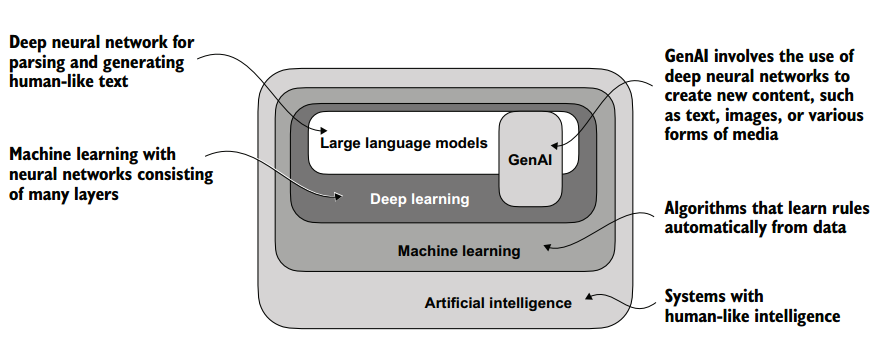
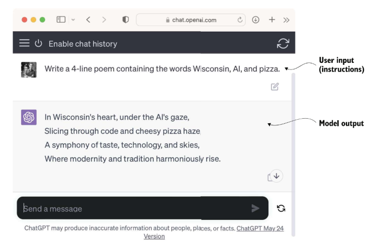
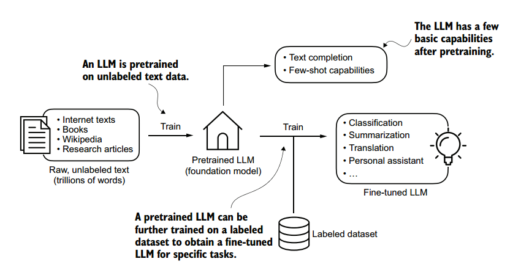
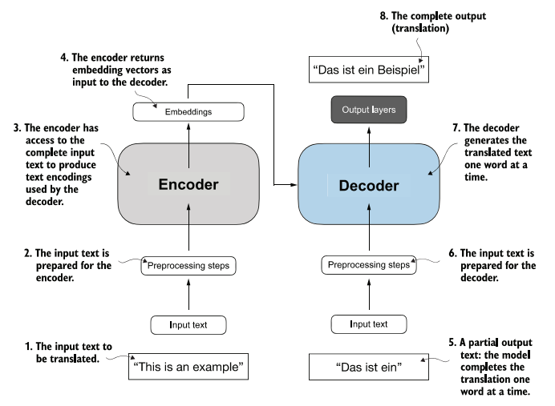
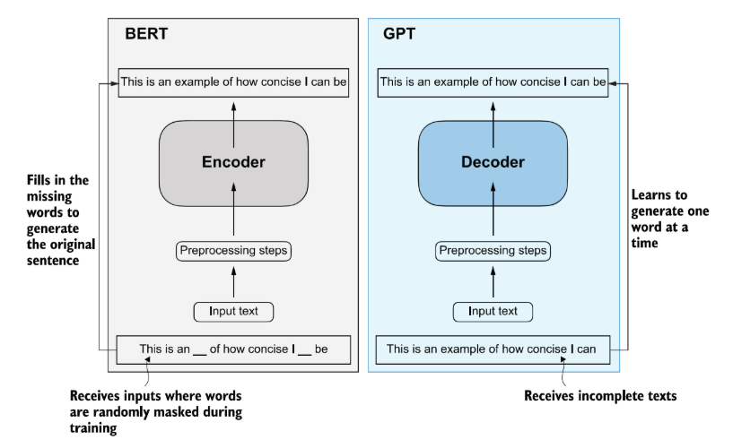
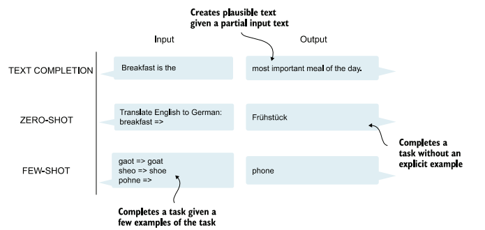
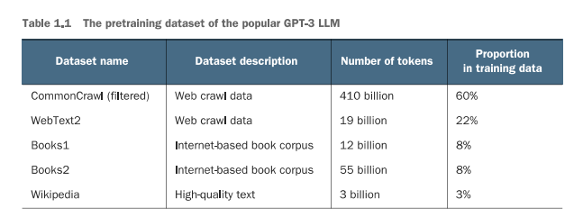
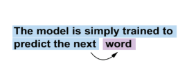
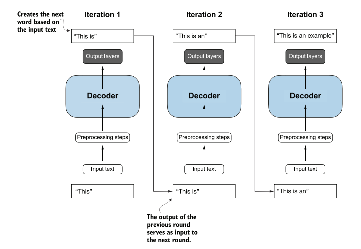
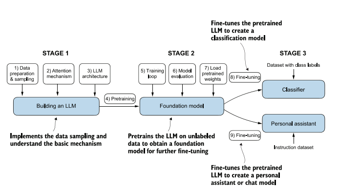

# Cap. 1 · Compreendendo os grandes modelos de linguagem

Conceitos fundamentais dos LLMs, a arquitetura Transformer e um plano passo a passo para construir um LLM do zero em código.

**Principais tópicos**

- Explicações em alto nível dos conceitos fundamentais por trás dos LLMs.
- Insights sobre a arquitetura Transformer, da qual os LLMs são derivados.
- Um plano para construir um LLM do zero.

## Introdução aos LLMs

- **Evolução do PLN:** os LLMs representam uma evolução das técnicas tradicionais de Processamento de Linguagem Natural, ampliando a capacidade de trabalhar com linguagem humana.
- **Maior capacidade linguística:** modelos anteriores eram geralmente desenvolvidos para tarefas específicas; os LLMs realizam diversas tarefas de linguagem a partir de um mesmo modelo.
- **Base tecnológica:** essa evolução se deve principalmente à arquitetura Transformer e ao treinamento com grandes volumes de dados textuais.

## O que é um LLM?

Um **Grande Modelo de Linguagem** é uma rede neural profunda treinada com grandes volumes de texto para compreender e gerar linguagem natural. O "grande" se refere tanto ao número de parâmetros quanto à quantidade de dados usada no treinamento.

| Conceito | Definição |
|---|---|
| **IA Generativa** | LLMs são uma forma de IA generativa (GenAI), capazes de criar textos, imagens e outras mídias. |
| **Deep Learning** | Redes neurais com múltiplas camadas que aprendem automaticamente a partir dos dados, sem extração manual de características. |
| **Machine Learning** | Algoritmos que aprendem regras a partir dos dados, permitindo previsões e decisões sem programação explícita. |

*Figura 1.1. Os LLMs são uma aplicação específica de técnicas de Deep Learning, que por sua vez é uma área especializada do Machine Learning (redes neurais com múltiplas camadas). LLMs estão inseridos no contexto do Deep Learning e podem integrar aplicações de IA Generativa.*

## Aplicações dos LLMs

Os LLMs automatizam praticamente qualquer tarefa que envolva análise e geração de texto:

- **Tradução e geração de texto:** tradução automática, geração de textos originais, resumo de documentos e análise de sentimentos.
- **Assistentes virtuais:** chatbots sofisticados como ChatGPT e Gemini ampliam mecanismos de busca e respondem consultas complexas.
- **Recuperação de conhecimento:** busca em documentos técnicos, sumarização de páginas extensas e respostas a questões em áreas como medicina e direito.

*Figura 1.2. Interfaces de LLMs permitem a comunicação em linguagem natural entre usuários e sistemas de IA: o usuário fornece instruções que orientam a geração de diferentes tipos de conteúdo.*

## Etapas de construção e utilização de LLMs

- **Construção do LLM:** preparação e amostragem dos dados, mecanismo de atenção e implementação da arquitetura para pré-treinamento.
- **Modelo fundacional:** loop de treinamento, avaliação do modelo e carregamento de pesos pré-treinados publicamente disponíveis para criar um modelo-base.
- **Fine-tuning:** ajuste do LLM pré-treinado para criar um classificador de textos (com dados rotulados) ou um assistente pessoal (com dados de instruções).

*Figura 1.3. O pré-treinamento envolve a previsão do próximo token em grandes conjuntos de texto. Depois, o modelo pré-treinado pode ser ajustado (fine-tuning) com um conjunto menor e rotulado.*

## Introdução à arquitetura Transformer

A arquitetura Transformer, apresentada em 2017, mudou o desenvolvimento de modelos de linguagem ao permitir um processamento mais eficiente das relações contextuais entre os elementos do texto. Hoje está na base de muitos LLMs modernos.

- **Encoder–Decoder:** o *encoder* processa o texto de entrada e gera representações numéricas contextualizadas; o *decoder* usa essas representações para produzir o texto de saída.
- **Self-Attention:** permite ao modelo identificar quais tokens são mais relevantes entre si, capturando relações e dependências ao longo da sequência.
- **BERT e GPT:** a arquitetura deu origem ao BERT (baseado no encoder, voltado à compreensão de texto) e ao GPT (baseado no decoder, voltado à geração de texto).
- **Transformer × LLM:** Transformer é uma *arquitetura* de rede neural; LLM é um *modelo de linguagem* treinado em grandes volumes de dados. Muitos LLMs atuais são Transformers, mas os conceitos não são sinônimos.

*Figura 1.4. O Transformer original, um modelo para tradução de idiomas. (a) O encoder processa o texto de entrada e produz um embedding, uma representação numérica que captura muitos fatores do texto; (b) o decoder gera o texto traduzido, uma palavra por vez. Aqui, o decoder precisa gerar apenas a palavra final "Beispiel", completando a tradução de "This is an example" para "Das ist ein…".*

*Figura 1.5. À esquerda, o encoder exemplifica LLMs semelhantes ao BERT, que preveem palavras mascaradas e servem principalmente a tarefas como classificação de textos. À direita, o decoder representa LLMs semelhantes ao GPT, projetados para tarefas generativas.*

### Zero-shot e few-shot

*Figura 1.6. Além de completar textos, LLMs semelhantes ao GPT realizam diversas tarefas sem novo treinamento, fine-tuning ou alterações na arquitetura. Fornecer exemplos da tarefa junto com a entrada é a configuração **few-shot**; realizar a tarefa sem exemplo algum é a configuração **zero-shot**.*

## Utilizando grandes conjuntos de dados

Os LLMs são treinados com grandes volumes de texto, abrangendo diversos temas e idiomas. Esses dados, que podem conter bilhões de palavras, permitem ao modelo aprender padrões e relações da linguagem. O GPT-3 exemplifica a dimensão e a diversidade desses conjuntos.

*Tabela 1.1. Quantidade de tokens por fonte de dados. Um token é a unidade de texto que o modelo processa; a contagem de tokens é aproximadamente o número de palavras e sinais de pontuação do texto.*

## Um olhar mais aprofundado sobre a arquitetura do GPT

O GPT evoluiu com o aumento de parâmetros e de dados de treinamento, o que permitiu tarefas como tradução e classificação. Seu ajuste fino com instruções contribuiu para o desenvolvimento do ChatGPT.

*Figura 1.7. Na tarefa de pré-treinamento dos modelos GPT, o sistema aprende a prever a palavra seguinte observando as palavras anteriores. Isso ensina como palavras e frases se relacionam, formando uma base que serve a muitas outras tarefas.*

*Figura 1.8. O GPT usa apenas a parte decodificadora do Transformer original. É unidirecional, da esquerda para a direita, gerando texto de forma iterativa, uma palavra de cada vez.*

As arquiteturas baseadas em GPT ampliaram a escala do Transformer original. Em modelos mais recentes, como o Llama, os princípios fundamentais permanecem semelhantes, o que torna essencial compreender a arquitetura do GPT.

## Construindo um LLM

*Figura 1.9. As três etapas: implementar a arquitetura e a preparação dos dados (etapa 1); pré-treinar o LLM para criar um modelo-base (etapa 2); e ajustar o modelo-base para transformá-lo em assistente pessoal ou classificador de texto (etapa 3).*

> **Na prática:** a etapa 1 corresponde aos notebooks [01 · Tokenização](../pratica/01-tokenizacao.md), [02 · Atenção](../pratica/02-atencao.md) e [03 · GPT e geração](../pratica/03-gpt-e-geracao.md); a etapa 2 ao [04 · Pré-treino](../pratica/04-pre-treino.md); a etapa 3 aos notebooks [05 · Classificador](../pratica/05-classificador.md) e [06 · Assistente](../pratica/06-assistente.md).
