# Cap. 2 · Trabalhando com dados de texto

Como transformar texto bruto em uma entrada numérica para um LLM: tokenização, vocabulário, embeddings e amostragem de dados.

**Principais tópicos**

- Preparação de textos para o treinamento de LLMs.
- Divisão do texto em tokens de palavras e subpalavras.
- *Byte Pair Encoding* (BPE) como forma mais avançada de tokenizar textos.
- Amostragem de exemplos de treinamento com uma janela deslizante.
- Conversão de tokens em vetores que alimentam o LLM.

## Preparando o texto para o LLM

Antes do treinamento, o texto bruto passa por três etapas de pré-processamento: **tokenização**, conversão em **token IDs** e criação de **embeddings**.

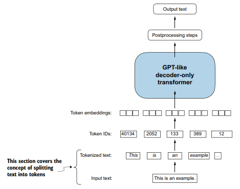

*Figura 2.4. O texto de entrada é dividido em tokens (palavras ou caracteres especiais), convertido em token IDs e transformado em embeddings antes de chegar ao Transformer.*

## Embeddings: convertendo dados em vetores

Um modelo de embedding transforma cada dado em um vetor numérico denso.

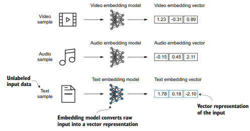

*Figura 2.2. Cada tipo de dado exige seu próprio modelo de embedding. Aqui, amostras de vídeo, áudio e texto viram vetores de três dimensões.*

### Word embeddings

Palavras com significados parecidos ficam próximas no espaço vetorial. Nos LLMs, os embeddings são aprendidos durante o treinamento e podem ter milhares de dimensões (12.288 no GPT-3).

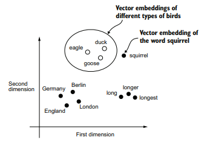

*Figura 2.3. Embeddings de palavras em duas dimensões: palavras relacionadas, como tipos de aves, aparecem agrupadas e distantes de outros conceitos, como países e cidades.*

## Tokenização

Tokenização é o processo de dividir o texto em unidades menores, os **tokens**, que podem ser palavras ou caracteres especiais, como a pontuação.

- **Divisão do texto:** com expressões regulares, o texto é separado nos espaços e na pontuação. A frase `Hello, world. Is this-- a test?` gera 10 tokens.
- **Maiúsculas e minúsculas:** o texto não é convertido para minúsculas; a capitalização ajuda o modelo a distinguir nomes próprios de substantivos comuns e a entender a estrutura das frases.
- **Espaços em branco:** removê-los reduz memória e processamento, mas mantê-los pode ser importante em dados sensíveis à estrutura, como código Python.

## Vocabulário e token IDs

O vocabulário associa cada token único do conjunto de treinamento a um número inteiro, o **token ID**. No conto *The Verdict*, usado no livro, são 1.130 tokens únicos.

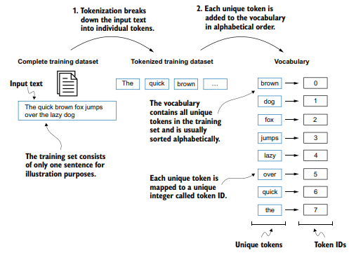

*Figura 2.6. O texto é dividido em tokens, os repetidos são removidos e os únicos são ordenados alfabeticamente e numerados. O exemplo é propositalmente pequeno e não inclui pontuação.*

## Tokenizer: encode e decode

Um tokenizador implementa dois métodos: `encode` (texto → IDs) e `decode` (IDs → texto).

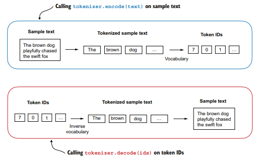

*Figura 2.8. `encode` divide o texto em tokens e os converte em IDs por meio do vocabulário; `decode` converte os IDs de volta em tokens e os concatena em texto natural.*

## Tokens especiais

Uma palavra fora do vocabulário gera erro no tokenizador simples. Por isso o vocabulário é estendido com tokens especiais: `<|unk|>`, para palavras desconhecidas, e `<|endoftext|>`, para separar textos.

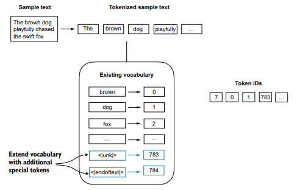

*Figura 2.9. `<|unk|>` representa palavras desconhecidas e `<|endoftext|>` separa duas fontes de texto sem relação entre si. Ambos recebem os últimos token IDs.*

### `<|endoftext|>` entre textos independentes

No treinamento com vários documentos, `<|endoftext|>` é inserido entre eles para indicar que, embora concatenados, os textos não estão relacionados. O GPT usa apenas esse token especial.

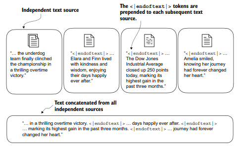

*Figura 2.10. Textos independentes são concatenados com `<|endoftext|>` entre eles, marcando o início ou o fim de cada segmento.*

## Byte Pair Encoding (BPE)

O BPE divide palavras desconhecidas em subpalavras e caracteres, dispensando o `<|unk|>`. É o tokenizador do GPT-2, do GPT-3 e do ChatGPT original, com vocabulário de **50.257 tokens**.

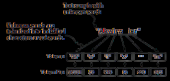

*Figura 2.11. O BPE decompõe palavras desconhecidas em subpalavras e caracteres individuais. Assim, qualquer palavra pode ser processada sem virar um token especial.*

> **Na prática:** o [notebook 01](../pratica/01-tokenizacao.md) compara tokenização por caractere, por palavra e BPE, mede os tokenizadores mais novos (`cl100k_base`, `o200k_base`) e implementa um BPE do zero.

## Janela deslizante (sliding window)

LLMs são pré-treinados prevendo o próximo token. A partir do texto tokenizado, criamos pares de entrada e alvo: o modelo vê os tokens anteriores e não tem acesso ao que vem depois do alvo.

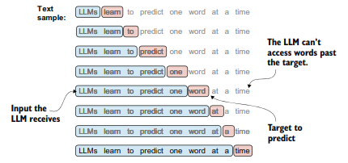

*Figura 2.12. Blocos de entrada (em azul) são extraídos do texto, e o alvo (em vermelho) é a palavra seguinte ao bloco. As palavras posteriores ao alvo ficam ocultas. A tokenização foi omitida para simplificar.*

### Entradas (x) e alvos (y)

Para o treinamento em lote, as entradas são organizadas em um tensor `x` e os alvos em um tensor `y`, que é `x` deslocado em uma posição. No PyTorch, isso é feito com as classes `Dataset` e `DataLoader`.

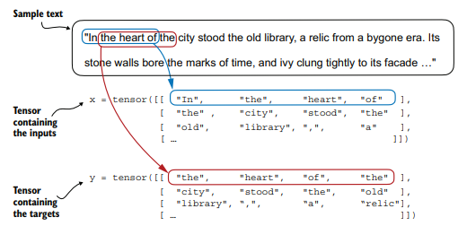

*Figura 2.13. Cada linha de `x` é um contexto de entrada; a linha correspondente de `y` contém os alvos, obtidos ao deslocar a entrada em uma posição.*

### Stride: o passo da janela

O *stride* define quantas posições a janela avança entre um exemplo e o seguinte. Com stride igual ao tamanho da janela não há sobreposição entre os lotes, o que reduz o risco de overfitting.

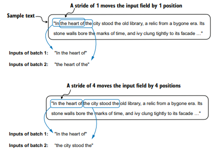

*Figura 2.14. Com stride 1, a janela avança uma posição a cada exemplo; com stride 4, avança quatro e não há sobreposição.*

## Token embeddings: a camada de embedding

A camada de embedding é uma matriz de pesos, inicializada com valores aleatórios e otimizada durante o treinamento. Obter o embedding de um token ID é uma consulta (*lookup*) a uma linha dessa matriz.

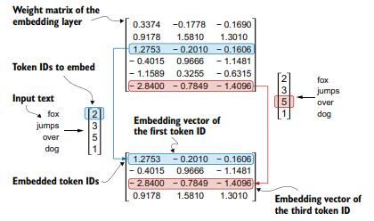

*Figura 2.16. A camada de embedding recupera da matriz de pesos o vetor de cada token ID. O ID 5 corresponde à sexta linha, pois a contagem em Python começa em 0.*

### O mesmo token ID gera sempre o mesmo vetor

A camada de embedding ignora a posição do token na sequência, e o self-attention também não tem noção de ordem. Por isso é necessário adicionar informação de posição.

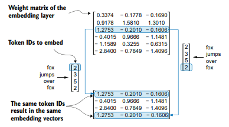

*Figura 2.17. O mesmo token ID produz o mesmo vetor, independentemente de sua posição na sequência.*

## Embeddings posicionais

Podem ser **absolutos**, associados a posições específicas da sequência, ou **relativos**, baseados na distância entre tokens. Os modelos GPT usam embeddings posicionais absolutos, otimizados durante o treinamento.

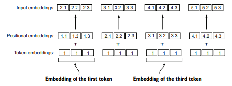

*Figura 2.18. Os embeddings posicionais são somados aos embeddings de token para formar os input embeddings. Têm a mesma dimensão dos embeddings de token (aqui com valor 1 por simplicidade).*

## Input embeddings: o pipeline completo

O texto é dividido em tokens, convertido em token IDs, transformado em token embeddings e combinado com embeddings posicionais, gerando os **input embeddings** que alimentam as camadas principais do LLM.

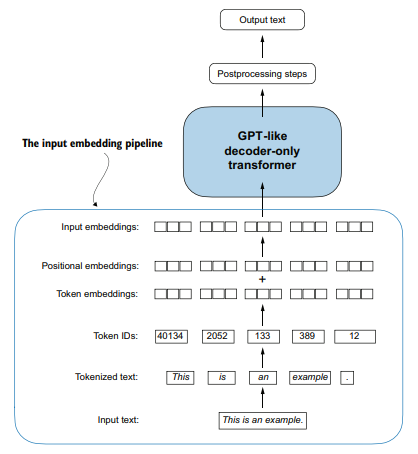

*Figura 2.19. Tokens → token IDs → token embeddings + embeddings posicionais → input embeddings.*

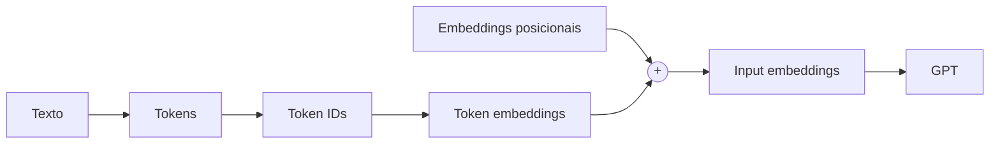

> **Na prática:** o [notebook 01](../pratica/01-tokenizacao.md) monta o `dataloader` com `stride`, cria `tok_emb` e `pos_emb` e mostra quanto a tabela de embeddings cresce com `emb_dim`.
