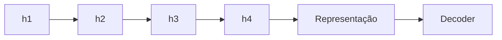
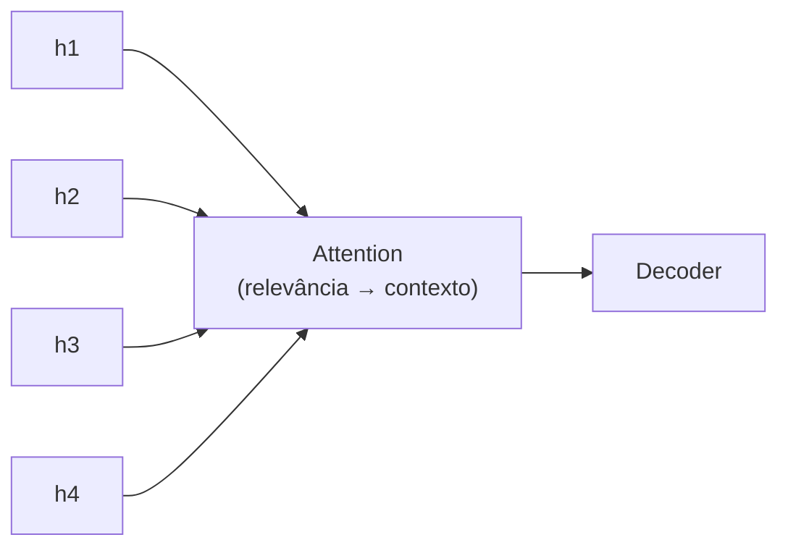
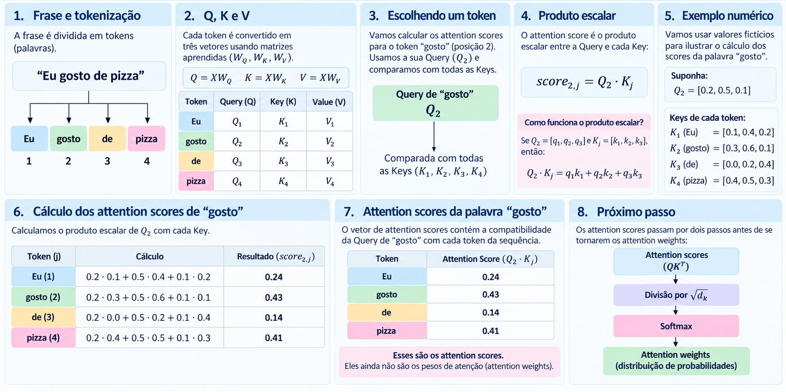
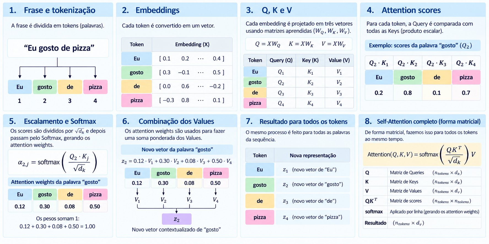
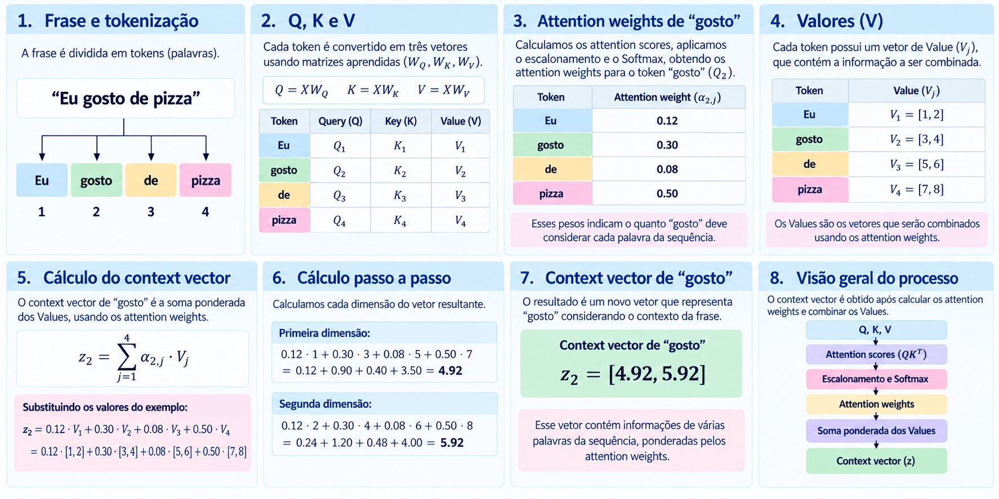
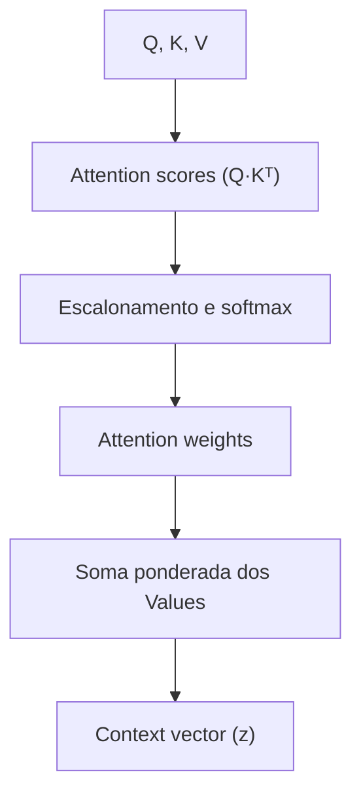
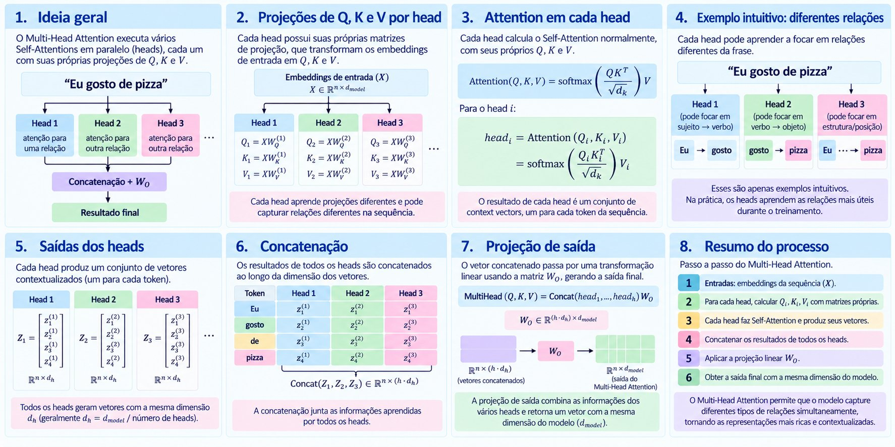

# Cap. 3 · Codificando mecanismos de atenção

A motivação para a atenção, as matrizes Q, K e V, o cálculo dos attention scores, a máscara causal e o multi-head attention, sempre com o mesmo exemplo: a frase *"Eu gosto de pizza"*.

## O problema das sequências longas

Antes dos Transformers, a tradução usava redes recorrentes em arquitetura encoder–decoder:

- **Encoder:** recebe a sequência de entrada e a transforma em uma representação.
- **Decoder:** recebe essa representação e produz a sequência de saída.

**Onde aparece a dificuldade?** Em sequências curtas, comprimir todo o contexto em uma única representação funciona razoavelmente. Em sequências mais longas e complexas, fica difícil preservar informações relevantes de partes distantes.

## Sem e com atenção

Sem atenção, o encoder acumula a informação passo a passo e entrega ao decoder apenas o estado final:



Com atenção, o decoder pode **consultar todos os estados** do encoder, pesando cada um pela sua relevância:



## Attention weights

Para produzir um token de saída, o modelo não precisa considerar todos os tokens de entrada com a mesma intensidade. O **score** indica a compatibilidade entre a Query e cada Key; o **softmax** transforma os scores em pesos normalizados que somam 1.

| Estado | Score | Peso (após softmax) |
|---|---|---|
| h1 | 0.2 | 0.10 |
| h2 | 0.3 | 0.15 |
| h3 | 0.1 | 0.05 |
| h4 | 0.9 | **0.70** |

0.10 + 0.15 + 0.05 + 0.70 = **1.00**: os pesos podem ser lidos como a contribuição relativa de cada elemento. *(Valores ilustrativos.)*

## Query, Key e Value

| | Pergunta que responde | Papel |
|---|---|---|
| **Query (Q)** | O que estou procurando agora? | Pergunta |
| **Key (K)** | Que tipo de informação eu tenho? | Identifica |
| **Value (V)** | Que informação eu vou entregar? | Entrega |

As três vêm dos embeddings de entrada `X`, multiplicados por matrizes aprendidas durante o treinamento:

```text
Q = X · W_Q        K = X · W_K        V = X · W_V
```

`W_Q`, `W_K` e `W_V` são parâmetros treináveis que produzem, respectivamente, Queries, Keys e Values.

## O que é o produto escalar?

O *dot product* é uma operação entre dois vetores que resulta em um único número:

```text
Q_gosto = [0.2, 0.5, 0.1]
K_pizza = [0.4, 0.5, 0.3]

Q_gosto · K_pizza = (0.2 × 0.4) + (0.5 × 0.5) + (0.1 × 0.3)
                  = 0.08 + 0.25 + 0.03 = 0.36
```

Esse 0.36 é o **attention score** entre "gosto" e "pizza". Por que ele indica compatibilidade? A Query representa "o que estou procurando" e a Key "que informação eu tenho": se os dois vetores apontam em direções parecidas, o produto escalar tende a ser maior.

## Attention scores



Para a palavra "gosto" (posição 2), comparamos sua Query `Q₂` com as Keys de todos os tokens:

| Token *j* | Cálculo `Q₂ · Kⱼ` | Score |
|---|---|---|
| Eu | 0.2·0.1 + 0.5·0.4 + 0.1·0.2 | 0.24 |
| gosto | 0.2·0.3 + 0.5·0.6 + 0.1·0.1 | **0.43** |
| de | 0.2·0.0 + 0.5·0.2 + 0.1·0.4 | 0.14 |
| pizza | 0.2·0.4 + 0.5·0.5 + 0.1·0.3 | 0.41 |

Esses ainda são *scores*, não pesos. Antes de virarem **attention weights** eles passam por dois passos: divisão por `√d_k` e softmax.

## Self-attention



1. A frase é tokenizada e cada token vira um embedding.
2. Cada embedding é projetado em Q, K e V.
3. Para cada token, a Query é comparada com todas as Keys (produto escalar).
4. Os scores são divididos por `√d_k` e passam pelo softmax, gerando os pesos (para "gosto": 0.12, 0.30, 0.08, 0.50).
5. Os pesos fazem uma soma ponderada dos Values, gerando o novo vetor contextualizado.
6. O mesmo acontece para todos os tokens ao mesmo tempo, em forma matricial:

```text
Attention(Q, K, V) = softmax( Q·Kᵀ / √d_k ) · V
```

| Matriz | Dimensão |
|---|---|
| Q, K | n_tokens × d_k |
| V | n_tokens × d_v |
| Q·Kᵀ (scores) | n_tokens × n_tokens |
| Resultado | n_tokens × d_v |

## Context vector



O *context vector* de "gosto" é a soma dos Values ponderada pelos attention weights:

```text
z₂ = Σⱼ α₂ⱼ · Vⱼ
   = 0.12·[1, 2] + 0.30·[3, 4] + 0.08·[5, 6] + 0.50·[7, 8]

1ª dimensão: 0.12 + 0.90 + 0.40 + 3.50 = 4.92
2ª dimensão: 0.24 + 1.20 + 0.48 + 4.00 = 5.92

z₂ = [4.92, 5.92]
```

O resultado é um novo vetor que representa "gosto" **considerando o contexto da frase**: ele contém informação de várias palavras, ponderadas pela relevância.



## Máscara causal

Na geração de texto o modelo não pode "olhar o futuro". A máscara causal zera a atenção para tokens posteriores ao atual:

| Sem máscara | Eu | gosto | de | pizza |
|---|---|---|---|---|
| **Eu** | ✓ | ✓ | ✓ | ✓ |
| **gosto** | ✓ | ✓ | ✓ | ✓ |
| **de** | ✓ | ✓ | ✓ | ✓ |
| **pizza** | ✓ | ✓ | ✓ | ✓ |

| Com máscara causal | Eu | gosto | de | pizza |
|---|---|---|---|---|
| **Eu** | ✓ | ✗ | ✗ | ✗ |
| **gosto** | ✓ | ✓ | ✗ | ✗ |
| **de** | ✓ | ✓ | ✓ | ✗ |
| **pizza** | ✓ | ✓ | ✓ | ✓ |

Cada token só enxerga a si mesmo e os anteriores. Por isso, no fine-tuning de classificação, usa-se a saída do **último** token: é o único que "viu" a mensagem inteira (ver [notebook 05](../pratica/05-classificador.md)).

## Multi-head attention



O multi-head attention executa vários self-attentions **em paralelo** (*heads*), cada um com suas próprias projeções de Q, K e V:

1. Cada head *i* tem suas matrizes `W_Q⁽ⁱ⁾`, `W_K⁽ⁱ⁾`, `W_V⁽ⁱ⁾`.
2. Cada head calcula `headᵢ = softmax(Qᵢ·Kᵢᵀ / √d_k) · Vᵢ`.
3. Heads diferentes podem aprender relações diferentes (sujeito → verbo, verbo → objeto, posição…). Na prática, os heads aprendem as relações mais úteis durante o treinamento.
4. Todos os heads geram vetores de mesma dimensão `d_h` (em geral `d_h = d_model / nº de heads`).
5. As saídas são **concatenadas** e passam por uma projeção linear `W_O`:

```text
MultiHead(Q, K, V) = Concat(head₁, …, head_h) · W_O
```

O resultado volta à dimensão do modelo (`d_model`), com representações mais ricas e contextualizadas.

> **Na prática:** o [notebook 02](../pratica/02-atencao.md) constrói o `MultiHeadAttention`, testa outros scores (aditivo, cosseno), varia o número de heads e mostra os heatmaps das 12 heads do GPT-2.

## O caminho de um token

Para ver tudo isso em movimento, do texto à previsão do próximo token, abra a demonstração interativa: [O caminho de um token](https://ll-ms-from-scratch-gray.vercel.app/web/v4/index.html).
