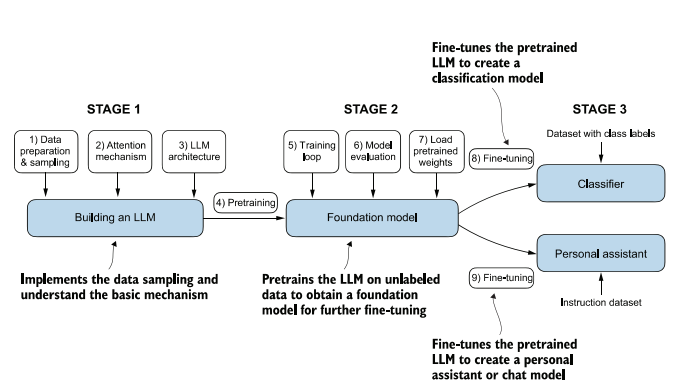

# Visão geral

Vamos explorar os principais conceitos por trás dos **Large Language Models (LLMs)**, desde seus fundamentos até a construção de um modelo de linguagem do zero. O fio condutor é o livro *Build a Large Language Model (From Scratch)*, de Sebastian Raschka: cada capítulo constrói uma peça que é usada no seguinte, até chegarmos a um GPT-2 completo, pré-treinado e ajustado.

## Roteiro

| Etapa | Tema | Onde ver |
|---|---|---|
| Cap. 1 | Compreendendo os grandes modelos de linguagem | [Teoria](01-compreendendo-llms.md) |
| Cap. 2 | Trabalhando com dados de texto | [Teoria](02-dados-de-texto.md) · [Notebook 01](../pratica/01-tokenizacao.md) |
| Cap. 3 | Codificando mecanismos de atenção | [Teoria](03-mecanismos-de-atencao.md) · [Notebook 02](../pratica/02-atencao.md) |
| Cap. 4 | Implementando um GPT do zero para gerar texto | [Notebook 03](../pratica/03-gpt-e-geracao.md) |
| Cap. 5 | Pré-treinamento com dados não rotulados | [Notebook 04](../pratica/04-pre-treino.md) |
| Cap. 6 | Fine-tuning para classificação | [Notebook 05](../pratica/05-classificador.md) |
| Cap. 7 | Fine-tuning para seguir instruções | [Notebook 06](../pratica/06-assistente.md) |
| Extra | Por que esses parâmetros? Do GPT-2 ao GPT-3, Llama e Claude | [Notebook 07](../pratica/07-parametros.md) |

A seção **Teoria** acompanha os slides da apresentação (capítulos 1 a 3). A seção **Prática** traz os notebooks da aula, com o código e as saídas de cada experimento.

## Os três estágios

1. **Construção do LLM:** preparação e amostragem dos dados, mecanismo de atenção e implementação da arquitetura.
2. **Modelo fundacional:** loop de treinamento, avaliação e carregamento de pesos pré-treinados publicamente disponíveis.
3. **Fine-tuning:** ajuste do modelo pré-treinado para virar um classificador de textos (dados rotulados) ou um assistente pessoal (dados de instruções).

## Slides da apresentação

[Build a Large Language Model (From Scratch): capítulos 1 a 3](pdfs/build-a-llm-capitulos-1-3.pdf)

## Material de apoio

- Livro: Sebastian Raschka, *Build a Large Language Model (From Scratch)*, Manning, 2024.
- Código da aula: [victorflll/LLMs-from-scratch, pasta `30-09`](https://github.com/victorflll/LLMs-from-scratch/tree/main/30-09).
- Demonstração interativa: [O caminho de um token](https://ll-ms-from-scratch-gray.vercel.app/web/v4/index.html).
