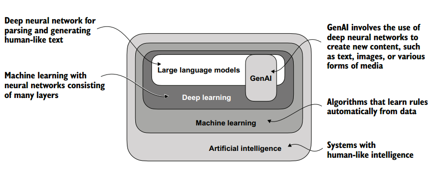
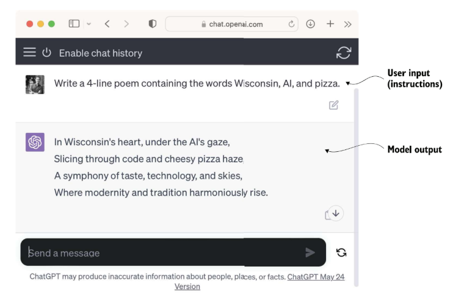
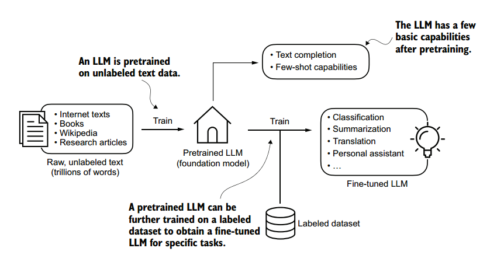
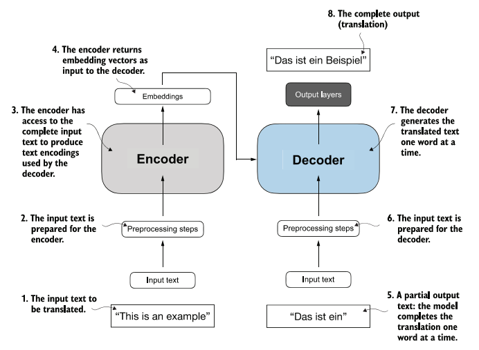
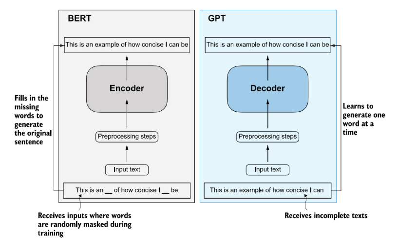
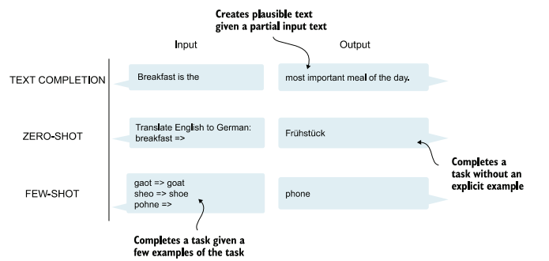
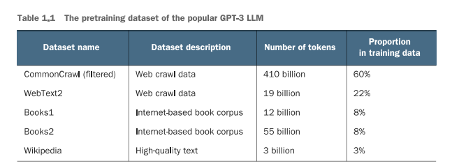
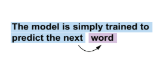
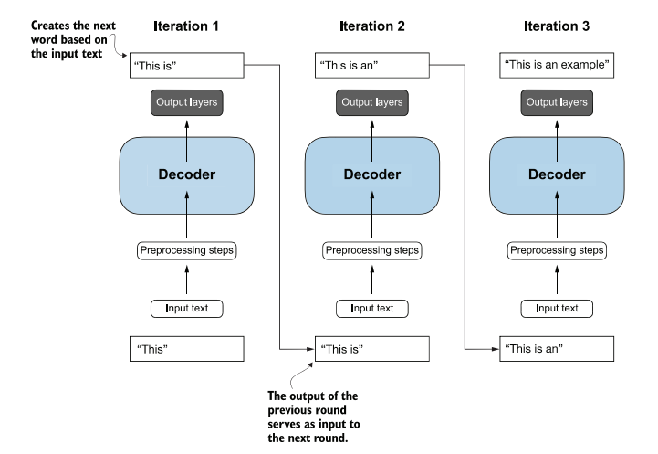
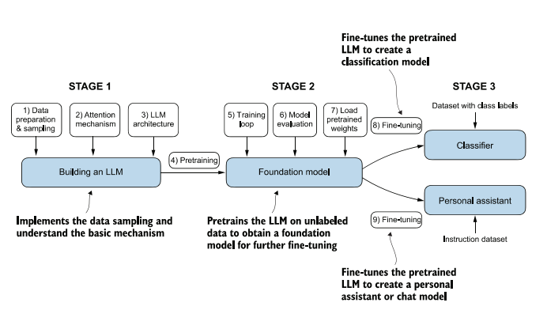

# Ch. 1 · Understanding large language models

The fundamental concepts behind LLMs, the Transformer architecture, and a step-by-step plan for coding an LLM from scratch.

**Main topics**

- High-level explanations of the fundamental concepts behind LLMs.
- Insights into the Transformer architecture, from which LLMs are derived.
- A plan for building an LLM from scratch.

## Introduction to LLMs

- **An evolution of NLP:** LLMs are an evolution of traditional Natural Language Processing techniques, expanding what machines can do with human language.
- **Broader language capabilities:** earlier models were usually built for specific tasks; LLMs perform many language tasks with a single model.
- **Technological basis:** this leap comes mainly from the Transformer architecture and from training on very large volumes of text.

## What is an LLM?

A **Large Language Model** is a deep neural network trained on large amounts of text to understand and generate natural language. "Large" refers both to the number of parameters and to the amount of training data.

| Concept | Definition |
|---|---|
| **Generative AI** | LLMs are a form of generative AI (GenAI), able to create text, images, and other media. |
| **Deep Learning** | Neural networks with many layers that learn automatically from data, without manual feature extraction. |
| **Machine Learning** | Algorithms that learn rules from data, making predictions and decisions without being explicitly programmed. |

*Figure 1.1. LLMs are a specific application of deep learning, which is itself a specialized area of machine learning (neural networks with many layers). LLMs sit within deep learning and can be part of generative AI applications.*

## Applications of LLMs

LLMs automate almost any task that involves analyzing and generating text:

- **Translation and text generation:** machine translation, original writing, document summarization, and sentiment analysis.
- **Virtual assistants:** sophisticated chatbots such as ChatGPT and Gemini augment search engines and answer complex queries.
- **Knowledge retrieval:** searching technical documents, summarizing long pages, and answering questions in fields like medicine and law.

*Figure 1.2. LLM interfaces let users and AI systems communicate in natural language: the user gives instructions that steer the generation of different kinds of content.*

## Stages of building and using LLMs

- **Building the LLM:** data preparation and sampling, the attention mechanism, and implementing the architecture for pretraining.
- **Foundation model:** training loop, model evaluation, and loading publicly available pretrained weights to obtain a base model.
- **Fine-tuning:** adapting the pretrained LLM into a text classifier (with labeled data) or a personal assistant (with instruction data).

*Figure 1.3. Pretraining an LLM means predicting the next token over large text datasets. The pretrained model can then be fine-tuned on a smaller, labeled dataset.*

## Introducing the Transformer architecture

The Transformer architecture, introduced in 2017, changed how language models are built by processing the contextual relationships between parts of a text much more efficiently. It is the basis of many modern LLMs.

- **Encoder–decoder:** the *encoder* processes the input text and produces contextualized numeric representations; the *decoder* uses them to produce the output text.
- **Self-attention:** lets the model weigh which tokens are most relevant to each other, capturing relationships and dependencies across the sequence.
- **BERT and GPT:** the architecture gave rise to BERT (encoder-based, focused on understanding text) and GPT (decoder-based, focused on generating text).
- **Transformer vs. LLM:** a Transformer is a neural network *architecture*; an LLM is a *language model* trained on huge amounts of data. Many current LLMs are Transformers, but the two terms are not synonyms.

*Figure 1.4. The original Transformer, a deep learning model for language translation. (a) The encoder processes the input text and produces an embedding, a numeric representation that captures many aspects of the text; (b) the decoder generates the translated text one word at a time. Here the decoder only has to generate the final word, "Beispiel", completing the translation of "This is an example" into "Das ist ein…".*

*Figure 1.5. On the left, the encoder exemplifies BERT-like LLMs, which predict masked words and are mainly used for tasks like text classification. On the right, the decoder represents GPT-like LLMs, designed for generative tasks.*

### Zero-shot and few-shot

*Figure 1.6. Beyond text completion, GPT-like LLMs can solve many tasks from their input alone, without retraining, fine-tuning, or architecture changes. Providing examples of the task along with the input is the **few-shot** setting; doing the task without any example is the **zero-shot** setting.*

## Using large datasets

LLMs are trained on large volumes of text covering many topics and languages. These datasets, which can contain billions of words, let the model learn the patterns and relationships of language. GPT-3 illustrates the scale and diversity of such datasets.

*Table 1.1. Number of tokens per data source. A token is the unit of text the model processes; the token count roughly equals the number of words and punctuation marks in the text.*

## A closer look at the GPT architecture

GPT grew with more parameters and more training data, which enabled tasks such as translation and classification. Fine-tuning it on instructions led to ChatGPT.

*Figure 1.7. In the next-word pretraining task of GPT models, the system learns to predict the next word in a sentence by looking at the words before it. This teaches how words and phrases usually relate, forming a foundation that transfers to many other tasks.*

*Figure 1.8. GPT uses only the decoder part of the original Transformer. It processes text in one direction, left to right, and generates text iteratively, one word at a time.*

GPT-based architectures scaled up the original Transformer. Newer models such as Llama keep the same core principles, which is why understanding GPT is essential.

## Building an LLM

*Figure 1.9. The three stages: implementing the LLM architecture and the data preparation process (stage 1); pretraining the LLM to create a foundation model (stage 2); and fine-tuning the foundation model into a personal assistant or text classifier (stage 3).*

> **In practice:** stage 1 corresponds to notebooks [01 · Tokenization](../practice/01-tokenization.md), [02 · Attention](../practice/02-attention.md) and [03 · GPT and generation](../practice/03-gpt-and-generation.md); stage 2 to [04 · Pretraining](../practice/04-pretraining.md); stage 3 to [05 · Classifier](../practice/05-classifier.md) and [06 · Assistant](../practice/06-assistant.md).
