# Ch. 2 · Working with text data

How to turn raw text into numeric input for an LLM: tokenization, vocabulary, embeddings, and data sampling.

**Main topics**

- Preparing text for training large language models.
- Splitting text into word and subword tokens.
- *Byte Pair Encoding* (BPE) as a more advanced way of tokenizing text.
- Sampling training examples with a sliding-window approach.
- Converting tokens into vectors that feed into the LLM.

## Preparing text for the LLM

Before training, raw text goes through three preprocessing steps: **tokenization**, conversion into **token IDs**, and creation of **embeddings**.

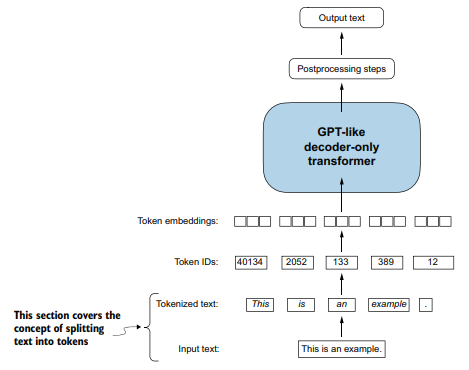

*Figure 2.4. The input text is split into tokens (words or special characters), converted into token IDs, and turned into embeddings before reaching the Transformer.*

## Embeddings: turning data into vectors

An embedding model turns each piece of data into a dense numeric vector.

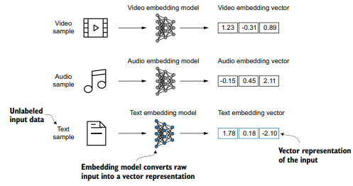

*Figure 2.2. Each data type needs its own embedding model. Here, video, audio, and text samples become three-dimensional vectors.*

### Word embeddings

Words with similar meanings sit close together in vector space. In LLMs, embeddings are learned during training and can have thousands of dimensions (12,288 in GPT-3).

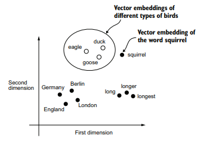

*Figure 2.3. Word embeddings in two dimensions: related words, such as types of birds, cluster together, far from other concepts such as countries and cities.*

## Tokenization

Tokenization splits text into smaller units, the **tokens**, which can be words or special characters such as punctuation.

- **Splitting the text:** with regular expressions, the text is split on whitespace and punctuation. The sentence `Hello, world. Is this-- a test?` yields 10 tokens.
- **Upper and lower case:** the text is not lowercased; capitalization helps the model tell proper nouns from common nouns and understand sentence structure.
- **Whitespace:** removing it saves memory and compute, but keeping it can matter for structure-sensitive data such as Python code.

## Vocabulary and token IDs

The vocabulary maps each unique token in the training set to an integer, the **token ID**. The short story *The Verdict*, used in the book, has 1,130 unique tokens.

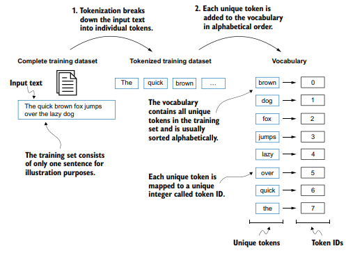

*Figure 2.6. The text is split into tokens, duplicates are removed, and the unique tokens are sorted alphabetically and numbered. The example is deliberately tiny and leaves out punctuation.*

## Tokenizer: encode and decode

A tokenizer implements two methods: `encode` (text → IDs) and `decode` (IDs → text).

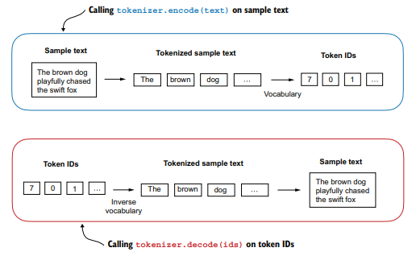

*Figure 2.8. `encode` splits the text into tokens and maps them to IDs through the vocabulary; `decode` maps the IDs back into tokens and joins them into natural text.*

## Special context tokens

A word outside the vocabulary makes the simple tokenizer fail. That is why the vocabulary is extended with special tokens: `<|unk|>` for unknown words and `<|endoftext|>` to separate texts.

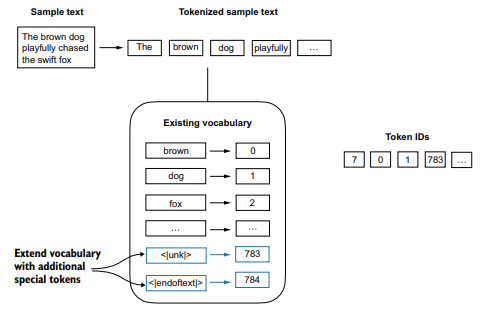

*Figure 2.9. `<|unk|>` stands for unknown words and `<|endoftext|>` separates two unrelated text sources. Both get the last token IDs.*

### `<|endoftext|>` between independent texts

When training on several documents, `<|endoftext|>` is inserted between them to signal that, although concatenated, the texts are unrelated. GPT uses only this special token.

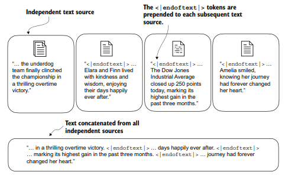

*Figure 2.10. Independent texts are concatenated with `<|endoftext|>` between them, marking the start or end of each segment.*

## Byte Pair Encoding (BPE)

BPE breaks unknown words into subwords and characters, so `<|unk|>` is no longer needed. It is the tokenizer of GPT-2, GPT-3, and the original ChatGPT, with a vocabulary of **50,257 tokens**.

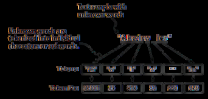

*Figure 2.11. BPE breaks unknown words into subwords and individual characters, so any word can be processed without being replaced by a special token.*

> **In practice:** [notebook 01](../practice/01-tokenization.md) compares character-level, word-level and BPE tokenization, measures newer tokenizers (`cl100k_base`, `o200k_base`), and implements BPE from scratch.

## Sliding window

LLMs are pretrained by predicting the next token. From the tokenized text we build input–target pairs: the model sees the previous tokens and has no access to anything after the target.

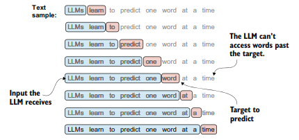

*Figure 2.12. Input chunks (blue) are extracted from the text, and the target (red) is the word that follows the chunk. Words after the target are hidden during training. Tokenization is omitted for simplicity.*

### Inputs (x) and targets (y)

For batched training, inputs are arranged in a tensor `x` and targets in a tensor `y`, which is `x` shifted by one position. In PyTorch this is done with the `Dataset` and `DataLoader` classes.

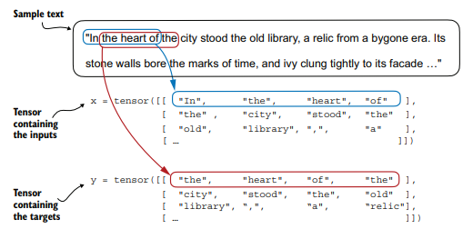

*Figure 2.13. Each row of `x` is an input context; the matching row of `y` holds the targets, obtained by shifting the input by one position.*

### Stride: the step of the window

The *stride* sets how many positions the window moves between one example and the next. With a stride equal to the window size there is no overlap between batches, which reduces the risk of overfitting.

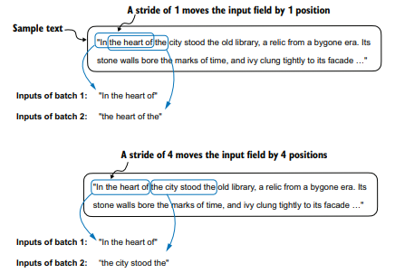

*Figure 2.14. With stride 1 the window moves one position per example; with stride 4 it moves four and there is no overlap.*

## Token embeddings: the embedding layer

The embedding layer is a weight matrix, initialized with random values and optimized during training. Getting the embedding of a token ID is a *lookup* of one row of that matrix.

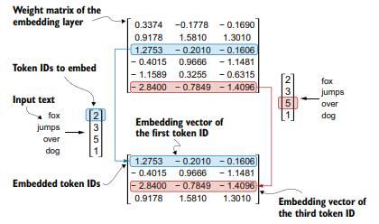

*Figure 2.16. The embedding layer retrieves the vector for each token ID from the weight matrix. Token ID 5 maps to the sixth row, since Python counts from 0.*

### The same token ID always gives the same vector

The embedding layer ignores the token's position in the sequence, and self-attention has no notion of order either. That is why position information has to be added.

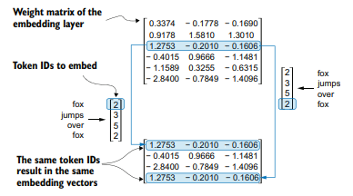

*Figure 2.17. The same token ID produces the same embedding vector regardless of its position in the input sequence.*

## Positional embeddings

They can be **absolute**, tied to specific positions in the sequence, or **relative**, based on the distance between tokens. GPT models use absolute positional embeddings that are optimized during training.

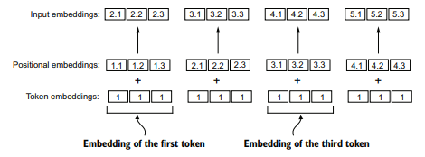

*Figure 2.18. Positional embeddings are added to token embeddings to form the input embeddings. They have the same dimension as the token embeddings (shown here with value 1 for simplicity).*

## Input embeddings: the full pipeline

Text is split into tokens, converted into token IDs, turned into token embeddings, and combined with positional embeddings, giving the **input embeddings** that feed the core layers of the LLM.

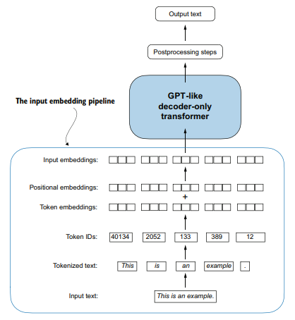

*Figure 2.19. Tokens → token IDs → token embeddings + positional embeddings → input embeddings.*

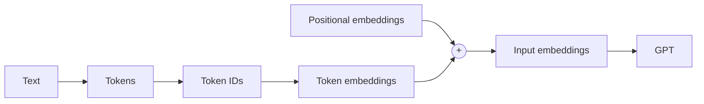

> **In practice:** [notebook 01](../practice/01-tokenization.md) builds the `dataloader` with `stride`, creates `tok_emb` and `pos_emb`, and shows how the embedding table grows with `emb_dim`.
