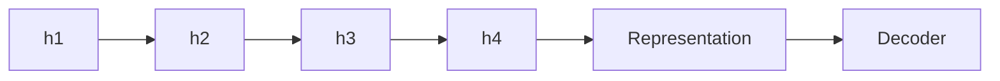
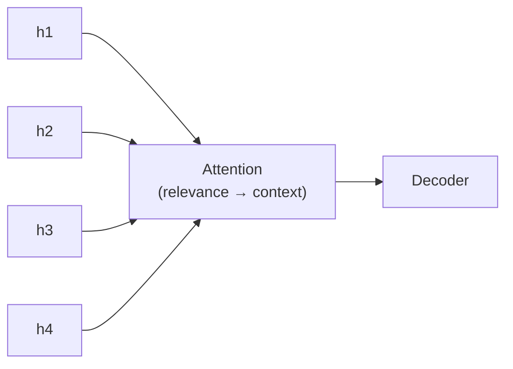
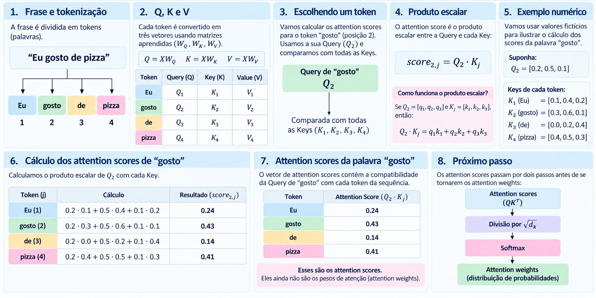
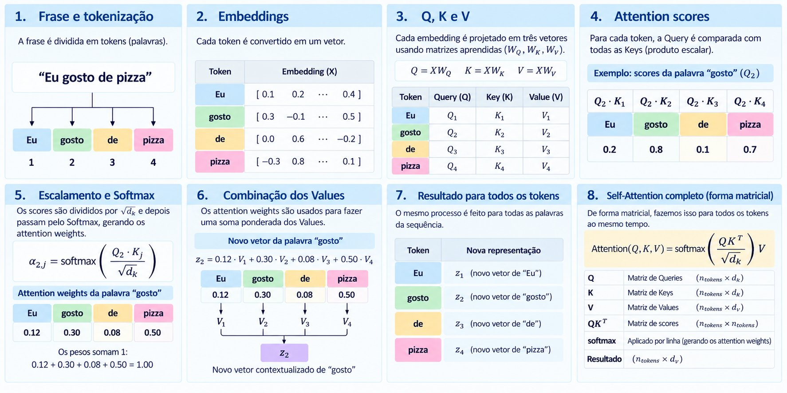
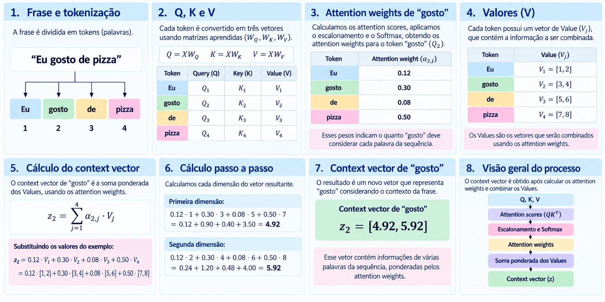
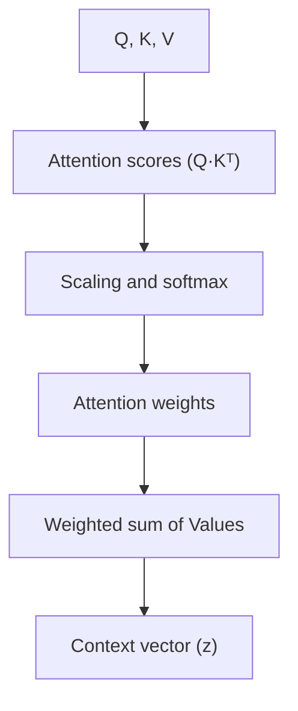
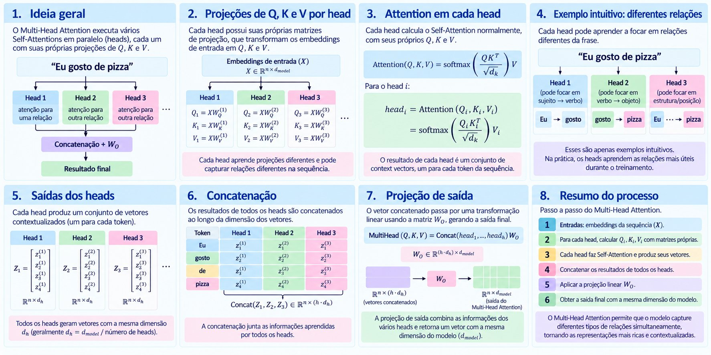

# Ch. 3 · Coding attention mechanisms

The motivation for attention, the Q, K and V matrices, computing attention scores, the causal mask, and multi-head attention, always with the same example: the Portuguese sentence *"Eu gosto de pizza"* ("I like pizza"; *gosto* = "like").

> The infographics on this page come from the presentation and keep their original Portuguese labels.

## The problem with modeling long sequences

Before Transformers, translation used recurrent networks in an encoder–decoder setup:

- **Encoder:** reads the input sequence and turns it into a representation.
- **Decoder:** takes that representation and produces the output sequence.

**Where does it break down?** For short sequences, squeezing all the context into a single representation works reasonably well. For longer, more complex sequences, it becomes hard to keep relevant information from distant parts of the input.

## Without and with attention

Without attention, the encoder accumulates information step by step and hands the decoder only the final state:



With attention, the decoder can **look at every encoder state**, weighting each one by its relevance:



## Attention weights

To produce one output token, the model does not need to consider every input token equally. The **score** measures how compatible the Query is with each Key; **softmax** turns the scores into normalized weights that sum to 1.

| State | Score | Weight (after softmax) |
|---|---|---|
| h1 | 0.2 | 0.10 |
| h2 | 0.3 | 0.15 |
| h3 | 0.1 | 0.05 |
| h4 | 0.9 | **0.70** |

0.10 + 0.15 + 0.05 + 0.70 = **1.00**: the weights can be read as the relative contribution of each element. *(Illustrative values.)*

## Query, Key and Value

| | Question it answers | Role |
|---|---|---|
| **Query (Q)** | What am I looking for right now? | Asks |
| **Key (K)** | What kind of information do I have? | Identifies |
| **Value (V)** | What information will I hand over? | Delivers |

All three come from the input embeddings `X`, multiplied by matrices learned during training:

```text
Q = X · W_Q        K = X · W_K        V = X · W_V
```

`W_Q`, `W_K` and `W_V` are trainable parameters that produce the Queries, Keys and Values, respectively.

## What is a dot product?

The *dot product* is an operation between two vectors that yields a single number:

```text
Q_gosto = [0.2, 0.5, 0.1]
K_pizza = [0.4, 0.5, 0.3]

Q_gosto · K_pizza = (0.2 × 0.4) + (0.5 × 0.5) + (0.1 × 0.3)
                  = 0.08 + 0.25 + 0.03 = 0.36
```

That 0.36 is the **attention score** between "gosto" and "pizza". Why does it signal compatibility? The Query represents "what am I looking for" and the Key "what information do I have": if the two vectors point in similar directions, the dot product tends to be larger.

## Attention scores



For the word "gosto" (position 2), we compare its Query `Q₂` with the Keys of every token:

| Token *j* | Computation `Q₂ · Kⱼ` | Score |
|---|---|---|
| Eu | 0.2·0.1 + 0.5·0.4 + 0.1·0.2 | 0.24 |
| gosto | 0.2·0.3 + 0.5·0.6 + 0.1·0.1 | **0.43** |
| de | 0.2·0.0 + 0.5·0.2 + 0.1·0.4 | 0.14 |
| pizza | 0.2·0.4 + 0.5·0.5 + 0.1·0.3 | 0.41 |

These are still *scores*, not weights. Before becoming **attention weights** they go through two steps: division by `√d_k` and softmax.

## Self-attention



1. The sentence is tokenized and each token becomes an embedding.
2. Each embedding is projected into Q, K and V.
3. For each token, the Query is compared with every Key (dot product).
4. The scores are divided by `√d_k` and passed through softmax, giving the weights (for "gosto": 0.12, 0.30, 0.08, 0.50).
5. The weights form a weighted sum of the Values, producing the new context-aware vector.
6. The same happens for all tokens at once, in matrix form:

```text
Attention(Q, K, V) = softmax( Q·Kᵀ / √d_k ) · V
```

| Matrix | Shape |
|---|---|
| Q, K | n_tokens × d_k |
| V | n_tokens × d_v |
| Q·Kᵀ (scores) | n_tokens × n_tokens |
| Result | n_tokens × d_v |

## Context vector



The *context vector* for "gosto" is the sum of the Values weighted by the attention weights:

```text
z₂ = Σⱼ α₂ⱼ · Vⱼ
   = 0.12·[1, 2] + 0.30·[3, 4] + 0.08·[5, 6] + 0.50·[7, 8]

1st dimension: 0.12 + 0.90 + 0.40 + 3.50 = 4.92
2nd dimension: 0.24 + 1.20 + 0.48 + 4.00 = 5.92

z₂ = [4.92, 5.92]
```

The result is a new vector that represents "gosto" **in the context of the sentence**: it carries information from several words, weighted by relevance.



## Causal mask

When generating text, the model must not "see the future". The causal mask zeroes out attention to tokens after the current one:

| No mask | Eu | gosto | de | pizza |
|---|---|---|---|---|
| **Eu** | ✓ | ✓ | ✓ | ✓ |
| **gosto** | ✓ | ✓ | ✓ | ✓ |
| **de** | ✓ | ✓ | ✓ | ✓ |
| **pizza** | ✓ | ✓ | ✓ | ✓ |

| Causal mask | Eu | gosto | de | pizza |
|---|---|---|---|---|
| **Eu** | ✓ | ✗ | ✗ | ✗ |
| **gosto** | ✓ | ✓ | ✗ | ✗ |
| **de** | ✓ | ✓ | ✓ | ✗ |
| **pizza** | ✓ | ✓ | ✓ | ✓ |

Each token only sees itself and the tokens before it. That is why classification fine-tuning uses the output of the **last** token: it is the only one that has "seen" the whole message (see [notebook 05](../practice/05-classifier.md)).

## Multi-head attention



Multi-head attention runs several self-attentions **in parallel** (*heads*), each with its own Q, K and V projections:

1. Each head *i* has its own matrices `W_Q⁽ⁱ⁾`, `W_K⁽ⁱ⁾`, `W_V⁽ⁱ⁾`.
2. Each head computes `headᵢ = softmax(Qᵢ·Kᵢᵀ / √d_k) · Vᵢ`.
3. Different heads can learn different relationships (subject → verb, verb → object, position…). In practice, heads learn whatever relationships are most useful during training.
4. All heads produce vectors of the same size `d_h` (usually `d_h = d_model / number of heads`).
5. The outputs are **concatenated** and go through a linear projection `W_O`:

```text
MultiHead(Q, K, V) = Concat(head₁, …, head_h) · W_O
```

The result goes back to the model dimension (`d_model`), with richer, more contextual representations.

> **In practice:** [notebook 02](../practice/02-attention.md) builds `MultiHeadAttention`, tries other scores (additive, cosine), varies the number of heads, and shows heatmaps of GPT-2's 12 heads.

## The path of a token

To see all of this in motion, from text to next-token prediction, open the interactive demo: [The path of a token](https://ll-ms-from-scratch-gray.vercel.app/web/v4/index.html).
