# Ch. 6 · Fine-tuning for classification

How to turn a pretrained LLM into a text classifier: preparing a labeled dataset, replacing the output layer, choosing which layers to train, and evaluating the result on a spam-detection task.

**Main topics**

- The two main kinds of fine-tuning: instruction and classification.
- Preparing a labeled dataset: balancing, splitting, and padding.
- Replacing the output head of a pretrained GPT with a classification head.
- Choosing which layers to train, and why only the last token is used.
- Classification loss and accuracy, the training loop, and using the model on new text.

## Where fine-tuning fits

Building an LLM happens in three stages. Chapters 2 to 5 coded the architecture, pretrained it, and loaded OpenAI's weights; this chapter covers step 8 of stage 3: fine-tuning the pretrained model as a **classifier**.

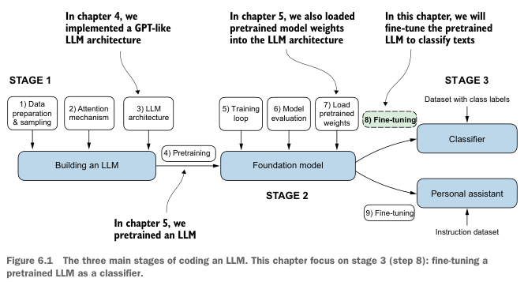

*Figure 6.1. The three stages of coding an LLM. The foundation model from stage 2 is now fine-tuned on labeled data to classify texts.*

## Instruction vs. classification fine-tuning

The two most common ways to fine-tune a language model are:

- **Instruction fine-tuning:** the model is trained on many tasks written as natural-language instructions, so it learns to follow prompts. It is the subject of chapter 7.
- **Classification fine-tuning:** the model is trained to pick one label from a fixed set, such as "spam" and "not spam". It is the subject of this chapter.

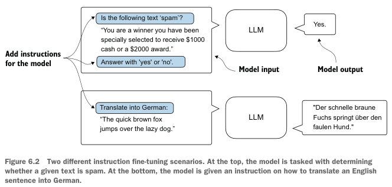

*Figure 6.2. An instruction fine-tuned model receives the task inside the prompt (check for spam, translate into German) and answers in free text.*

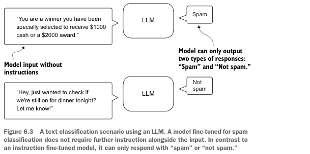

*Figure 6.3. A classification fine-tuned model needs no instruction: it receives only the message and can only answer with one of the classes it was trained on.*

| | Instruction fine-tuning | Classification fine-tuning |
|---|---|---|
| **Input** | instruction + text | text only |
| **Output** | free text | one of a fixed set of labels |
| **Data and compute** | more | less |
| **Flexibility** | general-purpose assistant | specialized in its classes |
| **In this course** | [notebook 06](../practice/06-assistant.md) | [notebook 05](../practice/05-classifier.md) |

A specialized model is easier to build than a generalist one: classification fine-tuning is the right choice when the task is to sort data into predefined categories, such as sentiment analysis or spam detection.

## The three-stage process

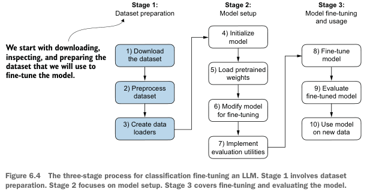

*Figure 6.4. Classification fine-tuning in three stages: prepare the dataset, set up the model (load the pretrained weights, modify it, implement the evaluation), then fine-tune, evaluate, and use it on new data.*

## Preparing the dataset

The example task is detecting spam in text messages, using the **SMS Spam Collection** dataset (UCI): 5,572 messages, each labeled "ham" (not spam) or "spam".

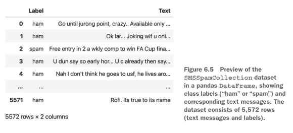

*Figure 6.5. Each row holds a class label ("ham" or "spam") and the text of the message.*

- **Balancing:** the data has 4,825 "ham" messages and only 747 "spam". A model that always answered "not spam" would already reach about 87% accuracy without learning anything. To avoid that, "ham" is undersampled down to 747 messages, giving a balanced set of 1,494.
- **Numeric labels:** "ham" becomes 0 and "spam" becomes 1, the integers the model will predict.
- **Split:** 70% for training, 10% for validation (to monitor training), and 20% for testing (messages the model never sees during training).

## Creating data loaders: padding

The messages have different lengths, but a batch has to be a rectangular tensor. There are two options: truncate every message to the length of the shortest one, which throws content away, or **pad** every message to the length of the longest one, which keeps everything. The book pads, using the `<|endoftext|>` token (ID **50256**) as the padding token.

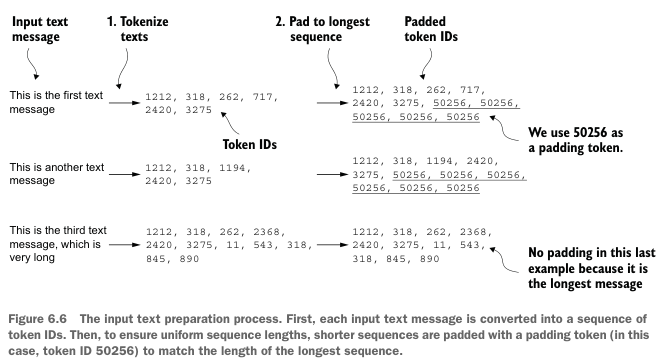

*Figure 6.6. Each message is tokenized; the shorter sequences are then padded with token ID 50256 until they match the longest one.*

The longest message in the training set has **120 tokens**, so every message becomes a sequence of 120 token IDs. The validation and test sets reuse that same length, truncating anything longer. With batches of 8, each batch is an `8 × 120` tensor of inputs plus 8 class labels.

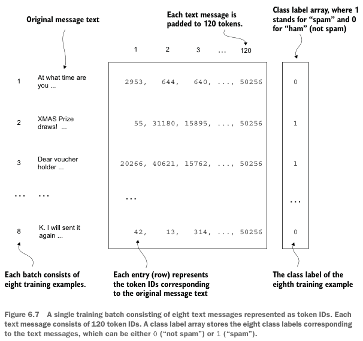

*Figure 6.7. A training batch: eight messages as rows of 120 token IDs, and an array with the class label of each one (1 = spam, 0 = ham).*

Unlike pretraining, the target is no longer the next token: it is a **single class label per message**.

> **In practice:** [notebook 05](../practice/05-classifier.md) downloads, balances and splits the dataset, and builds `SpamDataset` with `max_length = 120` (1,045 training, 149 validation, and 300 test messages).

## Initializing the model with pretrained weights

The model is GPT-2 small (124M parameters), loaded with OpenAI's pretrained weights exactly as in chapter 5. Before changing anything, it is worth checking whether the pretrained model can already classify spam through a prompt. It cannot: the base model only **continues text**, and it was never trained to follow instructions. That is why the architecture has to be adapted.

## Adding a classification head

The original output layer maps the 768 hidden units of the last layer to the **50,257** tokens of the vocabulary. For spam classification it is replaced by a new linear layer that maps the same 768 units to just **2** outputs, one for "not spam" and one for "spam".

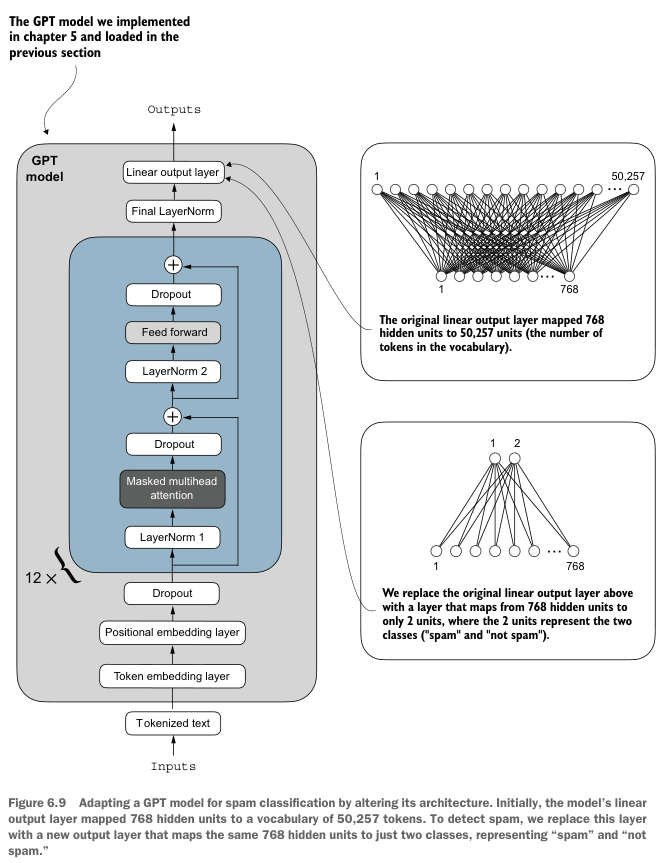

*Figure 6.9. The architecture stays the same up to the last layer: the 768 → 50,257 output layer is swapped for a 768 → 2 layer, one output per class.*

Two outputs are used instead of a single one so that the same recipe works for any number of classes: classifying sentiment, topics, or intent only changes the size of this layer.

### Which layers to train

The model is already pretrained, so there is no need to fine-tune every layer. The lower layers capture basic language structure that applies to almost any task, while the last layers hold more task-specific features. Training only the last layers is often enough, and it is much cheaper.

1. **Freeze** the whole model: every parameter becomes non-trainable (`requires_grad = False`).
2. **Replace** `out_head` with the new 768 → 2 layer, which is trainable by default.
3. **Unfreeze** the last Transformer block and the final `LayerNorm`, so the model can adjust a little to the new task.

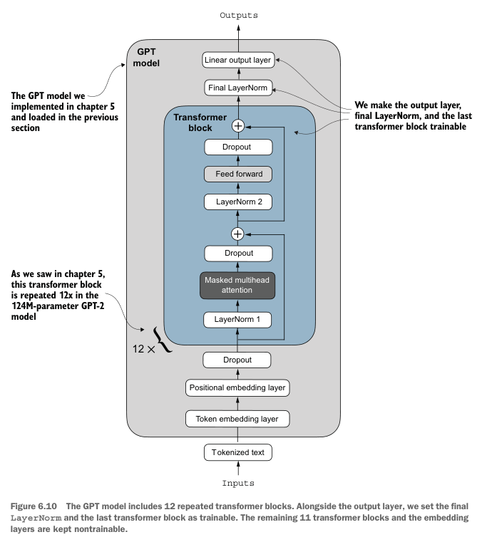

*Figure 6.10. Of the 12 Transformer blocks, only the last one is trained, together with the final LayerNorm and the new output layer. The other 11 blocks and the embedding layers stay frozen.*

> **In practice:** [notebook 05](../practice/05-classifier.md) freezes the model, swaps `out_head` for `Linear(768, 2)`, and compares training only the head, the head plus the last block, and the whole model: the chosen setup trains 7,090,946 of 124,441,346 parameters (about 6%).

## Why only the last token is used

With the new head, the model still returns one output per input token, now with 2 values each instead of 50,257: a message of 4 tokens gives a `4 × 2` output. But a classifier has to give **one** answer per message.

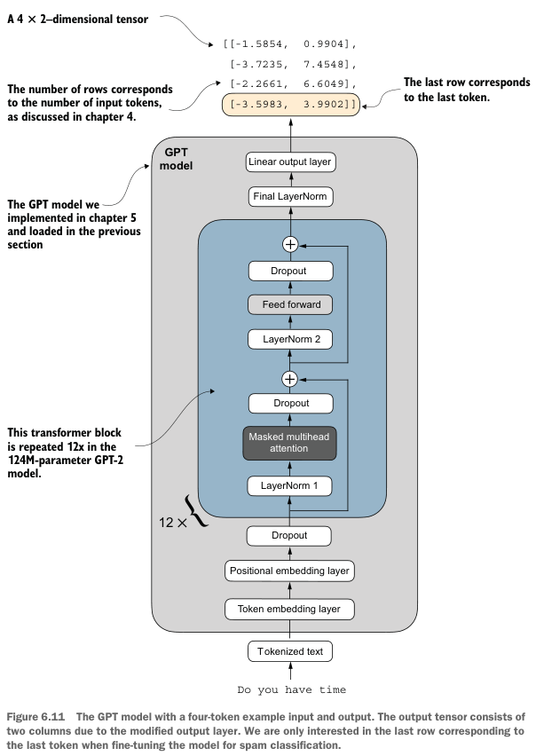

*Figure 6.11. A four-token input produces a 4 × 2 output, one row per token. Only the last row is used for classification.*

The answer comes from the **causal attention mask** seen in chapter 3: each token can only attend to itself and to the tokens before it. So the last token is the only one that has seen the whole message, and its output carries the most information about it.

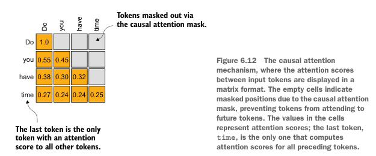

*Figure 6.12. In the causal attention matrix, the last token is the only one with an attention score for every other token, which makes it the natural choice for classifying the whole input.*

Because of padding, the last position is often a padding token (ID 50256) rather than the last real word. That still works: the padding token sits after the message, so it can attend to all of it.

## Classification loss and accuracy

To turn the output into a class label, the 2 values of the last token are converted into probabilities with `softmax`, and `argmax` returns the index of the larger one: 0 means "not spam" and 1 means "spam". Since `softmax` does not change which value is largest, `argmax` can be applied directly to the raw outputs (logits).

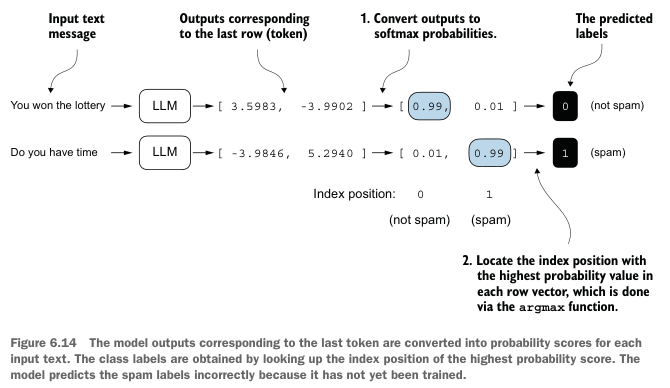

*Figure 6.14. The two outputs of the last token become probabilities, and the predicted label is the index of the highest one. Before fine-tuning, these predictions are wrong.*

- **Accuracy** is the share of messages classified correctly. It is the metric that matters, but it is not differentiable, so it cannot be optimized directly.
- **Loss** is the cross-entropy between the last token's logits and the true label. It is differentiable, and minimizing it during training is how accuracy goes up.

Before fine-tuning, the new head has random weights, so the model is close to a coin flip: about 50% accuracy on two balanced classes.

## Fine-tuning the model on supervised data

The training loop is the same one used for pretraining in chapter 5. The only differences are that it counts the **examples** seen instead of tokens, and that it measures the **classification accuracy** after each epoch instead of printing generated text.

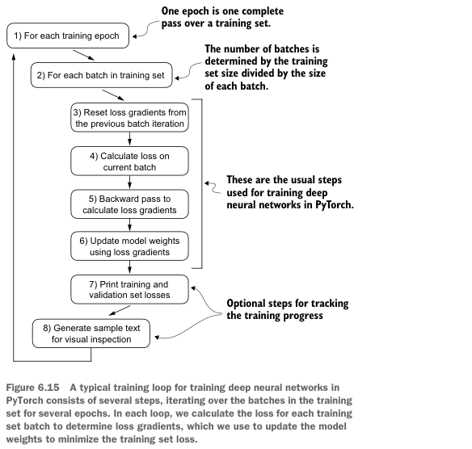

*Figure 6.15. For each epoch and each batch: reset the gradients, compute the loss, backpropagate, update the weights, and optionally print the training progress.*

The book trains with the `AdamW` optimizer (learning rate `5e-5`, weight decay `0.1`) for **5 epochs**, where one epoch is one full pass over the training set.

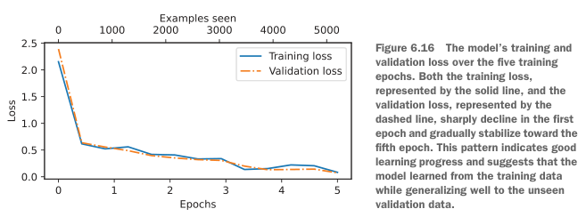

*Figure 6.16. Training and validation loss drop sharply in the first epoch and keep falling together, a sign that the model learns without noticeable overfitting.*

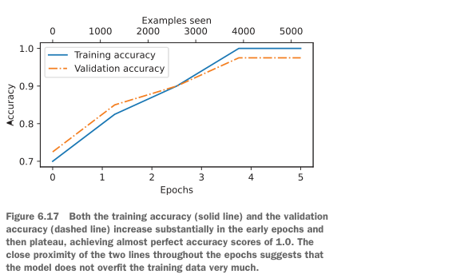

*Figure 6.17. Training and validation accuracy rise quickly and level off close to 100%, with the two curves staying close together.*

**How many epochs?** It depends on the dataset and the task difficulty; 5 is a reasonable starting point. If the model starts to overfit after a few epochs, fewer are needed; if the validation loss is still going down at the end, more may help.

## Using the LLM as a spam classifier

To classify a new message, the model repeats the steps used in training: tokenize the text, truncate or pad it to the training length (120), run the model, take the logits of the last token, and apply `argmax` to get "spam" or "not spam".

After 5 epochs, the fine-tuned model reaches about **97% accuracy on the training and validation sets and 96% on the test set**. Since training and test accuracy are close, the model learned the pattern of spam instead of memorizing the training messages.

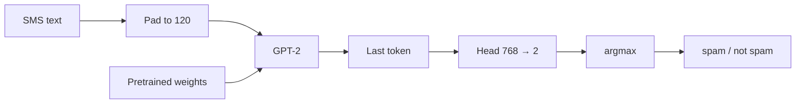

> **In practice:** [notebook 05](../practice/05-classifier.md) shows that the pretrained GPT-2 cannot answer the spam prompt, trains the classifier (or loads its checkpoint), goes from 45% accuracy before training to 95.7% on the test set, and classifies new messages written by the class.
