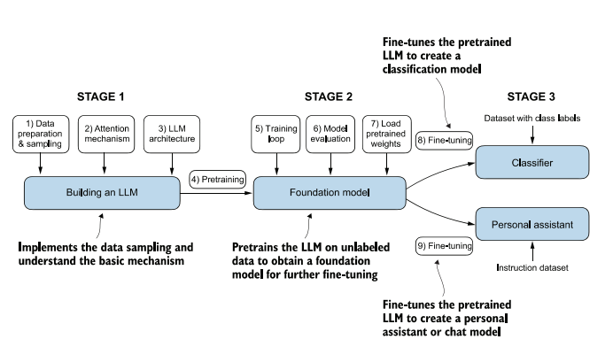

# Overview

We explore the main concepts behind **Large Language Models (LLMs)**, from their foundations to building a language model from scratch. The common thread is Sebastian Raschka's book *Build a Large Language Model (From Scratch)*: each chapter builds a piece that is used in the next, until we arrive at a complete GPT-2, pretrained and fine-tuned.

## Roadmap

| Step | Topic | Where to look |
|---|---|---|
| Ch. 1 | Understanding large language models | [Theory](01-understanding-llms.md) |
| Ch. 2 | Working with text data | [Theory](02-working-with-text-data.md) · [Notebook 01](../practice/01-tokenization.md) |
| Ch. 3 | Coding attention mechanisms | [Theory](03-attention-mechanisms.md) · [Notebook 02](../practice/02-attention.md) |
| Ch. 4 | Implementing a GPT model from scratch to generate text | [Notebook 03](../practice/03-gpt-and-generation.md) |
| Ch. 5 | Pretraining on unlabeled data | [Notebook 04](../practice/04-pretraining.md) |
| Ch. 6 | Fine-tuning for classification | [Notebook 05](../practice/05-classifier.md) |
| Ch. 7 | Fine-tuning to follow instructions | [Notebook 06](../practice/06-assistant.md) |
| Extra | Why these parameters? From GPT-2 to GPT-3, Llama and Claude | [Notebook 07](../practice/07-parameters.md) |

The **Theory** section follows the presentation slides (chapters 1 to 3). The **Practice** section contains the class notebooks, with the code and outputs of every experiment.

## The three stages

1. **Building the LLM:** data preparation and sampling, the attention mechanism, and implementing the architecture.
2. **Foundation model:** training loop, evaluation, and loading publicly available pretrained weights.
3. **Fine-tuning:** adapting the pretrained model into a text classifier (labeled data) or a personal assistant (instruction data).

## Presentation slides

The slides were presented in Portuguese.

[Build a Large Language Model (From Scratch): chapters 1 to 3](pdfs/build-a-llm-chapters-1-3.pdf)

## Further material

- Book: Sebastian Raschka, *Build a Large Language Model (From Scratch)*, Manning, 2024.
- Class code: [victorflll/LLMs-from-scratch, folder `30-09`](https://github.com/victorflll/LLMs-from-scratch/tree/main/30-09).
- Interactive demo: [The path of a token](https://ll-ms-from-scratch-gray.vercel.app/web/v4/index.html).
